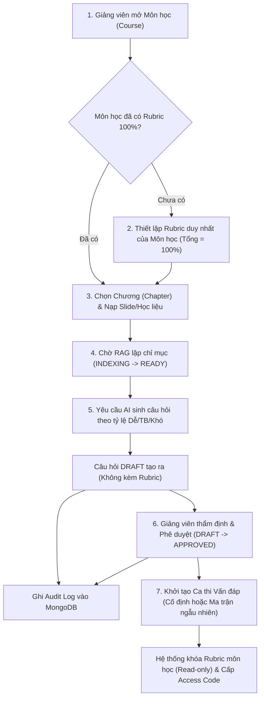

# QUY TRÌNH NGHIỆP VỤ: THIẾT LẬP RUBRIC MÔN HỌC, NẠP HỌC LIỆU RAG, SOẠN NGÂN HÀNG CÂU HỎI & KHỞI TẠO CA THI

**Document Identifier**: `FLOW-LECTURER-PREP-001`  
**Thuộc Phân Hệ**: Phân hệ Giảng viên (Lecturer Academic & Exam Operations)  
**Tài liệu liên quan**: [br-question-rubric.md](br-question-rubric.md) · [br-auth-rbac.md](br-auth-rbac.md) · [core-workflows.md](../core-workflows.md) · [lecturer.md (Page Maps)](../04-ui-ux-design/page-maps/lecturer.md)

---

## 1. Mục Đích & Bối Cảnh Nghiệp Vụ

Tài liệu này đặc tả quy trình tác nghiệp khép kín của **Giảng viên (Lecturer)** từ khi thiết lập tiêu chí đánh giá chuẩn của Môn học, nạp học liệu từng Chương, sinh câu hỏi với AI (RAG), quản lý ngân hàng câu hỏi dùng chung giữa các giảng viên, cho đến khi kích hoạt thành công một ca thi vấn đáp trực tuyến (Viva Exam).

### 1.1. Mục tiêu cốt lõi:

1. **Chuẩn hóa Rubric cấp Môn học**: Mỗi Môn học có đúng 1 Rubric duy nhất đạt tổng trọng số 100% để đảm bảo tính công bằng khảo thí tuyệt đối cho mọi sinh viên.
2. **Neo chặt tri thức vào giáo trình (Grounded Knowledge)**: Toàn bộ câu hỏi thi và đáp án mẫu được AI sinh ra từ slide/tài liệu từng Chương thông qua **Google Cloud Vertex AI Managed RAG Engine**, loại bỏ hiện tượng ảo giác (hallucination). RAG thuần túy sinh câu hỏi theo độ khó Dễ / Trung bình / Khó, tuyệt đối không sinh Rubric.
3. **Ngân hàng câu hỏi dùng chung & Tracking minh bạch**: Câu hỏi theo từng Chương là tài sản dùng chung của các giảng viên cùng bộ môn. Tích hợp **MongoDB** ghi nhận toàn bộ vết lịch sử thao tác (Audit Logs).
4. **Kiểm soát chất lượng con người (Human-in-the-Loop - HITL)**: Giảng viên giữ quyền tối cao trong việc rà soát nội dung câu hỏi, điều chỉnh mức độ khó và phê duyệt đưa vào ngân hàng chính thức.
5. **Cấu hình ca thi linh hoạt**: Hỗ trợ chọn danh sách câu hỏi cố định hoặc cấu hình ma trận đề bốc ngẫu nhiên theo Chương và độ khó.

### 1.2. Các bên tham gia (Actors) & Thực thể Dữ liệu:

- **Tác nhân chính**: `LECTURER` (Giảng viên phụ trách môn học), `ADMIN` (Quản trị viên hệ thống).
- **Thực thể dữ liệu (RDBMS / Cloud Spanner / PostgreSQL)**: `courses`, `chapters`, `materials`, `questions`, `rubrics`, `rubric_criteria`, `viva_exams`, `viva_exam_questions`, `viva_exam_configs`.
- **Thực thể lưu vết phi cấu trúc (MongoDB)**: `academic_audit_logs` (ghi lại hành động thêm, sửa, xóa, duyệt câu hỏi và chỉnh sửa rubric).

---

## 2. Quy Trình Tác Nghiệp Chuẩn (End-to-End Workflow)



---

## 3. Đặc Tả Chi Tiết Từng Bước Tác Nghiệp & Quy Tắc Kiểm Tra

### 3.1. Bước 1: Thiết Lập & Chuẩn Hóa Rubric Duy Nhất Của Môn Học (`/lecturer/courses/{id}/rubric`)

- **Mục tiêu**: Xây dựng bộ tiêu chí đánh giá chuẩn cho toàn bộ môn học để AI và giảng viên căn cứ chấm điểm.
- **Thao tác của Giảng viên**:
  1. Giảng viên vào danh mục Môn học phụ trách, chọn tab **Tiêu chí Đánh giá (Rubric)**.
  2. Bấm "Thêm tiêu chí" để định nghĩa từng tiêu chí con (ví dụ: Khái niệm cốt lõi, Khả năng tư duy mở rộng, Kỹ năng giải trình & thuật ngữ).
  3. Nhập trọng số % cho từng tiêu chí (`weight_percent`) sao cho tổng cộng đúng bằng 100%.
  4. Nhập mô tả yêu cầu cần đạt chi tiết cho từng tiêu chí.
  5. Bấm "Lưu bộ Rubric".
- **Business Rules kiểm tra**:
  - `BR-BANK-001`: Môn học bắt buộc phải có Rubric với $\sum \text{weight} = 100\%$ thì mới được duyệt câu hỏi vào ngân hàng chính thức hoặc mở ca thi.
  - `BR-BANK-006`: Bất kỳ giảng viên nào dạy môn học đều có thể tạo/sửa Rubric. Nhưng khi môn học đã có ca thi đang mở (`OPEN`) hoặc kết thúc, Rubric sẽ bị khóa vĩnh viễn (Read-Only).
  - `BR-BANK-007`: Hoạt động cập nhật Rubric được ghi log vào MongoDB (`action = UPDATE_RUBRIC`).

---

### 3.2. Bước 2: Nạp Học Liệu & Slide Theo Từng Chương (`/lecturer/chapters/{id}/materials`)

- **Mục tiêu**: Nạp tài liệu học liệu theo từng Chương kiến thức để phục vụ truy xuất ngữ nghĩa RAG.
- **Thao tác của Giảng viên**:
  1. Chọn Môn học -> Chọn Chương (`chapterId`).
  2. Chọn tab **Học liệu & Slide RAG**.
  3. Bấm "Tải tài liệu mới", chọn file từ máy tính (`.pdf`, `.pptx`, dung lượng $\le 50\text{MB}$) và bấm "Tải lên".
- **Cơ chế xử lý hệ thống**:
  1. Tệp được đẩy lên Google Cloud Storage (GCS) theo cấu trúc thư mục môn học/chương.
  2. Kích hoạt tiến trình bất đồng bộ của Vertex AI RAG Engine.
  3. Bản ghi tài liệu lưu ở bảng `materials` với trạng thái `INDEXING`.
- **Business Rules kiểm tra**:
  - `BR-AUTH-001`: Giảng viên chỉ nạp tài liệu cho các môn học/chương được phân công.
  - `BR-MAT-001`: Chỉ nhận `.pdf, .pptx, .ppt`, kích thước tối đa 50MB.

---

### 3.3. Bước 3: Theo Dõi Trạng Thái Học Liệu Của Chương

- **Mục tiêu**: Đảm bảo tài liệu đã được vector hóa thành công trước khi gọi AI sinh đề.
- **Trạng thái học liệu (`materials.rag_status`)**:
  - `INDEXING`: Đang xử lý bóc tách và sinh embedding vector.
  - `READY`: Hoàn tất, sẵn sàng phục vụ Semantic Search.
  - `FAILED`: Lỗi xử lý (file hỏng, lỗi phân tích cú pháp). Cho phép bấm "Thử lại (Re-index)".
- **Business Rules kiểm tra**:
  - `BR-MAT-003`: Chỉ tài liệu có trạng thái `READY` mới được chọn làm ngữ cảnh để sinh câu hỏi.

---

### 3.4. Bước 4: Yêu Cầu AI Sinh Câu Hỏi Dễ / Trung Bình / Khó Từ Chương

- **Mục tiêu**: Tự động sinh câu hỏi kiểm tra grounded trên tài liệu của Chương, phân loại theo độ khó trực quan mà không tạo ảo giác.
- **Thao tác của Giảng viên**:
  1. Tại Chương kiến thức, chọn tab **Ngân hàng câu hỏi**, bấm "Sinh câu hỏi bằng AI".
  2. Tích chọn các tài liệu có trạng thái `READY` của Chương làm nguồn tri thức.
  3. Nhập tổng số câu hỏi cần sinh (ví dụ: 10 câu).
  4. Cấu hình tỷ lệ 3 mức độ khó trực quan:
     - Tỷ lệ câu Dễ (`EASY`, ví dụ 40%).
     - Tỷ lệ câu Trung bình (`MEDIUM`, ví dụ 40%).
     - Tỷ lệ câu Khó (`HARD`, ví dụ 20%).
     - Tổng tỷ lệ phải bằng đúng 100%.
  5. Bấm "Bắt đầu sinh đề".
- **Cơ chế xử lý hệ thống**:
  1. Backend gọi Vertex AI RAG Engine tìm kiếm Top-K chunks phù hợp từ tài liệu của Chương.
  2. Gửi ngữ cảnh và Prompt chuẩn hóa kèm JSON Schema tới **Gemini 1.5 Flash**.
  3. **RAG trả về danh sách câu hỏi gồm**: `content`, `difficulty`, `model_answer`, `expected_keywords`. **Tuyệt đối KHÔNG sinh Rubric**.
  4. Lưu câu hỏi vào bảng `questions` với trạng thái `DRAFT`, `source = AI_GENERATED`, liên kết trực tiếp với `chapter_id`.
  5. Ghi nhận sự kiện sinh câu hỏi vào MongoDB `academic_audit_logs`.
- **Business Rules kiểm tra**:
  - `BR-BANK-002`: Câu hỏi AI sinh ra luôn bắt đầu ở trạng thái `DRAFT` và không có Rubric đi kèm.
  - `BR-BANK-004`: Số lượng câu hỏi sinh ra của từng mức độ `EASY`, `MEDIUM`, `HARD` bắt buộc phải khớp 100% với tỷ lệ cấu hình của giảng viên.

---

### 3.5. Bước 5: Thẩm Định, Phê Duyệt Câu Hỏi Trong Ngân Hàng Dùng Chung

- **Mục tiêu**: Các giảng viên cùng dạy môn cùng kiểm duyệt chất lượng câu hỏi, hoàn thiện ngân hàng đề thi chung của Chương.
- **Thao tác của Giảng viên**:
  1. Giảng viên lọc danh sách câu hỏi ở trạng thái `DRAFT` trong Chương.
  2. Kiểm tra nội dung câu hỏi, điều chỉnh câu chữ, sửa đáp án mẫu, từ khóa hoặc đổi lại độ khó nếu cần.
  3. Bấm **Phê duyệt (`APPROVE`)** hoặc **Từ chối (`REJECT`)**.
  4. Hệ thống ghi nhận thay đổi và ghi vết người duyệt vào MongoDB.
- **Business Rules kiểm tra**:
  - `BR-BANK-001`: Hệ thống chặn không cho bấm `APPROVE` nếu Môn học chưa có Rubric hoàn chỉnh (tổng trọng số = 100%).
  - `BR-BANK-005`: Bất kỳ giảng viên nào được phân công dạy môn học đều thấy ngân hàng câu hỏi chung và có thể tham gia duyệt câu hỏi.
  - `BR-BANK-007`: Mọi hành động Sửa / Phê duyệt / Từ chối đều lưu log vào MongoDB kèm `actor_id` và timestamp.

---

### 3.6. Bước 6: Khởi Tạo Ca Thi Vấn Đáp (`/exam-sessions`)

- **Mục tiêu**: Đóng gói kỳ thi và cấu hình phương thức phân phối đề thi cho thí sinh.
- **Thao tác của Giảng viên**:
  1. Mở mục **Phiên thi & Giám sát**, bấm "Tạo ca thi mới".
  2. Chọn Môn học tổ chức thi.
  3. Điền thông tin cấu hình phòng thi:
     - Tiêu đề ca thi, thời gian mở/đóng, thời lượng làm bài (`duration_minutes`).
     - Số câu hỏi chính (`max_questions`), giới hạn hỏi xoáy (`max_follow_up_per_question`).
     - Bộ từ khóa chuyên môn bổ trợ cho Google STT (`domain_keywords`).
     - Cho phép thi trên mobile (`allow_mobile_exam`).
  4. **Lựa chọn phương thức cấp đề**:
     - **Hình thức 1 - Chọn danh sách câu hỏi cố định**: Giảng viên tích chọn trực tiếp danh sách câu hỏi đã `APPROVED` từ các Chương của Môn học.
     - **Hình thức 2 - Cấu hình ma trận đề ngẫu nhiên**: Giảng viên chọn Chương và số lượng câu theo từng độ khó (ví dụ: Chương 1 lấy 1 Dễ + 1 Trung bình; Chương 2 lấy 1 Khó). Khi sinh viên vào thi, hệ thống tự động bốc ngẫu nhiên từ ngân hàng `APPROVED`.
  5. Bấm "Hoàn tất tạo ca thi".
- **Cơ chế xử lý hệ thống**:
  1. Kiểm tra điều kiện: Môn học đã có Rubric 100% hợp lệ.
  2. Tự động sinh cặp mã: `session_code` (công khai) và `access_code` (bí mật).
  3. Kích hoạt cờ khóa Rubric môn học (`rubric.is_locked = TRUE`).
  4. Tạo bản ghi ca thi ở bảng `viva_exams` ở trạng thái `SCHEDULED`.
- **Business Rules kiểm tra**:
  - `BR-EXAM-001`: Tổng số câu hỏi `APPROVED` có sẵn trong ngân hàng phải đủ để đáp ứng cấu hình đề thi.
  - `BR-BANK-006`: Rubric môn học chính thức bị khóa chỉnh sửa khi ca thi được tạo.

---

## 4. Bảng Vòng Đời Trạng Thái Của Các Thực Thể

### 4.1. Vòng đời Học liệu (`materials.rag_status`):

| Trạng thái | Ý nghĩa | Hành động tiếp theo |
| :--- | :--- | :--- |
| `INDEXING` | Đang tải lên GCS và chạy embedding RAG | Chờ xử lý nền hoàn tất. |
| `READY` | Lập chỉ mục thành công | Đủ điều kiện chọn để AI sinh câu hỏi. |
| `FAILED` | Lỗi bóc tách / vector hóa | Bấm "Thử lại (Re-index)" hoặc xóa file. |

### 4.2. Vòng đời Câu hỏi (`questions.status`):

| Trạng thái | Ý nghĩa | Ràng buộc nghiệp vụ |
| :--- | :--- | :--- |
| `DRAFT` | Câu hỏi nháp do AI sinh ra hoặc GV soạn thô | **CẤM** đưa vào đề thi. Cần Môn học có Rubric 100% để duyệt. |
| `APPROVED` | Đã qua kiểm duyệt của giảng viên | **Đủ điều kiện** đưa vào đề thi hoặc ma trận bốc đề. |
| `REJECTED` | Câu hỏi không đạt chất lượng học thuật | Ẩn khỏi ngân hàng câu hỏi khả dụng. |
| `ARCHIVED` | Câu hỏi cũ đã lưu trữ qua các kỳ | Chỉ dùng để tham khảo lịch sử. |

### 4.3. Vòng đời Ca thi (`viva_exams.status`):

| Trạng thái | Ý nghĩa | Hành vi hệ thống |
| :--- | :--- | :--- |
| `SCHEDULED` | Ca thi đã tạo, chưa đến giờ mở | Sinh viên chưa thể vào phòng thi. Rubric môn học đã khóa. |
| `OPEN` | Ca thi đang trong thời gian diễn ra | Sinh viên nhập đúng cặp mã để bắt đầu phỏng vấn AI. |
| `CLOSED` | Hết thời gian thi | Chặn lượt thi mới; chuyển sang chấm điểm AI & thẩm định HITL. |
| `ARCHIVED` | Hoàn tất công bố điểm & phúc khảo | Đóng vĩnh viễn dữ liệu ca thi. |

---

## 5. Cấu Trúc Nhật Ký Hoạt Động (MongoDB Audit Logs)

Các hành động liên quan đến Ngân hàng câu hỏi và Rubric được lưu vào collection `academic_audit_logs`:

```json
{
  "_id": "662a8c1f4e12ab34cd56ef78",
  "course_id": "CS101",
  "chapter_id": "CHAP-01",
  "actor_id": "GV002",
  "actor_name": "Nguyen Van A",
  "action": "APPROVE_QUESTION",
  "target_entity": "QUESTION",
  "target_id": "Q-9842",
  "details": {
    "difficulty": "MEDIUM",
    "previous_status": "DRAFT",
    "new_status": "APPROVED"
  },
  "created_at": "2026-10-24T16:20:00Z"
}
```
