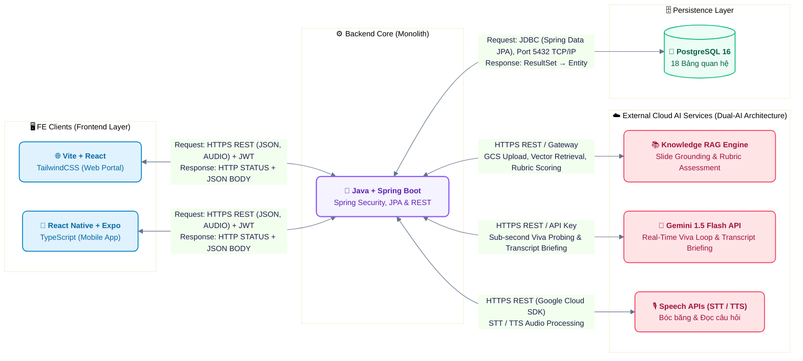
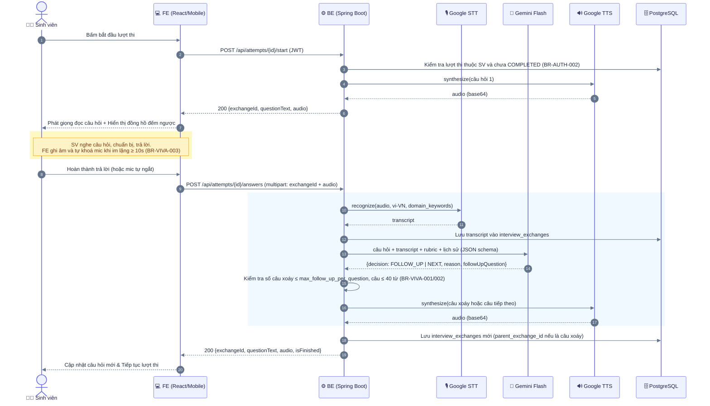

# Architecture Design - AIVES

> **Hệ thống**: AI-powered Viva Exam System (AIVES)  
> **Kiểu kiến trúc**: Client - Server, backend **Monolith** (1 ứng dụng Spring Boot) gọi dịch vụ AI bên thứ ba qua HTTPS REST.  
> **Liên quan**: [00-overview](../00-overview/README.md) · [01-business-rule](../01-business-rule/README.md) · [ERD](../ERD/README.md) · [03-context-diagram](../03-context-diagram/README.md) · [core-workflows](../core-workflows.md)

---

## 1. Sơ đồ kiến trúc


Bản Mermaid tương đương (sửa được trực tiếp trên GitHub):



Mỗi mũi tên hai chiều ghi cả request (chiều đi) và response (chiều về), biểu thị sự cách ly hoàn toàn giữa FE và các dịch vụ AI bên ngoài thông qua Backend Gateway.

---

## 2. Thành phần

| Khối | Công nghệ | Vai trò |
| :--- | :--- | :--- |
| **FE** | **Vite + React**, **TailwindCSS** | Web portal cho sinh viên và giảng viên: phòng thi vấn đáp trực tuyến, quản lý giáo trình / ngân hàng câu hỏi / rubric / ca thi, màn hình thẩm định điểm (HITL), tra cứu và gửi phúc khảo. |
| **Mobile** | **React Native + Expo** | Ứng dụng di động cho sinh viên tham gia ca thi vấn đáp linh hoạt, tích hợp micro ghi âm và phát âm thanh câu hỏi native. |
| **BE** | **Java + Spring Boot** | Trung tâm điều phối toàn bộ hệ thống (Centralized API Gateway): xác thực JWT, phân quyền RBAC, quản lý phiên thi, cách ly bảo mật toàn bộ khóa/chứng chỉ AI trên server, điều phối hàng đợi tác vụ nền (Background Jobs). |
| **DB** | **PostgreSQL** | Lưu toàn bộ dữ liệu nghiệp vụ quan hệ theo [Physical ERD](../ERD/03-physical-erd.md) (18 bảng) với mã hóa UTF-8 hỗ trợ tiếng Việt trọn vẹn. |
| **Cloud AI Services** | **Knowledge RAG Engine** | Kho ngữ liệu kiến thức bài giảng: phân mảnh slide (PPTX, PDF), đánh chỉ mục vector, sinh câu hỏi nháp chuẩn Bloom và thực hiện **thẩm định rubric có căn cứ (Grounded Assessment)** dựa trên bản tóm lược của sinh viên kèm trích dẫn slide bài giảng (slide citations). |
| | **Gemini 1.5 Flash API** | Mô hình ngôn ngữ lớn tối ưu độ trễ thấp (< 1.5s): đóng vai trò Giám khảo tương tác thời gian thực trong phòng thi (hỏi xoáy $\le 40$ từ) và **tổng hợp/cô đọng transcript sau thi (Candidate Briefing)** thành bản tóm lược kỹ thuật có cấu trúc chuyển sang cho RAG Engine đánh giá. |
| | **Speech-to-Text (STT)** | Chuyển đổi audio câu trả lời của thí sinh thành transcript chữ tiếng Việt (`vi-VN`) với tập từ khóa chuyên ngành công nghệ phần mềm. |
| | **Text-to-Speech (TTS)** | Chuyển đổi câu hỏi thi dạng text thành giọng đọc truyền cảm, phát trực tiếp cho thí sinh trong phòng thi. |

---

## 3. Giao tiếp giữa các khối

| # | Chiều | Giao thức | Dữ liệu | Ghi chú |
| :---: | :--- | :--- | :--- | :--- |
| 1 | FE (Web/Mobile) → BE | HTTPS REST + JWT | JSON; audio câu trả lời gửi dạng `multipart/form-data` | JWT gửi trong header `Authorization: Bearer <token>`; Mobile gửi `platform: "MOBILE"` khi join ca thi |
| 2 | BE → FE (Web/Mobile) | HTTP response | Mã trạng thái HTTP + JSON body | Audio câu hỏi (TTS) trả về dạng base64/URL hoặc phát qua TTS trên client |
| 3a | BE → RAG Engine | HTTPS REST / Gateway | Slide bài giảng (PPTX, PDF), truy vấn tương đồng vector, bản brief của sinh viên và rubric tiêu chí chấm | Kết nối server-side; cách ly namespace theo từng môn học; RAG trả về điểm và slide citations |
| 3b | BE → Gemini Flash API | HTTPS REST / API Key | Transcript câu trả lời, ngữ cảnh hội thoại, câu hỏi mở rộng ($\le 40$ từ), prompt brief transcript sau thi | Độ trễ phản hồi sub-second (< 1.5s); kiểm soát chặt chẽ JSON Schema; API key được bảo vệ bí mật trên server |
| 3c | BE → Speech Services | HTTPS REST (Cloud SDK) | Stream audio câu trả lời từ thí sinh (STT) và text câu hỏi khảo thí (TTS) | Bổ sung phrase hints tiếng Việt chuyên ngành; trả về transcript và audio neural |
| 4 | Cloud Services → BE | HTTPS response | Vector chunks, kết quả hỏi xoáy, bản tóm lược brief, điểm số rubric trích dẫn slide, transcript STT, audio TTS | BE kiểm tra tính hợp lệ JSON Schema trước khi ghi nhận vào CSDL |
| 5 | BE → DB | JDBC qua Spring Data JPA | Câu lệnh SQL | Kết nối TCP/IP cổng **5432** (mặc định của PostgreSQL), quản lý qua HikariCP |
| 6 | DB → BE | JDBC | `ResultSet` được Hibernate map thành Entity | |

**Mã trạng thái HTTP dùng thống nhất**: `200` / `201` thành công, `400` dữ liệu sai hoặc vi phạm điều kiện thi thiết bị (`MOBILE_EXAM_NOT_ALLOWED`), `401` chưa đăng nhập / token hết hạn, `403` không đủ quyền (`BR-AUTH-002`), `404` không tìm thấy, `409` xung đột trạng thái (ví dụ bắt đầu lượt thi đã `COMPLETED`), `500` lỗi hệ thống, `502` / `504` lỗi hoặc quá thời gian khi gọi dịch vụ AI.

---

## 4. Tech stack

| Tầng | Công nghệ | Lý do chọn |
| :--- | :--- | :--- |
| FE Web | Vite + React (TypeScript) | Build nhanh, cấu hình ít, hệ sinh thái lớn. |
| FE Web | TailwindCSS | Dựng giao diện nhanh, đồng bộ style giữa các màn hình. |
| FE Web | MediaRecorder / Web Audio API | Ghi âm câu trả lời và đo khoảng lặng (`BR-VIVA-003`). Micro chỉ chạy trên `https://` hoặc `localhost`. |
| FE Mobile | React Native (Expo Router, TypeScript) | Đa nền tảng (Android/iOS), hỗ trợ hot-reload, trải nghiệm native mượt mà. |
| FE Mobile | Expo Audio / Expo Speech | Thu âm micro trực tiếp và phát giọng nói tổng hợp trên thiết bị di động. |
| BE | Java + Spring Boot (Spring Web, Spring Security + JWT, Spring Data JPA, Bean Validation) | Chuẩn phổ biến cho backend Java, chia layer rõ ràng, tích hợp sẵn bảo mật và ORM. |
| DB | PostgreSQL | CSDL quan hệ mã nguồn mở, miễn phí; database mã hoá UTF-8 nên `VARCHAR` / `TEXT` lưu đúng tiếng Việt. BE kết nối bằng driver `org.postgresql:postgresql`. |
| AI Storage | Google Cloud Storage (GCS) | Lưu trữ phi cấu trúc các tệp slide bài giảng (PPTX, PDF) phân tách theo môn học. |
| AI Retrieval | Vertex AI Managed RAG Engine + Cloud Spanner | Quản lý ngữ liệu vector, tìm kiếm tương đồng cosine Top-5 chunks với mô hình `text-multilingual-embedding-002`. |
| AI Reasoning | Vertex AI Gemini 1.5 Flash | Suy luận có dẫn chứng (Grounded Inference), độ trễ thấp (< 1.5s), tuân thủ JSON Schema nghiêm ngặt. |
| AI Speech | Google Cloud Speech-to-Text / Text-to-Speech | Hỗ trợ tiếng Việt (`vi-VN`), gọi an toàn qua Google Cloud SDK từ Backend. |

---

## 5. Bên trong BE

### 5.1. Phân tầng

```
Controller (REST API, nhận / trả DTO)
    │
    ▼
Service (nghiệp vụ, kiểm tra Business Rules, transaction)
    │                      │
    ▼                      ▼
Repository (JPA)      Integration client (Gemini, STT, TTS)
    │                      │
    ▼                      ▼
PostgreSQL            3rd Party Services
```

- Controller **không** chứa nghiệp vụ, chỉ nhận request, validate DTO và gọi Service.
- Service là nơi kiểm tra Business Rule (ví dụ lệch điểm > 2.0 phải có ghi chú).
- Gọi dịch vụ AI đi qua **interface** (`LlmClient`, `SpeechToTextClient`, `TextToSpeechClient`) để dễ mock khi test và đổi nhà cung cấp.

### 5.2. Module nghiệp vụ

| Module | Bảng sở hữu (Physical ERD) | Chức năng |
| :--- | :--- | :--- |
| `auth` | `roles`, `users` | Đăng nhập, cấp JWT, quản lý tài khoản, phân quyền `ADMIN` / `LECTURER` / `STUDENT`. |
| `content` | `lessons`, `topics`, `questions`, `rubrics`, `rubric_criteria` | Quản lý bài học, ngân hàng câu hỏi, rubric; gọi Gemini sinh câu hỏi nháp (`BR-BANK-002`). |
| `exam` | `viva_exams`, `viva_exam_topics`, `viva_exam_questions`, `viva_attempts` | Tạo phiên thi (sinh mã phiên + mã truy cập), chọn câu hỏi; sinh viên tự vào bằng 2 mã đó (tạo lượt thi `IN_PROGRESS`), đếm ngược thời gian, kết thúc bài thi. |
| `vivaroom` | `interview_exchanges` | Điều phối phòng thi: nhận audio, gọi STT → Gemini → TTS, quyết định hỏi xoáy. |
| `grading` | `question_grades`, `criteria_grades`, `grade_appeals` | Chấm điểm AI, giảng viên thẩm định / chốt điểm (HITL), công bố, phúc khảo. |
| `audit` / `jobs` | `audit_logs`, `system_settings`, `background_jobs` | Ghi vết, cấu hình hệ thống, chạy việc nền. |

### 5.3. Cấu trúc package gợi ý

```
src/main/java/com/aives/
├── AivesApplication.java
├── common/          # config, security (JWT filter), exception handler, dto dùng chung
├── modules/
│   ├── auth/        # controller/ service/ repository/ entity/ dto/
│   ├── content/
│   ├── exam/
│   ├── vivaroom/
│   ├── grading/
│   └── audit/
├── jobs/            # đọc bảng background_jobs và chạy việc nền (@Scheduled + @Async)
└── integration/
    ├── ai/          # LlmClient, GeminiClient, prompt template
    └── speech/      # SpeechToTextClient, TextToSpeechClient (Google)
```

### 5.4. Việc chạy nền (Two-Stage Post-Exam Assessment)

Chấm điểm AI cho cả bài thi mất thời gian và đòi hỏi đối chiếu slide bài giảng kỹ lưỡng, nên được thực hiện bất đồng bộ sau khi sinh viên hoàn thành phòng thi:

1. Khi sinh viên nộp bài, BE cập nhật `viva_attempts.status = COMPLETED` và thêm 1 bản ghi `background_jobs` (`EVALUATE_ATTEMPT`) **trong cùng 1 transaction**.
2. Một tác vụ `@Scheduled` trong BE định kỳ lấy job `PENDING`, kích hoạt luồng xử lý bất đồng bộ `@Async` gồm 2 giai đoạn:
   - **Giai đoạn A (Gemini Candidate Briefing)**: BE gửi toàn bộ transcript hội thoại cho Gemini 1.5 Flash API để tổng hợp, lược bỏ khẩu ngữ, chắt lọc các luận điểm kỹ thuật và lỗ hổng kiến thức thành một bản tóm lược có cấu trúc (`candidate_response_brief`).
   - **Giai đoạn B (RAG Grounded Assessment & Slide Citations)**: BE chuyển bản brief này cùng bộ Rubric tiêu chí sang Knowledge RAG Engine. RAG Engine truy vấn vector kho slide bài giảng môn học, đối chiếu luận điểm của sinh viên với kiến thức chuẩn trong slide, chấm điểm từng tiêu chí rubric và trả về điểm số kèm trích dẫn slide bài giảng (slide citations).
3. BE lưu kết quả vào `question_grades` và `criteria_grades` với trạng thái `AI_DRAFT`, cập nhật `viva_attempts.result_status = PENDING_REVIEW` để giảng viên thẩm định (HITL).
4. Job lỗi được thử lại tối đa 3 lần (`attempts < 3`); nếu hết lượt thì đánh dấu `FAILED` và `result_status = GRADING_FAILED` để giảng viên chấm thủ công.

Cách này không cần thêm message broker ngoài (như Redis, RabbitMQ...), đảm bảo hệ thống tinh gọn, ổn định và dễ vận hành.

---

## 6. Luồng xử lý chính

### 6.1. Một lượt hỏi - đáp trong phòng thi



### 6.2. Chấm điểm và công bố (Two-Stage AI Assessment & HITL)

1. **Sinh viên nộp bài**: Kết thúc phòng thi, BE kích hoạt tác vụ nền `EVALUATE_ATTEMPT`.
2. **Bước 1 - Gemini Briefing**: Gemini 1.5 Flash API đọc toàn bộ transcript các lượt hỏi đáp, tổng hợp và cô đọng câu trả lời của thí sinh thành bản tóm lược kỹ thuật súc tích (`candidate_response_brief`).
3. **Bước 2 - RAG Grounded Evaluation**: Knowledge RAG Engine tiếp nhận bản brief, đối chiếu với slide bài giảng (vector chunks) và tiêu chí Rubric để chấm điểm và trích dẫn trang slide làm minh chứng.
4. **Lưu trữ điểm sơ bộ**: BE lưu `question_grades` (`AI_DRAFT`) và `criteria_grades`, chuyển trạng thái `result_status = PENDING_REVIEW`.
5. **Giảng viên thẩm định (HITL)**: Giảng viên xem lại bản tóm lược, transcript, slide trích dẫn, phê duyệt hoặc điều chỉnh điểm (bắt buộc nhập lý do nếu điểm lệch > 2.0 so với AI đề xuất).
6. **Công bố & Phúc khảo**: Giảng viên bấm công bố kết quả → `PUBLISHED`. Sinh viên xem điểm và có quyền gửi đơn phúc khảo (`grade_appeals`) nếu có thắc mắc.

---

## 7. Bảo mật

- Toàn bộ giao tiếp FE ↔ BE và BE ↔ External AI Services đều thông qua giao thức mã hóa **HTTPS**.
- **JWT** cấp khi đăng nhập; mọi API (trừ đăng nhập) phải có token. BE kiểm tra quyền theo role và theo quyền sở hữu dữ liệu (`BR-AUTH-001`, `BR-AUTH-002`).
- **Mô hình Centralized API Gateway & Cô lập Chứng chỉ Server-side**: Toàn bộ khóa bảo mật (API keys cho Gemini, Access Tokens cho RAG Engine và Cloud Speech) được lưu trữ và quản lý tập trung trên Backend Server qua biến môi trường bảo mật. Client (Web/Mobile) tuyệt đối không có quyền truy cập trực tiếp hay nắm giữ bất kỳ thông tin xác thực nào của các dịch vụ AI đám mây.
- Mật khẩu người dùng được băm an toàn bằng thuật toán **BCrypt** trước khi lưu vào `users.password_hash`.
- CSDL PostgreSQL chạy trong mạng nội bộ, chỉ cho phép kết nối từ Backend qua cổng 5432, ngăn chặn truy cập trực tiếp từ Internet.

---

## 8. Vấn đề cần nhóm thống nhất

| # | Vấn đề | Chi tiết | Đề xuất |
| :---: | :--- | :--- | :--- |
| 1 | **Nơi lưu file audio** | Physical ERD có các cột `full_audio_key`, `question_audio_key`, `answer_audio_key` nhưng sơ đồ kiến trúc chưa có khối lưu file. | Lưu trong thư mục trên server BE (đơn giản nhất cho đồ án), hoặc thêm khối Object Storage vào sơ đồ. |
| 2 | **Độ dài audio gửi STT** | API nhận dạng đồng bộ của Google STT chỉ nhận audio ngắn (khoảng 1 phút), trong khi `answer_seconds` mặc định là 120 giây. | Giới hạn thời gian trả lời ≤ 60 giây, hoặc dùng chế độ nhận dạng dài (long-running). Nên kiểm tra lại giới hạn trên tài liệu Google Cloud trước khi chốt. |
| 3 | **REST thay cho WebSocket** | Sơ đồ chỉ dùng REST, trong khi `BR-AUTH-003` đang viết theo WebSocket (1 kết nối active / SV). | Sửa `BR-AUTH-003` theo REST, ví dụ: mỗi lượt thi chỉ có 1 phiên hợp lệ, request từ phiên cũ bị từ chối. |
| 4 | **Độ trễ ≤ 3 giây** (`BR-VIVA-003`) | Mỗi lượt gọi tuần tự STT → Gemini → TTS nên dễ vượt 3 giây. | Đo thực tế; nếu vượt thì trả text câu hỏi trước, audio TTS tải sau. |
| 5 | **Tài liệu cũ chưa khớp** | `00-overview` còn nhắc RAG, `BR-AUTH-001` còn nhắc `EXAM_EXAMINER`, `core-workflows` còn nhắc RAG worker / `pgvector`, Next.js, Redis, BullMQ, WebSocket. | Cập nhật các tài liệu này theo ERD và kiến trúc mới. |

---

## 9. Quy định Quản lý Biến Môi trường (.env & .env.example)

Để đảm bảo các thành viên trong nhóm không quên cập nhật cấu hình khi có biến mới và đồng thời đảm bảo việc triển khai (Deploy lên Render/Cloud) diễn ra trơn tru:

### 9.1. Phân biệt 2 môi trường qua `APP_ENV`
- **Môi trường Local Dev (`APP_ENV=local` hoặc `dev`)**:
  - Bắt buộc có file `.env` cục bộ được tạo từ `.env.example`.
  - Cơ chế tự động kiểm tra đồng bộ: Khi khởi chạy, ứng dụng so sánh danh sách các key giữa `.env.example` và `.env`.
  - Nếu `.env` thiếu bất kỳ key nào có trong `.env.example`: Chặn khởi động (`exit 1`) và hiển thị hướng dẫn chi tiết danh sách biến cần bổ sung.
  - Nếu `.env` có key mới chưa được ghi vào `.env.example`: Hiển thị cảnh báo nhắc dev cập nhật `.env.example` cho cả team.
- **Môi trường Deploy / Production (`APP_ENV=deploy` hoặc `production`, hoặc cờ nhận diện tự động như `RENDER=true`)**:
  - Không đọc và không kiểm tra sự tồn tại của file `.env` trên đĩa (vì trên môi trường Cloud/Docker, file `.env` bị `.dockerignore` loại bỏ để bảo mật).
  - Đọc trực tiếp cấu hình từ các biến môi trường hệ thống (`System.getenv` / `process.env`).
  - Kiểm tra tính đầy đủ của các biến môi trường bắt buộc (như `DB_URL`, `JWT_SECRET`,...).

### 9.2. Triển khai đồng bộ trên cả 3 repository
1. **Backend (`aives-backend`)**: Xử lý trong `AivesApplication.java` tại hàm `validateEnvironment()`.
2. **Frontend (`aives-frontend`)**: Xử lý trong `vite-env-check.js` (plugin Vite) kiểm tra trước khi dev/build.
3. **Mobile (`aives-mobile`)**: Xử lý trong `scripts/check-env.js` (hook `prestart` trong `package.json`).
