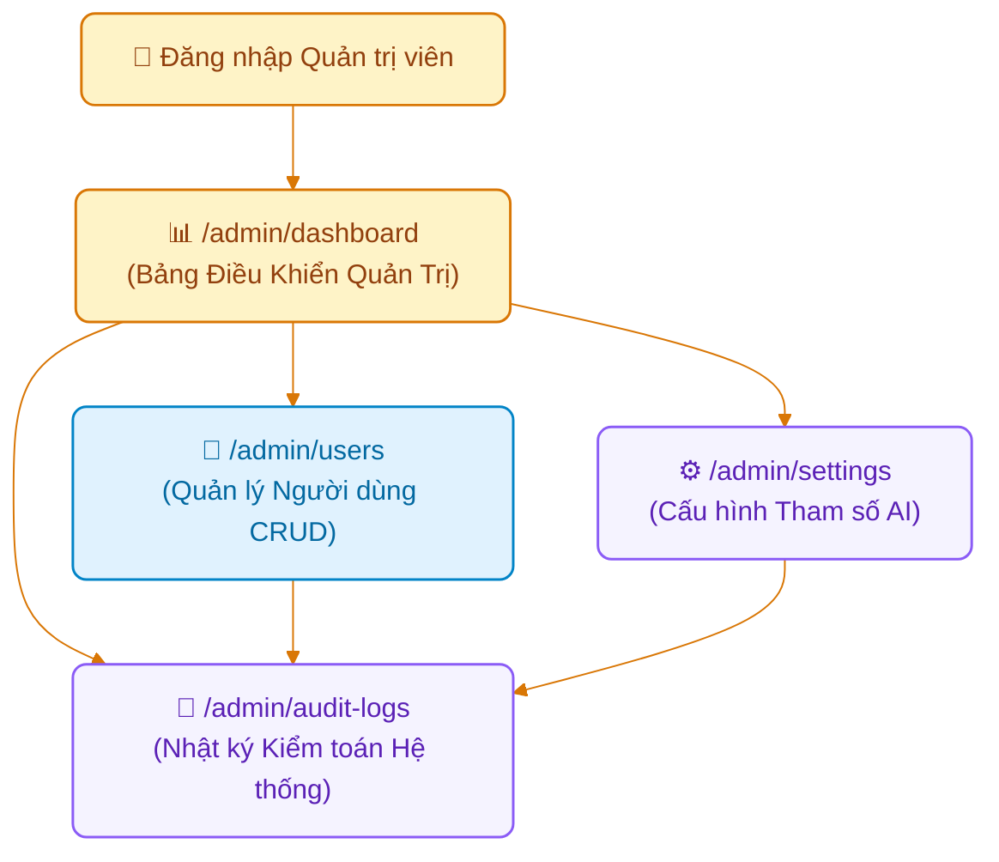

# Page Map: Phân Hệ Quản Trị Viên (Admin Role)

> **Hệ thống**: AI-powered Viva Exam System (AIVES)  
> **Vai trò người dùng**: Quản trị viên (`ADMIN`)  
> **Tài liệu cha**: [04-ui-ux-design/README.md](../README.md)  
> **Source of Truth**: [br-auth-rbac.md](../../01-business-rule/br-auth-rbac.md), [05-crud-demo](../../05-crud-demo/README.md), [Software_Architecture_Design_Report.md](../../Software_Architecture_Design_Report.md)

---

## 1. Danh Sách Các Trang (Route Matrix)

| Đường dẫn (URL Route) | Tên màn hình | Quyền truy cập (RBAC) | Trạng thái FE hiện tại | Mô tả nghiệp vụ |
| :--- | :--- | :--- | :---: | :--- |
| `/admin/dashboard` | **Bảng Điều Khiển Quản Trị** | `ADMIN` | Đã có (`AdminDashboardPage.tsx`) | Bức tranh tổng quan vận hành hệ thống: tổng số người dùng phân bổ theo role (Sinh viên, Giảng viên, Admin), số phiên thi đang hoạt động, lượng tài nguyên AI tiêu thụ (STT/TTS minutes, Token LLM) và trạng thái kết nối CSDL / Cloud AI. |
| `/admin/users` | **Quản Lý Tài Khoản (CRUD)** | `ADMIN` | Đã có (`AdminUsersPage.tsx`) | Quản lý người dùng toàn hệ thống: danh sách phân trang, lọc theo vai trò, tạo mới tài khoản sinh viên/giảng viên (tự sinh mã `STxxxxxx`, `LExxxxxx`), bật/tắt kích hoạt trạng thái (`Active` / `Inactive`) và xóa tài khoản an toàn (`05-crud-demo`). |
| `/admin/settings` | **Cấu Hình Hệ Thống & Tham Số AI** | `ADMIN` | Đã có (`AdminSettingsPage.tsx`) | Quản lý các tham số cấu hình lưu trong bảng `system_settings`: chỉ định Model LLM (`gemini-1.5-flash`), endpoint Google Cloud STT/TTS, ngưỡng phát hiện im lặng (`SILENCE_SUBMIT_SECONDS = 10`), số câu hỏi xoáy trần. |
| `/admin/audit-logs` | **Nhật Ký Kiểm Toán (Audit Logs)** | `ADMIN` | Đã có (`AdminAuditLogsPage.tsx`) | Tra cứu chi tiết toàn bộ vết thao tác nhạy cảm trong bảng `audit_logs` (`UC11`): ai (`actor_id`) đã ghi đè điểm, công bố kết quả, duyệt câu hỏi, hoặc xóa dữ liệu kèm giá trị trước/sau khi sửa. |

---

## 2. Luồng Người Dùng & Sơ Đồ Điều Hướng (Navigation Flow)



---

## 3. Đặc Tả Chi Tiết Các Màn Hình Mới Cần Xây Dựng

### 3.1. Bảng Điều Khiển Quản Trị (`/admin/dashboard` - AdminDashboardPage)
- **Mục đích**: Giám sát hiệu năng và tài nguyên toàn hệ sinh thái AIVES, đưa ra cảnh báo sớm về hạn ngạch AI hoặc tải hệ thống.
- **Wireframe Layout**:
```text
+-------------------------------------------------------------------------+
| [AIVES Logo]  [Dashboard] [Tài khoản] [Cấu hình AI] [Audit Logs]   [👤] |
+-------------------------------------------------------------------------+
|                                                                         |
|  🛡️ Bảng Điều Khiển Quản Trị Hệ Thống AIVES                             |
|                                                                         |
|  +--------------------+ +--------------------+ +--------------------+   |
|  | 👥 Tổng người dùng | | 📋 Ca thi hoạt động| | 🤖 Tài nguyên AI   |   |
|  |  1,420 tài khoản   | |      8 phiên       | |   98.2% Sẵn sàng   |   |
|  | (1.2k SV, 210 GV)  | |  (142 SV đang thi) | | (Google STT/TTS OK)|   |
|  +--------------------+ +--------------------+ +--------------------+   |
|                                                                         |
|  +------------------- TRẠNG THÁI DỊCH VỤ NỀN ------------------------+  |
|  | • PostgreSQL Database: KẾT NỐI BÌNH THƯỜNG (Supabase Cloud)        |
|  | • Google Cloud Speech API: HOẠT ĐỘNG TỐT (Độ trễ trung bình: 1.2s) |
|  | • Gemini Flash Model: HOẠT ĐỘNG TỐT (JSON Schema Enforced)         |
|  +--------------------------------------------------------------------+  |
|                                                                         |
|  +------------------ HOẠT ĐỘNG KIỂM TOÁN GẦN NHẤT -------------------+  |
|  | • [10:14] GV gv.an@aives.edu.vn đã điều chỉnh điểm bài thi AT001928 |
|  | • [09:45] Admin đã tạo tài khoản giảng viên mới (LE190281)         |
|  | [ Xem toàn bộ nhật ký Audit ]                                      |
|  +--------------------------------------------------------------------+  |
|                                                                         |
+-------------------------------------------------------------------------+
```

### 3.2. Màn hình Nhật Ký Kiểm Toán Chuyên Sâu (`/admin/audit-logs` - AdminAuditLogsPage)
- **Mục đích**: Đáp ứng tiêu chuẩn kiểm toán an toàn thông tin và tính liêm chính trong thi cử đại học (`Software_Architecture_Design_Report.md`).
- **Thành phần**:
  - Bộ lọc đa chiều:
    - Tìm kiếm theo Người thực hiện (`actor_id` hoặc email).
    - Lọc theo Hành động: `CREATE_USER`, `UPDATE_STATUS`, `OVERRIDE_SCORE`, `PUBLISH_RESULT`, `RESOLVE_APPEAL`.
    - Lọc theo Thực thể: `users`, `viva_exams`, `question_grades`, `grade_appeals`.
    - Lọc theo khoảng ngày.
  - Bảng dữ liệu chi tiết:
    - Thời gian (Timestamp chuẩn ISO format).
    - Người thao tác (kèm Avatar và Role badge).
    - Hành động nghiệp vụ & ID đối tượng.
    - So sánh giá trị cũ (`old_value`) vs giá trị mới (`new_value`) dạng hộp đối chiếu trực quan.
