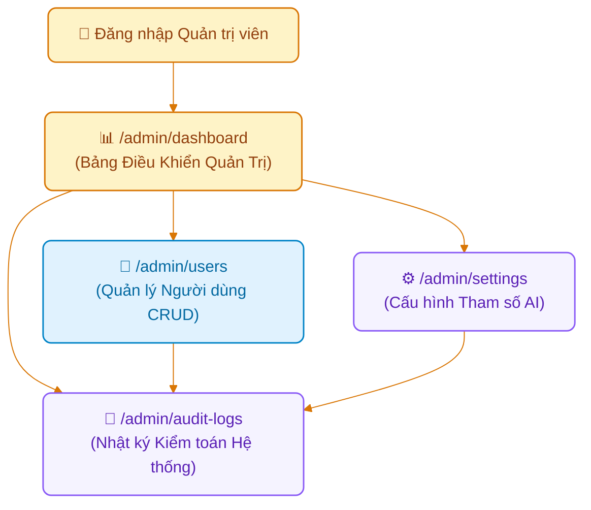

# Page Map: Phân Hệ Quản Trị Viên (Admin Role)

> **Hệ thống**: AI-powered Viva Exam System (AIVES)  
> **Vai trò người dùng**: Quản trị viên (`ADMIN`)  
> **Tài liệu cha**: [04-ui-ux-design/README.md](../README.md)  
> **Source of Truth**: [br-auth-rbac.md](../../01-business-rule/br-auth-rbac.md), [05-crud-demo](../../05-crud-demo/README.md), [Software_Architecture_Design_Report.md](../../Software_Architecture_Design_Report.md)

---

## 1. Danh Sách Các Trang (Route Matrix)

| Đường dẫn (URL Route) | Tên màn hình | Quyền truy cập (RBAC) | Trạng thái FE hiện tại | Mô tả nghiệp vụ |
| :--- | :--- | :--- | :---: | :--- |
| `/admin/dashboard` | **Bảng Điều Khiển Quản Trị** | `ADMIN` | Đã có (`AdminDashboardPage.tsx`) | Bức tranh tổng quan vận hành hệ thống: tổng số người dùng phân bổ theo role (Sinh viên, Giảng viên, Admin), số phiên thi đang hoạt động, lượng tài nguyên AI tiêu thụ (STT/TTS minutes, Token LLM) và trạng thái kết nối CSDL / Cloud AI. |
| `/admin/users` | **Quản Lý Tài Khoản (CRUD)** | `ADMIN` | Đã có (`AdminUsersPage.tsx`) | Quản lý người dùng toàn hệ thống: danh sách phân trang, lọc theo vai trò, tạo mới tài khoản sinh viên/giảng viên (tự sinh mã `STxxxxxx`, `LExxxxxx`), bật/tắt kích hoạt trạng thái (`Active` / `Inactive`) và xóa tài khoản an toàn (`05-crud-demo`). |
| `/admin/settings` | **Cấu Hình Hệ Thống & Tham Số AI** | `ADMIN` | Đã có (`AdminSettingsPage.tsx`) | Quản lý các tham số cấu hình lưu trong bảng `system_settings`: chỉ định Model LLM (`gemini-1.5-flash`), endpoint Google Cloud STT/TTS, ngưỡng phát hiện im lặng (`SILENCE_SUBMIT_SECONDS = 10`), số câu hỏi xoáy trần. |
| `/admin/audit-logs` | **Nhật Ký Kiểm Toán (Audit Logs)** | `ADMIN` | Đã có (`AdminAuditLogsPage.tsx`) | Tra cứu chi tiết toàn bộ vết thao tác nhạy cảm trong bảng `audit_logs` (`UC11`): ai (`actor_id`) đã ghi đè điểm, công bố kết quả, duyệt câu hỏi, hoặc xóa dữ liệu kèm giá trị trước/sau khi sửa. |

---

## 2. Luồng Người Dùng & Sơ Đồ Điều Hướng (Navigation Flow)



---

## 3. Đặc Tả Kiến Trúc Giao Diện (Admin Portal Layout Architecture)

### 3.1. Cấu Trúc Bố Cục Sidebar Dọc (Left Sidebar Layout)
Để tối ưu không gian hiển thị, tránh quá tải cho thanh Top Navbar (khi tài khoản Admin có nhiều danh mục quản trị lẫn khảo thí), phân hệ Admin chuyển sang kiến trúc **Layout Cột Dọc Bên Trái (Left Sidebar Layout)** với các tiêu chuẩn thiết kế:
- **Thanh Cột Dọc Bên Trái (Fixed Left Sidebar - 260px)**:
  - **Header Sidebar**: Logo AIVES kèm nhãn định danh `Admin Console / SOC`.
  - **Nhóm 1: Quản Trị Hệ Thống (System Administration)**:
    - 📊 `Bảng điều khiển` (`/admin/dashboard`) - SOC tổng quan vận hành, quota AI, metrics.
    - 👥 `Tài khoản người dùng` (`/admin/users`) - CRUD người dùng, phân quyền SV/GV.
    - ⚙️ `Cấu hình AI & Tham số` (`/admin/settings`) - Model LLM, STT/TTS, tham số hệ thống.
    - 📜 `Nhật ký kiểm toán` (`/admin/audit-logs`) - Vết thao tác an toàn thông tin & điểm số (UC11).
  - **Nhóm 2: Khảo Thí & Học Liệu (Exam Operations)**:
    - ⏱️ `Phiên thi & Giám sát` (`/exam-sessions`)
    - 📚 `Chương trình & Học liệu` (`/lecturer/curriculum`, `/lecturer/materials`)
    - ❓ `Ngân hàng câu hỏi & Rubric` (`/lecturer/questions`, `/lecturer/rubrics`)
    - ⚖️ `Thẩm định & Phúc khảo` (`/lecturer/reviews`, `/lecturer/appeals`)
  - **Footer Sidebar**: Thông tin phiên bản (`v1.0.0-prod`), trạng thái kết nối máy chủ Cloud, nút Thu nhỏ/Mở rộng.
- **Thanh Tiêu Đề Trên (Clean Top Header - 64px)**:
  - Breadcrumb định vị ngữ cảnh (`Admin > Dashboard`).
  - Trạng thái hệ thống thời gian thực (`System Operational` badge xanh).
  - Chuyển đổi ngôn ngữ (`LanguageSwitch`).
  - Profile rút gọn của Quản trị viên & Nút Đăng xuất.

### 3.2. Bảng Điều Khiển Quản Trị Tinh Gọn (`/admin/dashboard` - AdminDashboardPage)
- **Mục đích**: Giám sát hiệu năng và tài nguyên toàn hệ sinh thái AIVES, đưa ra cảnh báo sớm về hạn ngạch AI hoặc tải hệ thống với giao diện Clean, Clear, phân cấp trực quan.
- **Wireframe Layout (Clean & Balanced)**:
```text
+------------------+-------------------------------------------------------------------+
| [AIVES Admin]    | [=] Breadcrumb: Admin > Dashboard        [● Live] [🌐 VI] [👤 Admin] [🚪] |
+------------------+-------------------------------------------------------------------+
| [QUẢN TRỊ CORE]  |                                                                   |
| 📊 Dashboard (●) |  Bảng Điều Khiển Quản Trị Hệ Thống              [🔄 Làm mới: 10:45] |
| 👥 Người dùng    |  ---------------------------------------------------------------- |
| ⚙️ Cấu hình AI   |  [👥 Tổng người dùng] [⏱️ Ca thi mở] [🤖 AI Quota] [🟢 Sẵn sàng]  |
| 📜 Audit Logs    |     1,420 Users         8 Live          32% Used       99.98% OK      |
|                  |                                                                   |
| [KHẢO THÍ]       |  +-----------------------------+ +-----------------------------+  |
| ⏱️ Phiên thi     |  | 📊 HẠN NGẠCH TÀI NGUYÊN AI   | | 🟢 TRẠNG THÁI DỊCH VỤ NỀN   |  |
| 📚 Học liệu      |  | • Speech STT: 29% (Mức an toàn)| | • Supabase DB: 28ms (OK)     |  |
| ❓ Ngân hàng câu |  | • Cloud TTS:  24% (Mức an toàn)| | • Cloud Speech: 1.1s (OK)    |  |
| ⚖️ Thẩm định     |  | • Gemini LLM: 42% (Mức an toàn)| | • Gemini 2.5 Flash: 840ms    |  |
|                  |  +-----------------------------+ | • Async Worker: 0 lỗi       |  |
|                  |                                  +-----------------------------+  |
|                  |  +-------------------------------------------------------------+  |
|                  |  | 📜 HOẠT ĐỘNG KIỂM TOÁN GẦN NHẤT       [Xem toàn bộ nhật ký]  |  |
|                  |  | • 10:14 | gv.an@aives.edu.vn | OVERRIDE_SCORE | AT001928         |  |
|                  |  | • 09:45 | admin@aives.edu.vn | CREATE_USER    | LE190281         |  |
| ⚙️ v1.0.0-prod   |  +-------------------------------------------------------------+  |
+------------------+-------------------------------------------------------------------+
```

### 3.2. Màn hình Nhật Ký Kiểm Toán Chuyên Sâu (`/admin/audit-logs` - AdminAuditLogsPage)
- **Mục đích**: Đáp ứng tiêu chuẩn kiểm toán an toàn thông tin và tính liêm chính trong thi cử đại học (`Software_Architecture_Design_Report.md`).
- **Thành phần**:
  - Bộ lọc đa chiều:
    - Tìm kiếm theo Người thực hiện (`actor_id` hoặc email).
    - Lọc theo Hành động: `CREATE_USER`, `UPDATE_STATUS`, `OVERRIDE_SCORE`, `PUBLISH_RESULT`, `RESOLVE_APPEAL`.
    - Lọc theo Thực thể: `users`, `viva_exams`, `question_grades`, `grade_appeals`.
    - Lọc theo khoảng ngày.
  - Bảng dữ liệu chi tiết:
    - Thời gian (Timestamp chuẩn ISO format).
    - Người thao tác (kèm Avatar và Role badge).
    - Hành động nghiệp vụ & ID đối tượng.
    - So sánh giá trị cũ (`old_value`) vs giá trị mới (`new_value`) dạng hộp đối chiếu trực quan.
