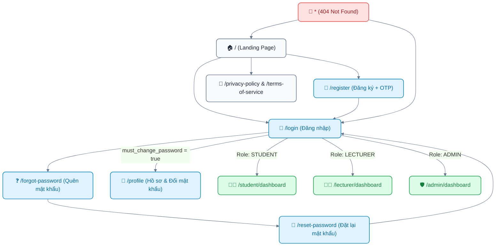

# Page Map: Cổng Chung, Xác Thực & Trang Công Khai (Public / Auth / Common)

> **Hệ thống**: AI-powered Viva Exam System (AIVES)  
> **Phân hệ**: Cổng chung, Xác thực & Ngoại lệ (Public, Authentication, Profile & Error Pages)  
> **Tài liệu cha**: [04-ui-ux-design/README.md](../README.md)  
> **Source of Truth**: [01-business-rule](../../01-business-rule/README.md), [br-auth-rbac.md](../../01-business-rule/br-auth-rbac.md)

---

## 1. Danh Sách Các Trang (Route Matrix)

| Đường dẫn (URL Route) | Tên màn hình | Quyền truy cập (RBAC) | Trạng thái FE hiện tại | Mô tả nghiệp vụ |
| :--- | :--- | :--- | :---: | :--- |
| `/` | **Landing Page** | Công khai (Public) | Đã có (`HomePage.tsx`) | Giới thiệu hệ thống AIVES, giải pháp Viva Voce bằng AI, các tính năng nổi bật, quy trình và nút kêu gọi hành động (CTA). |
| `/login` | **Đăng Nhập** | Công khai (Guest) | Đã có (`LoginPage.tsx`) | Form đăng nhập email/mật khẩu hỗ trợ cả 3 vai trò (`ADMIN`, `LECTURER`, `STUDENT`). Hỗ trợ ghi nhớ tài khoản và chuyển hướng tự động theo role. |
| `/register` | **Đăng Ký Tài Khoản** | Công khai (Guest) | Đã có (`RegisterPage.tsx`) | Sinh viên tự đăng ký bằng email trường (`@fpt.edu.vn`), bắt buộc xác thực mã OTP 6 chữ số gửi qua email (`BR-AUTH-005`). |
| `/forgot-password` | **Quên Mật Khẩu** | Công khai (Guest) | Đã có (`ForgotPasswordPage.tsx`) | Nhập địa chỉ email tài khoản, hệ thống gửi mã OTP 6 chữ số khôi phục mật khẩu có hiệu lực 5 phút. |
| `/reset-password` | **Đặt Lại Mật Khẩu** | Công khai (Guest) | Đã có (`ResetPasswordPage.tsx`) | Nhập mã OTP và mật khẩu mới (kiểm tra độ mạnh và xác nhận trùng khớp) để hoàn tất khôi phục. |
| `/profile` | **Hồ Sơ Cá Nhân** | Yêu cầu đăng nhập (Tất cả Roles) | Đã có (`ProfilePage.tsx`) | Xem thông tin tài khoản (Họ tên, email, mã định danh `users_id`), đổi thông tin cá nhân và cập nhật mật khẩu mới. |
| `/privacy-policy` | **Chính Sách Bảo Mật** | Công khai (Public) | Đã có (`PolicyPage.jsx`) | Điều khoản lưu trữ và bảo mật dữ liệu âm thanh, bản bóc băng giọng nói và mã hóa thông tin. |
| `/terms-of-service` | **Điều Khoản Dịch Vụ** | Công khai (Public) | Đã có (`PolicyPage.jsx`) | Quy định về liêm chính học thuật, chống gian lận trong phòng thi viva ảo. |
| `*` | **Trang 404 Không Tìm Thấy** | Công khai (Public) | Đã có (`NotFoundPage.tsx`) | Thông báo URL không tồn tại kèm hình ảnh minh họa Mascot AIVES và nút điều hướng về trang chủ/Dashboard phù hợp. |

---

## 2. Luồng Người Dùng & Sơ Đồ Điều Hướng (Navigation Flow)



---

## 3. Đặc Tả Chi Tiết Các Màn Hình Mới Cần Xây Dựng

### 3.1. Màn hình Quên Mật Khẩu (`/forgot-password` - ForgotPasswordPage)
- **Mục đích**: Cho phép người dùng lấy lại quyền truy cập khi quên mật khẩu qua cơ chế xác thực email OTP.
- **Wireframe Layout**:
```text
+-------------------------------------------------------------+
| [Logo AIVES]                                [Ngôn ngữ: VI] |
+-------------------------------------------------------------+
|                                                             |
|                 +-------------------------+                 |
|                 | 🔐 Quên Mật Khẩu        |                 |
|                 | Nhập email trường để    |                 |
|                 | nhận mã OTP đặt lại     |                 |
|                 |                         |                 |
|                 | [📧 Email: ____________] |                 |
|                 |                         |                 |
|                 | [ GỬI MÃ XÁC THỰC OTP ] |                 |
|                 |                         |                 |
|                 | < Quay lại Đăng nhập    |                 |
|                 +-------------------------+                 |
|                                                             |
+-------------------------------------------------------------+
```
- **Hành động & Ràng buộc**:
  - Kiểm tra định dạng email hợp lệ.
  - Gọi API gửi OTP (thời hạn 5 phút, cooldown 60 giây giữa 2 lần gửi).
  - Chuyển tiếp sang màn hình `/reset-password` kèm state email.

### 3.2. Màn hình Đặt Lại Mật Khẩu (`/reset-password` - ResetPasswordPage)
- **Mục đích**: Nhập mã OTP đã nhận qua email và nhập mật khẩu mới.
- **Wireframe Layout**:
```text
+-------------------------------------------------------------+
| [Logo AIVES]                                [Ngôn ngữ: VI] |
+-------------------------------------------------------------+
|                                                             |
|                 +-------------------------+                 |
|                 | 🔄 Đặt Lại Mật Khẩu     |                 |
|                 | Mã gửi tới: sv@fpt.edu. |                 |
|                 |                         |                 |
|                 | [🔢 Mã OTP 6 số: _____] |                 |
|                 | (Còn hiệu lực: 04:32)   |                 |
|                 |                         |                 |
|                 | [🔒 Mật khẩu mới: _____] |                 |
|                 | [🔒 Xác nhận MK: ______] |                 |
|                 |                         |                 |
|                 | [ XÁC NHẬN ĐỔI MẬT KHẨU]|                 |
|                 |                         |                 |
|                 | Chưa nhận được mã? Gửi lại|               |
|                 +-------------------------+                 |
|                                                             |
+-------------------------------------------------------------+
```

### 3.3. Màn hình 404 Not Found (`*` - NotFoundPage)
- **Mục đích**: Bắt mọi đường dẫn không tồn tại, tránh màn hình trắng hoặc chuyển hướng đột ngột, mang lại trải nghiệm chuyên nghiệp.
- **Thành phần**:
  - Hình minh họa Mascot AIVES (robot thông minh).
  - Tiêu đề: "404 - Không tìm thấy trang này".
  - Mô tả: "Đường dẫn bạn yêu cầu không tồn tại hoặc đã được chuyển sang địa chỉ mới."
  - Nút bấm điều hướng: "Về Trang Chủ" (cho khách) hoặc "Về Bảng Điều Khiển" (nếu đã đăng nhập).

### 3.4. Đăng nhập bằng Google (Google Single Sign-On - Web & Mobile)
- **Vị trí**:
  - Web: Trang Đăng Nhập (`/login` - `LoginPage.tsx`), đặt ngay dưới form đăng nhập mật khẩu với phân cách "Hoặc đăng nhập với".
  - Mobile: Màn hình Đăng Nhập (`app/login.tsx`), nút "Tiếp tục với Google" chuẩn thương hiệu kèm Google Logo.
- **Hành vi UX**:
  - Người dùng bấm nút "Đăng nhập với Google".
  - Hệ thống mở popup / web browser xác thực Google OIDC.
  - Sau khi người dùng cấp quyền, lấy `idToken` và gửi về backend (`POST /api/auth/google`).
  - Trong quá trình gửi token, hiển thị trạng thái loading spinner trên nút và khoá tương tác tạm thời.
  - Khi thành công: tự động lưu session và điều hướng người dùng tới Dashboard tương ứng với role.
  - Khi thất bại: hiển thị thông báo lỗi rõ ràng (ví dụ "Tài khoản của bạn đã bị vô hiệu hoá" hoặc "Xác thực Google không thành công").

