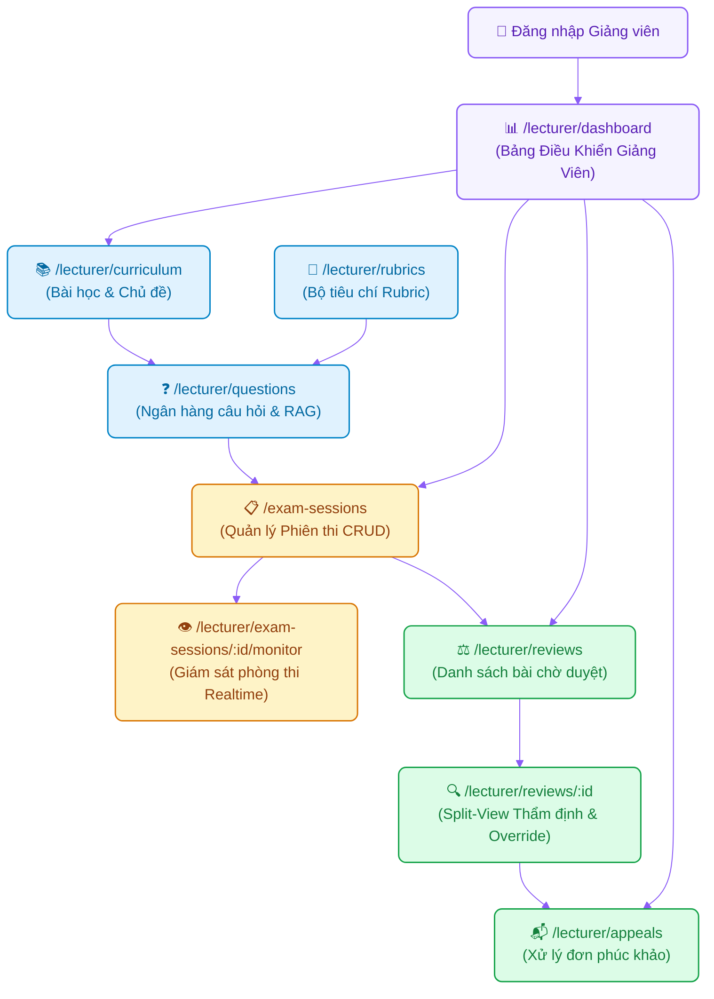

# Page Map: Phân Hệ Giảng Viên (Lecturer Role)

> **Hệ thống**: AI-powered Viva Exam System (AIVES)  
> **Vai trò người dùng**: Giảng viên / Giám khảo (`LECTURER`)  
> **Tài liệu cha**: [04-ui-ux-design/README.md](../README.md)  
> **Source of Truth**: [br-auth-rbac.md](../../01-business-rule/br-auth-rbac.md), [br-question-rubric.md](../../01-business-rule/br-question-rubric.md), [br-grading-review.md](../../01-business-rule/br-grading-review.md)

---

## 1. Danh Sách Các Trang (Route Matrix)

| Đường dẫn (URL Route) | Tên màn hình | Quyền truy cập (RBAC) | Trạng thái FE hiện tại | Mô tả nghiệp vụ |
| :--- | :--- | :--- | :---: | :--- |
| `/lecturer/dashboard` | **Bảng Điều Khiển Giảng Viên** | `LECTURER`, `ADMIN` | Cần bổ sung (`LecturerDashboardPage.tsx`) | Màn hình tổng quan sau đăng nhập: thẻ số liệu (ca thi đang mở, số bài thi đang chờ duyệt HITL, đơn phúc khảo cần xử lý), danh sách hành động nhanh và biểu đồ tiến độ chấm điểm. |
| `/exam-sessions` | **Quản Lý Phiên Thi (CRUD)** | `LECTURER`, `ADMIN` | Đã có (`ExamSessionsPage.tsx`) | Quản lý vòng đời ca thi viva: tạo mới, sửa thời gian, tạo lại passcode bí mật, hủy phiên, cấu hình số câu hỏi xoáy tối đa, từ khóa chuyên môn và cờ cho phép thi trên di động (`allow_mobile_exam`). |
| `/lecturer/exam-sessions/:id/monitor` | **Giám Sát Trực Tiếp Ca Thi (Live Monitor)** | `LECTURER`, `ADMIN` | Cần bổ sung (`LiveExamMonitorPage.tsx`) | Giám sát trạng thái phòng thi theo thời gian thực (`BR-AUTH-004`): danh sách thí sinh đang làm bài, thời gian còn lại, câu hỏi hiện tại, trạng thái mic/kết nối. |
| `/lecturer/curriculum` | **Quản Lý Bài Học & Chủ Đề (Curriculum)** | `LECTURER`, `ADMIN` | Cần bổ sung (`CurriculumManagementPage.tsx`) | Quản lý danh mục Bài học (`lessons`) và các Chủ đề con (`topics`) trực thuộc môn học phụ trách theo CSDL quan hệ. |
| `/lecturer/questions` | **Ngân Hàng Câu Hỏi & RAG** | `LECTURER`, `ADMIN` | Đã có (`QuestionBankPage.tsx`) | Quản lý câu hỏi theo 4 mức Bloom, tải file giáo trình/slide môn học để AI trích xuất câu hỏi nháp (`DRAFT`), gán rubric và phê duyệt sang `APPROVED` (`BR-BANK-002`). |
| `/lecturer/rubrics` | **Quản Lý Tiêu Chí Rubric** | `LECTURER`, `ADMIN` | Đã có (`RubricManagementPage.tsx`) | Thiết lập danh mục Rubric chấm điểm: tiêu chí, mô tả chuẩn và trọng số % đảm bảo tổng đúng bằng 100% (`BR-BANK-001`). Hỗ trợ tải file rubric bằng AI. |
| `/lecturer/materials` | **Quản Lý Học Liệu & Slide RAG** | `LECTURER`, `ADMIN` | Đang triển khai (`MaterialsManagementPage.tsx`) | Quản lý danh mục tài liệu/slide môn học đã tải lên Google Cloud Storage (GCS) theo môn học, theo dõi trạng thái đồng bộ Vertex AI RAG Corpus (`INDEXING`, `READY`, `FAILED`), cho phép tìm kiếm, xem trước, tải lại, gán bài học/chủ đề và xóa tài liệu của tài khoản giảng viên. |
| `/lecturer/reviews` | **Thẩm Định Điểm AI (HITL Review Board)** | `LECTURER`, `ADMIN` | Đã có (`LecturerReviewPage.tsx`) | Danh sách các lượt thi đã hoàn thành (`COMPLETED`) đang ở trạng thái `PENDING_REVIEW` do AI chấm ngầm đề xuất. |
| `/lecturer/reviews/:attemptId` | **Đối Soát & Duyệt Điểm Chi Tiết** | `LECTURER`, `ADMIN` | Đã có (`LecturerReviewPage.tsx`) | Màn hình split-view 2 cột đối chiếu: Audio/Transcript lời nói sinh viên vs Bảng điểm gợi ý của AI. Quyền ghi đè điểm (`OverrideScore`), bắt buộc nhập lý do nếu chênh lệch $> 2.0$ điểm (`BR-GRADE-002`) và nút Công bố điểm (`PUBLISHED`). |
| `/lecturer/appeals` | **Quản Lý Đơn Phúc Khảo** | `LECTURER`, `ADMIN` | Đã có (`AppealsManagementPage.tsx`) | Tiếp nhận khiếu nại của sinh viên, xem lại bằng chứng transcript gốc, ra quyết định Chấp thuận (điều chỉnh điểm) hoặc Từ chối kèm phản hồi giải thích. |

---

## 2. Luồng Người Dùng & Sơ Đồ Điều Hướng (Navigation Flow)



---

## 3. Đặc Tả Chi Tiết Các Màn Hình Mới Cần Xây Dựng

### 3.1. Bảng Điều Khiển Giảng Viên (`/lecturer/dashboard` - LecturerDashboardPage)
- **Mục đích**: Bức tranh toàn cảnh về tiến độ học thuật, cảnh báo các bài thi đang chờ duyệt điểm và khiếu nại chưa xử lý.
- **Wireframe Layout**:
```text
+-------------------------------------------------------------------------+
| [AIVES Logo]  [Phiên thi] [Bài học] [Câu hỏi] [Rubric] [Duyệt điểm] [👤]|
+-------------------------------------------------------------------------+
|                                                                         |
|  👨‍🏫 Bảng Điều Khiển Giảng Viên - Học kỳ Spring 2026                     |
|                                                                         |
|  +--------------------+ +--------------------+ +--------------------+   |
|  | 🕒 Ca thi đang mở  | | ⏳ Bài chờ duyệt   | | 📬 Phúc khảo chờ   |   |
|  |     3 ca thi       | |   12 bài thi (HITL)| |     4 đơn mới      |   |
|  +--------------------+ +--------------------+ +--------------------+   |
|                                                                         |
|  +---------------- CÁC VIỆC CẦN XỬ LÝ GẤP ----------------------------+  |
|  | ⚠️ Ca thi SWD392-SE1701: 5 bài thi vừa hoàn thành cần thẩm định     |
|  | ⚠️ Sinh viên Trần Văn Cường nộp đơn phúc khảo câu hỏi 2 (CSDL)     |
|  | [ Duyệt điểm ngay ]   [ Xem đơn phúc khảo ]                        |
|  +--------------------------------------------------------------------+  |
|                                                                         |
|  +---------------- CA THI GẦN ĐÂY & TRẠNG THÁI -----------------------+  |
|  | • Kiểm tra Vấn đáp Java Advanced - 24/28 SV đã nộp [ Giám sát ]    |
|  | • Bảo vệ Đồ án Kiến trúc Phần mềm - Chuẩn bị mở [ Xem đề ]         |
|  +--------------------------------------------------------------------+  |
|                                                                         |
+-------------------------------------------------------------------------+
```

### 3.2. Màn hình Quản Lý Bài Học & Chủ Đề (`/lecturer/curriculum` - CurriculumManagementPage)
- **Mục đích**: Quản lý cây phân cấp tri thức môn học: Môn học $\rightarrow$ Bài học (`lessons`) $\rightarrow$ Chủ đề (`topics`).
- **Thành phần**:
  - Cột trái: Danh sách các Bài học (Thêm mới Lesson, Sửa tiêu đề, Xóa).
  - Cột phải: Danh sách các Chủ đề thuộc Bài học được chọn (Thêm Topic mới, mô tả chủ đề, số câu hỏi đang liên kết trong Topic).
  - Nút chuyển nhanh: "Soạn câu hỏi cho chủ đề này" $\rightarrow$ dẫn tới `/lecturer/questions?topicId=...`.

### 3.3. Màn hình Giám Sát Trực Tiếp Ca Thi (`/lecturer/exam-sessions/:id/monitor` - LiveExamMonitorPage)
- **Mục đích**: Theo dõi realtime các thí sinh đang trong phòng thi viva ảo để phòng ngừa sự cố hoặc gian lận.
- **Thành phần**:
  - Thông tin ca thi: Tên ca, Mã phiên, Passcode, Thời gian bắt đầu / kết thúc.
  - Bảng danh sách thí sinh:
    - Họ tên, Mã SV (`users_id`), Thiết bị (Web / Mobile).
    - Trạng thái phòng thi: `ĐANG TRẢ LỜI CÂU 2/4`, `CHUẨN BỊ`, `ĐÃ NỘP BÀI`.
    - Thời lượng còn lại của từng thí sinh.
    - Trạng thái tín hiệu: Micro On/Off, Ping mạng.

### 3.4. Màn hình Quản Lý Học Liệu & Slide RAG (`/lecturer/materials` - MaterialsManagementPage)
- **Mục đích**: Cho phép giảng viên quản lý toàn diện các tài liệu, bài giảng slide (.pptx, .pdf) đã tải lên Google Cloud Storage (GCS) và nạp vào Vertex AI RAG Corpus theo môn học.
- **Phân quyền (RBAC)**: Giảng viên chỉ xem và thao tác trên học liệu do chính mình tải lên (`lecturerId`), Quản trị viên (`ADMIN`) có quyền xem toàn bộ.
- **Thành phần & Chức năng**:
  - **Bộ lọc & Tìm kiếm**: Lọc theo Bài học (`lessonId`), Chủ đề (`topicId`), Trạng thái RAG (`INDEXING`, `READY`, `FAILED`), tìm kiếm theo tên file / tiêu đề.
  - **Nút "Upload tài liệu mới"**: Mở `UploadMaterialModal` chọn file `.pptx, .ppt, .pdf`, gán bài học/chủ đề và gửi lên backend lưu GCS + lập chỉ mục RAG Corpus.
  - **Bảng danh sách học liệu**:
    - Tiêu đề & Tên file gốc, kích thước, định dạng icon (.pptx / .pdf).
    - Bài học & Chủ đề liên kết.
    - Đường dẫn Cloud Storage (`gs://...`).
    - Trạng thái nạp RAG Corpus kèm badge màu (`READY`: xanh lá, `INDEXING`: xanh dương xoay, `FAILED`: đỏ).
    - Ngày tải lên.
    - Hành động: Nạp lại RAG (`Re-index`), Đổi bài học/chủ đề liên kết, Xóa tài liệu (xóa khỏi GCS & RAG Corpus).
