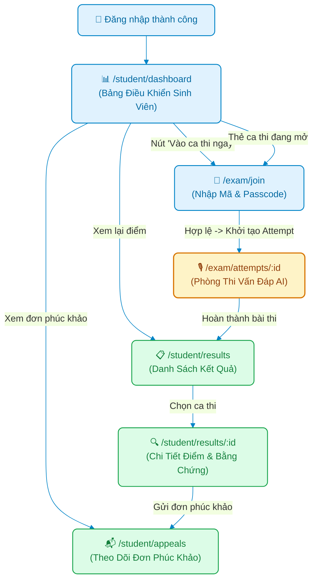

# Page Map: Phân Hệ Sinh Viên (Student Role)

> **Hệ thống**: AI-powered Viva Exam System (AIVES)  
> **Vai trò người dùng**: Sinh viên / Thí sinh (`STUDENT`)  
> **Tài liệu cha**: [04-ui-ux-design/README.md](../README.md)  
> **Source of Truth**: [br-auth-rbac.md](../../01-business-rule/br-auth-rbac.md), [br-ai-interview.md](../../01-business-rule/br-ai-interview.md), [br-grading-review.md](../../01-business-rule/br-grading-review.md)

---

## 1. Danh Sách Các Trang (Route Matrix)

| Đường dẫn (URL Route) | Tên màn hình | Quyền truy cập (RBAC) | Trạng thái FE hiện tại | Mô tả nghiệp vụ |
| :--- | :--- | :--- | :---: | :--- |
| `/student/dashboard` | **Bảng Điều Khiển Sinh Viên** | `STUDENT` | Đã có (`StudentDashboardPage.tsx`) | Màn hình chính sau khi đăng nhập. Hiển thị thẻ thống kê cá nhân (số bài thi đã hoàn thành, điểm trung bình, ca thi sắp tới), hộp nhập nhanh mã ca thi, danh sách ca thi đang mở và lịch sử gần nhất. |
| `/exam/join` | **Vào Phòng Thi** | `STUDENT` | Đã có (`JoinExamPage.tsx`) | Form nhập Mã ca thi (`AIVES_EXAM_yyyy_xxxxxx`) và Passcode 6 chữ số (`BR-AUTH-002`). Xác thực điều kiện vào thi và kiểm tra thiết bị. |
| `/exam/attempts/:attemptId` | **Phòng Thi Vấn Đáp AI** | `STUDENT` | Đã có (`ExamRoomPage.tsx`) | Không gian phòng thi trực tiếp: kiểm tra mic/tai nghe (Mic Check), nghe câu hỏi AI qua giọng đọc TTS, trả lời bằng giọng nói qua micro (Web Audio API sóng âm), tự động ngắt mic khi im lặng $\ge 10$s (`BR-VIVA-003`), nhận câu hỏi xoáy thích ứng. |
| `/student/results` | **Kết Quả Thi** | `STUDENT` | Đã có (`StudentResultsPage.tsx`) | Danh sách các đợt thi đã hoàn thành kèm trạng thái điểm số (`PUBLISHED` hoặc `PENDING_REVIEW`). |
| `/student/results/:attemptId` | **Chi Tiết Bảng Điểm & Phúc Khảo** | `STUDENT` | Đã có (`StudentResultsPage.tsx`) | Xem báo cáo phân tích chi tiết: điểm từng câu hỏi, tiêu chí Rubric đạt được, điểm mạnh, điểm cần cải thiện, bản transcript hội thoại và nút nộp đơn phúc khảo (`grade_appeals`). |
| `/student/appeals` | **Theo Dõi Đơn Phúc Khảo** | `STUDENT` | Đã có (`StudentAppealsPage.tsx`) | Màn hình riêng biệt theo dõi tiến độ xử lý toàn bộ các đơn phúc khảo sinh viên đã gửi: trạng thái (`PENDING`, `ACCEPTED`, `REJECTED`), điểm trước/sau điều chỉnh và giải trình chính thức từ Giảng viên. |

---

## 2. Luồng Người Dùng & Sơ Đồ Điều Hướng (Navigation Flow)



---

## 3. Đặc Tả Chi Tiết Các Màn Hình Mới Cần Xây Dựng

### 3.1. Bảng Điều Khiển Sinh Viên (`/student/dashboard` - StudentDashboardPage)
- **Mục đích**: Trung tâm điều hướng mọi hoạt động học tập và thi cử của sinh viên, mang lại sự tự tin và tiện lợi.
- **Wireframe Layout**:
```text
+-------------------------------------------------------------------------+
| [AIVES Logo]  [Trang chủ] [Vào ca thi] [Kết quả thi] [Phúc khảo]   [👤] |
+-------------------------------------------------------------------------+
|                                                                         |
|  👋 Chào mừng trở lại, Nguyễn Văn Sinh Viên (ST180293)!                 |
|                                                                         |
|  +-------------------+  +-------------------+  +--------------------+   |
|  | 🕒 Ca thi sắp tới |  | 🏆 Điểm TB Viva  |  | 📬 Đơn phúc khảo   |   |
|  |      2 ca thi     |  |       8.4 / 10    |  |     1 đang chờ     |   |
|  +-------------------+  +-------------------+  +--------------------+   |
|                                                                         |
|  +----------------------- VÀO CA THI NHANH --------------------------+  |
|  | Nhập nhanh mã ca thi và mã passcode để bắt đầu ngay:                |
|  | [ AIVES_EXAM_2026_xxxxxx ]  [ 123456 ]   [ 🚀 THAM GIA CA THI ]     |
|  +--------------------------------------------------------------------+  |
|                                                                         |
|  +--------------------- DANH SÁCH CA THI CỦA BẠN --------------------+  |
|  | [Tab: Đang mở (1)]   [Tab: Sắp diễn ra (2)]   [Tab: Đã hoàn thành (4)]|
|  |                                                                    |
|  | • Kiểm tra Vấn đáp Kiến trúc Phần mềm - K18                         |
|  |   Thời lượng: 20 phút | Hạn: 18:00 Hôm nay | Trạng thái: ĐANG MỞ     |
|  |   [ Bấm vào thi ]                                                  |
|  +--------------------------------------------------------------------+  |
|                                                                         |
+-------------------------------------------------------------------------+
```

### 3.2. Màn hình Theo Dõi Đơn Phúc Khảo (`/student/appeals` - StudentAppealsPage)
- **Mục đích**: Cung cấp góc nhìn minh bạch cho sinh viên theo dõi toàn bộ các khiếu nại điểm số đã nộp.
- **Thành phần**:
  - Thẻ tóm tắt: Tổng số đơn, Số đơn đang chờ xử lý (`PENDING`), Số đơn được chấp thuận tăng điểm (`ACCEPTED`), Số đơn bị từ chối (`REJECTED`).
  - Danh sách bảng đơn phúc khảo:
    - Mã đơn & Tên ca thi / Câu hỏi khiếu nại.
    - Điểm ban đầu (`scoreBefore`) vs Điểm sau phúc khảo (`scoreAfter`).
    - Lý do sinh viên giải trình.
    - Trạng thái huy hiệu (Badge) màu sắc rõ ràng.
    - Phản hồi chính thức của Giảng viên (`lecturerResponse`) và thời gian giải quyết.
