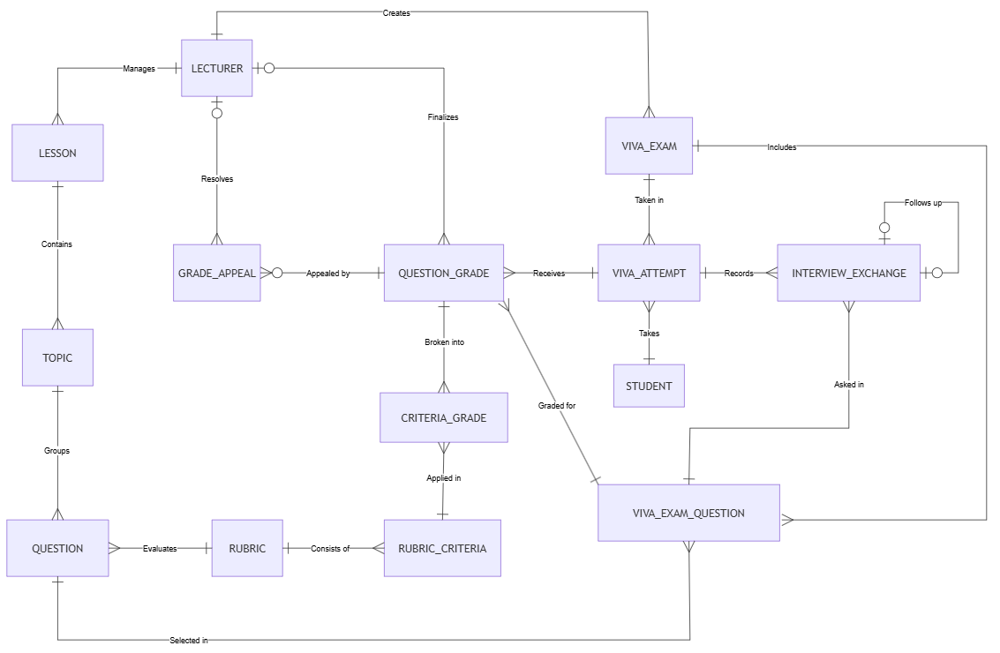

# Conceptual ERD - AIVES

> **Mức**: Conceptual (quan niệm) - chỉ gồm thực thể, quan hệ và bản số, chưa có thuộc tính.  
> **Mã nguồn**: [conceptual-erd.mmd](conceptual-erd.mmd)  
> **Căn cứ**: [00-overview](../00-overview/README.md), [01-business-rule](../01-business-rule/README.md)

---

## 1. Sơ đồ

---

## 2. Danh sách thực thể (16)

Các thực thể được chia theo 4 nhóm nghiệp vụ, tương ứng các module hệ thống.

### 2.1. Người dùng

| Thực thể | Ý nghĩa |
| :--- | :--- |
| `LECTURER` | Giảng viên. Giảng dạy môn học, quản lý chương, đóng góp ngân hàng câu hỏi dùng chung, tạo đề thi, chốt điểm và xử lý phúc khảo. |
| `STUDENT` | Sinh viên. Làm bài thi vấn đáp với AI và xem kết quả đã công bố. |

### 2.2. Nội dung & Ngân hàng câu hỏi (module `content`)

| Thực thể | Ý nghĩa |
| :--- | :--- |
| `COURSE` | Môn học. Là cấp cao nhất của cấu trúc học thuật. Mỗi môn học chỉ có **1 Rubric chuẩn duy nhất** và nhiều Chương. |
| `CHAPTER` | Chương kiến thức thuộc Môn học. Là nơi nạp học liệu RAG và quản lý ngân hàng câu hỏi chung. |
| `MATERIAL` | Học liệu, slide bài giảng, giáo trình PDF/PPTX nạp theo từng Chương để RAG lập chỉ mục tri thức. |
| `QUESTION` | Câu hỏi trong ngân hàng dùng chung của Chương (do giảng viên tạo hoặc AI RAG sinh theo 3 mức độ Dễ/Trung bình/Khó). Kế thừa Rubric duy nhất của Môn học. |
| `RUBRIC` | Bộ tiêu chí chấm điểm duy nhất cho toàn bộ môn học (`BR-BANK-001`, `BR-BANK-006`). |
| `RUBRIC_CRITERIA` | Một tiêu chí trong rubric môn học, có trọng số (%). Tổng trọng số của 1 rubric = 100% (`BR-BANK-001`). |

### 2.3. Đề thi & Phòng thi (module `exam`, `vivaroom`)

| Thực thể | Ý nghĩa |
| :--- | :--- |
| `VIVA_EXAM` | Đề thi / đợt thi vấn đáp do giảng viên tạo theo môn học, chứa cấu hình thời gian và số lần hỏi xoáy tối đa. |
| `VIVA_EXAM_QUESTION` | Câu hỏi được chọn vào một đề thi (kèm thứ tự và trọng số). Là thực thể trung gian giữa `VIVA_EXAM` và `QUESTION`. |
| `VIVA_ATTEMPT` | Một lượt thi của một sinh viên cho một đề thi. |
| `INTERVIEW_EXCHANGE` | Một lượt hỏi - đáp trong phòng thi: câu hỏi AI đọc, transcript câu trả lời, quyết định hỏi xoáy của AI (`BR-VIVA-001`, `BR-VIVA-002`). |

### 2.4. Chấm điểm & Phúc khảo (module `grading`)

| Thực thể | Ý nghĩa |
| :--- | :--- |
| `QUESTION_GRADE` | Điểm của một câu hỏi trong một lượt thi: điểm AI đề xuất và điểm giảng viên chốt (HITL, `BR-GRADE-002`). |
| `CRITERIA_GRADE` | Điểm chi tiết theo từng tiêu chí rubric của môn học, kèm trích dẫn bằng chứng từ transcript (`BR-GRADE-001`). |
| `GRADE_APPEAL` | Đơn phúc khảo của sinh viên cho điểm một câu hỏi. |

---

## 3. Quan hệ & Bản số (22 quan hệ)

| # | Quan hệ | Ký hiệu | Diễn giải |
| :---: | :--- | :---: | :--- |
| 1 | `LECTURER` **Teaches** `COURSE` | `}|--|{` | Giảng viên có thể giảng dạy nhiều môn học; một môn học có nhiều giảng viên phụ trách (dùng chung ngân hàng câu hỏi). |
| 2 | `COURSE` **Defines** `RUBRIC` | `\|\|--\|\|` | Mỗi môn học chỉ có đúng 1 Rubric duy nhất; Rubric thuộc về đúng 1 môn học (`BR-BANK-001`, `BR-BANK-006`). |
| 3 | `RUBRIC` **Consists of** `RUBRIC_CRITERIA` | `\|\|--\|{` | Rubric gồm 1..n tiêu chí; tổng trọng số bằng 100% (`BR-BANK-001`, `BR-BANK-003`). |
| 4 | `COURSE` **Contains** `CHAPTER` | `\|\|--\|{` | Môn học gồm 1..n chương kiến thức. |
| 5 | `CHAPTER` **Provides** `MATERIAL` | `\|\|--\|{` | Chương chứa 1..n tài liệu/slide học liệu để RAG nạp tri thức. |
| 6 | `CHAPTER` **Contains** `QUESTION` | `\|\|--\|{` | Chương quản lý ngân hàng câu hỏi dùng chung giữa các giảng viên cùng bộ môn. |
| 7 | `COURSE` **Organizes** `VIVA_EXAM` | `\|\|--\|{` | Ca thi vấn đáp được tổ chức theo môn học. |
| 8 | `LECTURER` **Creates** `VIVA_EXAM` | `\|\|--\|{` | Mỗi đề thi / ca thi do đúng 1 giảng viên khởi tạo. |
| 9 | `VIVA_EXAM` **Includes** `VIVA_EXAM_QUESTION` | `\|\|--\|{` | Đề thi gồm 1..n câu hỏi. |
| 10 | `QUESTION` **Selected in** `VIVA_EXAM_QUESTION` | `\|\|--\|{` | Một câu hỏi trong ngân hàng có thể được chọn vào nhiều đề thi. |
| 11 | `VIVA_EXAM` **Taken in** `VIVA_ATTEMPT` | `\|\|--\|{` | Đề thi (phiên thi) có nhiều lượt thi; mỗi sinh viên vào phiên có đúng 1 lượt. |
| 12 | `STUDENT` **Takes** `VIVA_ATTEMPT` | `\|\|--\|{` | Mỗi lượt thi thuộc đúng 1 sinh viên (`BR-AUTH-002`). |
| 13 | `VIVA_ATTEMPT` **Records** `INTERVIEW_EXCHANGE` | `\|\|--\|{` | Lượt thi ghi lại toàn bộ các lượt hỏi - đáp. |
| 14 | `VIVA_EXAM_QUESTION` **Asked in** `INTERVIEW_EXCHANGE` | `\|\|--\|{` | Mỗi lượt hỏi - đáp thuộc về 1 câu hỏi của đề (câu gốc hoặc câu xoáy). |
| 15 | `INTERVIEW_EXCHANGE` **Follows up** `INTERVIEW_EXCHANGE` | `\|o--o\|` | Tự tham chiếu 0..1 - 0..1: câu hỏi xoáy nối tiếp một lượt trước đó, tạo thành chuỗi hỏi xoáy. Độ dài chuỗi bị giới hạn bởi `max_follow_up_per_question` (`BR-VIVA-001`). |
| 16 | `VIVA_ATTEMPT` **Receives** `QUESTION_GRADE` | `\|\|--\|{` | Lượt thi nhận điểm cho từng câu hỏi. |
| 17 | `VIVA_EXAM_QUESTION` **Graded for** `QUESTION_GRADE` | `\|\|--\|{` | Mỗi điểm câu hỏi gắn với đúng 1 câu hỏi của đề. |
| 18 | `LECTURER` **Finalizes** `QUESTION_GRADE` | `\|o--\|{` | Giảng viên chốt điểm (HITL). Phía LECTURER là 0..1 vì lúc AI vừa chấm xong thì chưa có ai chốt. |
| 19 | `QUESTION_GRADE` **Broken into** `CRITERIA_GRADE` | `\|\|--\|{` | Điểm câu hỏi được tách theo từng tiêu chí trong Rubric môn học. |
| 20 | `RUBRIC_CRITERIA` **Applied in** `CRITERIA_GRADE` | `\|\|--\|{` | Mỗi điểm tiêu chí ứng với đúng 1 tiêu chí rubric của môn học. |
| 21 | `QUESTION_GRADE` **Appealed by** `GRADE_APPEAL` | `\|\|--o{` | Một điểm câu hỏi có 0..n đơn phúc khảo. |
| 22 | `LECTURER` **Resolves** `GRADE_APPEAL` | `\|o--\|{` | Giảng viên xử lý phúc khảo. Phía LECTURER là 0..1 vì đơn đang chờ thì chưa có người xử lý. |

---

## 4. Luồng Dữ Liệu Đọc Theo Sơ Đồ

1. **Chuẩn bị cấu trúc môn học & Rubric**: Giảng viên thiết lập `COURSE` và cấu hình bộ `RUBRIC` duy nhất (gồm các `RUBRIC_CRITERIA` đạt tổng 100%).
2. **Nạp học liệu & Soạn câu hỏi**: Giảng viên tạo các `CHAPTER`, nạp `MATERIAL` (slide, giáo trình) để RAG lập chỉ mục. Sau đó gọi AI sinh câu hỏi (theo 3 mức Dễ / Trung bình / Khó, không sinh Rubric) hoặc tự nhập thủ công vào `QUESTION`. Các giảng viên cùng dạy môn cùng xem và phê duyệt (`APPROVED`).
3. **Tạo phiên thi & sinh viên vào thi**: `LECTURER` tạo `VIVA_EXAM` thuộc môn học, chọn câu hỏi thành `VIVA_EXAM_QUESTION` (chọn cố định hoặc theo ma trận bốc ngẫu nhiên). `STUDENT` nhập mã phiên + mã truy cập để vào thi → tạo `VIVA_ATTEMPT`.
4. **Thi vấn đáp**: Mỗi câu hỏi sinh ra các `INTERVIEW_EXCHANGE` (câu gốc và chuỗi xoáy).
5. **Chấm điểm**: AI căn cứ vào Rubric duy nhất của Môn học để tạo `QUESTION_GRADE` + các `CRITERIA_GRADE`; `LECTURER` chốt điểm (**Finalizes**).
6. **Phúc khảo**: `STUDENT` gửi `GRADE_APPEAL` cho điểm câu hỏi; `LECTURER` xử lý (**Resolves**).

---

## 5. Ghi Chú Thiết Kế

- **Ngân hàng câu hỏi dùng chung (Shared Question Bank)**: Các câu hỏi gắn vào `CHAPTER` thuộc `COURSE`, mọi giảng viên được phân công giảng dạy môn học đều có thể truy cập, đóng góp và sử dụng.
- **Rubric duy nhất ở cấp Môn học**: Đảm bảo toàn bộ câu hỏi và mọi ca thi thuộc môn học đều được chấm theo cùng một chuẩn mực công bằng. Khóa cứng (Read-Only) khi môn học có ca thi đang diễn ra.
- **Lưu vết phi cấu trúc**: Sử dụng MongoDB collection `academic_audit_logs` để lưu toàn bộ lịch sử thao tác thêm, sửa, xóa, duyệt câu hỏi và cập nhật Rubric.
