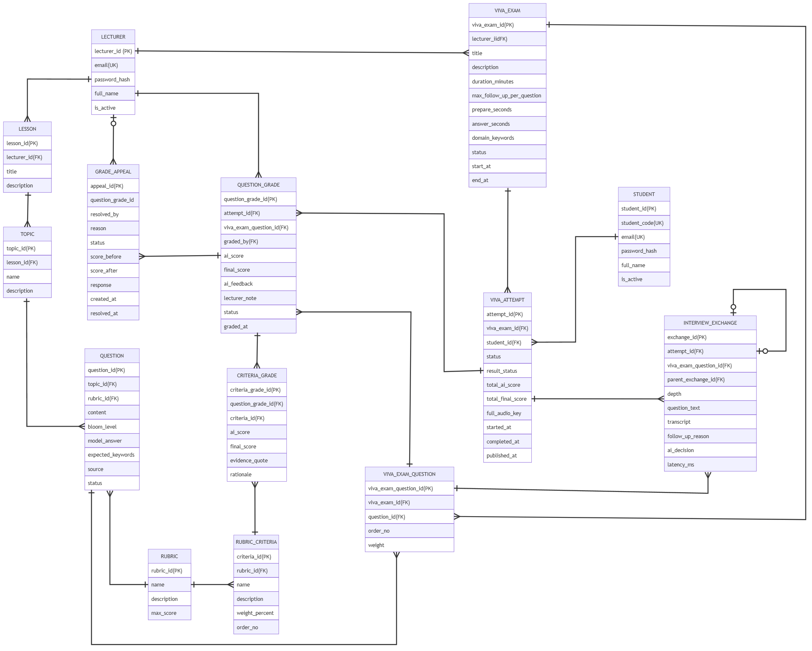

# Logical ERD - AIVES

> **Mức**: Logical (luận lý) - đã có thuộc tính, kiểu dữ liệu chuẩn hoá, khoá chính (PK), khoá ngoại (FK), ràng buộc duy nhất (UK). Chưa gắn với hệ quản trị cơ sở dữ liệu cụ thể.  
> **Mã nguồn**: [logical-erd.mmd](logical-erd.mmd)  
> **Căn cứ**: [Conceptual ERD](01-conceptual-erd.md), [01-business-rule](../01-business-rule/README.md)

---

## 1. Sơ Đồ

---

## 2. Thay Đổi So Với Bản Thiết Kế Cũ

1. **Chuẩn hóa cây phân cấp học thuật**: Thay thế phân cấp rời rạc `LESSON` / `TOPIC` bằng `COURSE` (Môn học) → `CHAPTER` (Chương) → `MATERIAL` (Học liệu RAG) & `QUESTION` (Ngân hàng câu hỏi dùng chung).
2. **Rubric duy nhất ở cấp Môn học**: Thực thể `RUBRIC` liên kết trực tiếp $1:1$ với `COURSE` (`course_id` UNIQUE). Bảng `QUESTION` không cần lưu riêng `rubric_id` mà kế thừa bộ Rubric chuẩn của Môn học (`BR-BANK-001`, `BR-BANK-006`).
3. **Phân loại độ khó trực quan**: Thay thế thang nhận thức Bloom (`REMEMBER`, `UNDERSTAND`, `APPLY`, `ANALYZE`) bằng 3 mức độ thực tế: `EASY` (Dễ), `MEDIUM` (Trung bình), `HARD` (Khó).
4. **Bổ sung quản lý học liệu RAG**: Thêm thực thể `MATERIAL` gắn theo từng Chương (`chapter_id`) để quản lý trạng thái lập chỉ mục RAG (`INDEXING`, `READY`, `FAILED`).
5. **Theo dõi cộng tác & lưu vết kiểm toán**: Bổ sung `created_by` trong `QUESTION` và tích hợp MongoDB `academic_audit_logs` để theo dõi lịch sử chỉnh sửa, phê duyệt (`BR-BANK-005`, `BR-BANK-007`).

---

## 3. Danh Sách Thực Thể & Thuộc Tính

### 3.1. `LECTURER`

| Thuộc tính | Khoá | Kiểu | Mô tả |
| :--- | :---: | :--- | :--- |
| `lecturer_id` | PK | int | Mã định danh giảng viên |
| `email` | UK | string | Email tài khoản giảng viên |
| `password_hash` | | string | Mật khẩu băm (BCrypt) |
| `full_name` | | string | Họ và tên |
| `is_active` | | boolean | Trạng thái kích hoạt tài khoản |

### 3.2. `STUDENT`

| Thuộc tính | Khoá | Kiểu | Mô tả |
| :--- | :---: | :--- | :--- |
| `student_id` | PK | int | Mã sinh viên |
| `email` | UK | string | Email sinh viên |
| `password_hash` | | string | Mật khẩu băm |
| `full_name` | | string | Họ và tên |
| `is_active` | | boolean | Trạng thái hoạt động |

### 3.3. `COURSE`

| Thuộc tính | Khoá | Kiểu | Mô tả |
| :--- | :---: | :--- | :--- |
| `course_id` | PK | int | Mã môn học |
| `course_code` | UK | string | Mã học phần (ví dụ: `SWD392`, `PRN211`) |
| `name` | | string | Tên môn học |
| `description` | | text | Mô tả mục tiêu học phần |

### 3.4. `CHAPTER`

| Thuộc tính | Khoá | Kiểu | Mô tả |
| :--- | :---: | :--- | :--- |
| `chapter_id` | PK | int | Mã chương kiến thức |
| `course_id` | FK → `COURSE` | int | Môn học chứa chương (**Contains**) |
| `name` | | string | Tên chương (ví dụ: `Chương 1 - Design Patterns`) |
| `order_no` | | int | Thứ tự chương trong môn học |
| `description` | | text | Mô tả tóm tắt nội dung chương |

### 3.5. `MATERIAL`

| Thuộc tính | Khoá | Kiểu | Mô tả |
| :--- | :---: | :--- | :--- |
| `material_id` | PK | int | Mã tài liệu học liệu |
| `chapter_id` | FK → `CHAPTER` | int | Chương chứa tài liệu (**Provides**) |
| `uploaded_by` | FK → `LECTURER` | int | Giảng viên tải lên |
| `title` | | string | Tên file hiển thị |
| `file_url` | | string | Đường dẫn tệp trên GCS |
| `file_type` | | string | Định dạng: `pdf`, `pptx`, `ppt` |
| `file_size` | | int | Kích thước file tính theo bytes |
| `rag_status` | | enum | `INDEXING`, `READY`, `FAILED` |

### 3.6. `QUESTION`

| Thuộc tính | Khoá | Kiểu | Mô tả |
| :--- | :---: | :--- | :--- |
| `question_id` | PK | int | Mã câu hỏi |
| `chapter_id` | FK → `CHAPTER` | int | Chương chứa câu hỏi (**Contains**) |
| `created_by` | FK → `LECTURER` | int | Giảng viên khởi tạo / kích hoạt sinh AI |
| `content` | | text | Nội dung câu hỏi |
| `difficulty` | | enum | Mức độ khó: `EASY`, `MEDIUM`, `HARD` |
| `model_answer` | | text | Đáp án mẫu chuẩn |
| `expected_keywords` | | text | Từ khoá chuyên môn kỳ vọng (mảng JSON) |
| `source` | | enum | `MANUAL`, `AI_GENERATED` (`BR-BANK-002`) |
| `status` | | enum | `DRAFT`, `APPROVED`, `REJECTED`, `ARCHIVED` |

### 3.7. `RUBRIC`

| Thuộc tính | Khoá | Kiểu | Mô tả |
| :--- | :---: | :--- | :--- |
| `rubric_id` | PK | int | Mã rubric |
| `course_id` | FK → `COURSE`, UK | int | Môn học chứa Rubric chuẩn (**Defines**) |
| `name` | | string | Tên rubric (chuẩn hóa môn học) |
| `description` | | text | Mô tả tổng quan khung tiêu chí |
| `max_score` | | decimal | Điểm tối đa (thang 10) |
| `is_locked` | | boolean | Khóa chỉnh sửa khi có ca thi đang mở/kết thúc (`BR-BANK-006`) |

### 3.8. `RUBRIC_CRITERIA`

| Thuộc tính | Khoá | Kiểu | Mô tả |
| :--- | :---: | :--- | :--- |
| `criteria_id` | PK | int | Mã tiêu chí con |
| `rubric_id` | FK → `RUBRIC` | int | Rubric chứa tiêu chí (**Consists of**) |
| `name` | | string | Tên tiêu chí đánh giá |
| `description` | | text | Tiêu chuẩn chi tiết để đạt điểm (`BR-BANK-003`) |
| `weight_percent` | | decimal | Trọng số %, tổng tiêu chí trong 1 rubric = 100% |
| `order_no` | | int | Thứ tự hiển thị tiêu chí |

### 3.9. `VIVA_EXAM`

| Thuộc tính | Khoá | Kiểu | Mô tả |
| :--- | :---: | :--- | :--- |
| `viva_exam_id` | PK | string | Mã đợt thi (ví dụ: `AIVES_EXAM_2026_SWD001`) |
| `course_id` | FK → `COURSE` | int | Môn học tổ chức thi (**Organizes**) |
| `lecturer_id` | FK → `LECTURER` | int | Giảng viên tạo ca thi (**Creates**) |
| `title` | | string | Tiêu đề ca thi |
| `description` | | text | Mô tả quy chế thi |
| `passcode` | | string | Mã truy cập bí mật |
| `duration_minutes` | | int | Thời lượng tối đa cho 1 lượt thi |
| `max_follow_up_per_question` | | int | Giới hạn số lượt hỏi xoáy tối đa |
| `prepare_seconds` | | int | Thời gian chuẩn bị trước mỗi câu hỏi |
| `answer_seconds` | | int | Thời gian trả lời tối đa cho mỗi câu |
| `domain_keywords` | | text | Từ khóa chuyên ngành bổ trợ Google STT |
| `start_at` | | datetime | Thời điểm mở phòng thi |
| `end_at` | | datetime | Thời điểm đóng phòng thi |
| `cancelled_at` | | datetime | Thời điểm hủy ca thi (nếu có) |

### 3.10. `VIVA_EXAM_QUESTION`

| Thuộc tính | Khoá | Kiểu | Mô tả |
| :--- | :---: | :--- | :--- |
| `viva_exam_question_id` | PK | int | Mã liên kết câu hỏi trong đề thi |
| `viva_exam_id` | FK → `VIVA_EXAM` | string | Đề thi (**Includes**) |
| `question_id` | FK → `QUESTION` | int | Câu hỏi được chọn (**Selected in**) |
| `order_no` | | int | Thứ tự hỏi câu này trong đề |
| `weight` | | decimal | Trọng số câu hỏi trong đề |

### 3.11. `VIVA_ATTEMPT`

| Thuộc tính | Khoá | Kiểu | Mô tả |
| :--- | :---: | :--- | :--- |
| `attempt_id` | PK | int | Mã lượt thi của sinh viên |
| `viva_exam_id` | FK → `VIVA_EXAM` | string | Đề thi (**Taken in**) |
| `student_id` | FK → `STUDENT` | int | Sinh viên tham gia (**Takes**) |
| `status` | | enum | `NOT_STARTED`, `IN_PROGRESS`, `COMPLETED`, `ABANDONED` |
| `result_status` | | enum | `NONE`, `GRADING`, `PENDING_REVIEW`, `GRADING_FAILED`, `PUBLISHED` |
| `total_ai_score` | | decimal | Tổng điểm AI chấm |
| `total_final_score` | | decimal | Tổng điểm giảng viên chốt cuối cùng |
| `full_audio_key` | | string | Đường dẫn bản ghi âm toàn bộ lượt thi |
| `started_at` | | datetime | Thời điểm bắt đầu thi |
| `deadline_at` | | datetime | Thời hạn chót kết thúc lượt thi |
| `completed_at` | | datetime | Thời điểm nộp bài |
| `published_at` | | datetime | Thời điểm công bố điểm |

### 3.12. `INTERVIEW_EXCHANGE`

| Thuộc tính | Khoá | Kiểu | Mô tả |
| :--- | :---: | :--- | :--- |
| `exchange_id` | PK | int | Mã lượt hỏi đáp |
| `attempt_id` | FK → `VIVA_ATTEMPT` | int | Lượt thi (**Records**) |
| `viva_exam_question_id` | FK → `VIVA_EXAM_QUESTION` | int | Câu hỏi trong đề (**Asked in**) |
| `parent_exchange_id` | FK → `INTERVIEW_EXCHANGE` | int | Lượt hỏi trước; `NULL` nếu là câu hỏi gốc (**Follows up**) |
| `depth` | | int | Độ sâu hỏi xoáy (0 = câu gốc, 1..n = câu xoáy) |
| `question_text` | | text | Nội dung câu hỏi AI phát âm |
| `transcript` | | text | Nội dung câu trả lời của sinh viên |
| `follow_up_reason` | | enum | `INCOMPLETE`, `AMBIGUOUS`, `CONTRADICTORY` |
| `ai_decision` | | enum | `FOLLOW_UP`, `NEXT`, `SKIPPED` |
| `latency_ms` | | int | Độ trễ xử lý AI |

### 3.13. `QUESTION_GRADE`

| Thuộc tính | Khoá | Kiểu | Mô tả |
| :--- | :---: | :--- | :--- |
| `question_grade_id` | PK | int | Mã bảng điểm câu hỏi |
| `attempt_id` | FK → `VIVA_ATTEMPT` | int | Lượt thi (**Receives**) |
| `viva_exam_question_id` | FK → `VIVA_EXAM_QUESTION` | int | Câu hỏi trong đề (**Graded for**) |
| `graded_by` | FK → `LECTURER` | int | Giảng viên chốt điểm HITL (**Finalizes**); NULL khi mới có điểm AI |
| `ai_score` | | decimal | Điểm AI chấm cho câu |
| `final_score` | | decimal | Điểm chốt sau cùng |
| `ai_feedback` | | text | Nhận xét chi tiết từ AI |
| `lecturer_note` | | text | Ghi chú của giảng viên |
| `status` | | enum | `AI_DRAFT`, `APPROVED`, `FAILED` |
| `graded_at` | | datetime | Thời điểm chốt điểm |

### 3.14. `CRITERIA_GRADE`

| Thuộc tính | Khoá | Kiểu | Mô tả |
| :--- | :---: | :--- | :--- |
| `criteria_grade_id` | PK | int | Mã điểm thành phần tiêu chí |
| `question_grade_id` | FK → `QUESTION_GRADE` | int | Bảng điểm câu hỏi (**Broken into**) |
| `criteria_id` | FK → `RUBRIC_CRITERIA` | int | Tiêu chí Rubric môn học được áp dụng (**Applied in**) |
| `ai_score` | | decimal | Điểm AI chấm theo tiêu chí |
| `final_score` | | decimal | Điểm giảng viên chốt cho tiêu chí |
| `evidence_quote` | | text | Đoạn trích dẫn transcript làm bằng chứng |
| `rationale` | | text | Lập luận giải thích điểm |

### 3.15. `GRADE_APPEAL`

| Thuộc tính | Khoá | Kiểu | Mô tả |
| :--- | :---: | :--- | :--- |
| `appeal_id` | PK | int | Mã đơn phúc khảo |
| `question_grade_id` | FK → `QUESTION_GRADE` | int | Điểm câu hỏi bị khiếu nại (**Appealed by**) |
| `resolved_by` | FK → `LECTURER` | int | Giảng viên giải quyết (**Resolves**); NULL khi chưa xử lý |
| `reason` | | text | Lý do sinh viên xin phúc khảo |
| `status` | | enum | `PENDING`, `ACCEPTED`, `REJECTED` |
| `score_before` | | decimal | Điểm trước khi phúc khảo |
| `score_after` | | decimal | Điểm sau khi điều chỉnh |
| `response` | | text | Phản hồi của giảng viên |
| `created_at` | | datetime | Thời điểm nộp đơn |
| `resolved_at` | | datetime | Thời điểm xử lý xong |

---

## 4. Tóm Tắt Quy Tắc Ràng Buộc Nghiệp Vụ Trên Schema

| Ràng buộc | Thực thể | Căn cứ Business Rule |
| :--- | :--- | :--- |
| Mỗi môn học chỉ có duy nhất 1 Rubric | `RUBRIC.course_id` (UNIQUE) | `BR-BANK-001`, `BR-BANK-006` |
| Tổng `weight_percent` của 1 rubric phải bằng 100% | `RUBRIC_CRITERIA` | `BR-BANK-001` |
| Mỗi tiêu chí bắt buộc có `description` chi tiết | `RUBRIC_CRITERIA` | `BR-BANK-003` |
| Rubric bị khóa (is_locked = TRUE) khi có ca thi OPEN/CLOSED | `RUBRIC` | `BR-BANK-006` |
| Câu hỏi APPROVED bắt buộc môn học phải có Rubric 100% | `QUESTION` | `BR-BANK-001` |
| Phân loại độ khó bắt buộc thuộc `EASY`, `MEDIUM`, `HARD` | `QUESTION` | `BR-BANK-004` |
