# Cover Page

| Item | Details |
| :--- | :--- |
| **University / Institute** | FPT University |
| **Course Code & Name** | SWD392 — Software Architecture and Design |
| **Project Name** | AI-Powered Viva Exam System (**AIVES**) |
| **Academic Instructor** | [Instructor Name] |
| **Class** | [Class ID, e.g., SE17xx] |
| **Project Repository** | AI-powered-Viva-Exam-System |
| **Submission Date** | October 2026 |

### Project Team Members & Contribution

| No. | Student ID | Full Name | Role | Responsibilities | Signature |
| :---: | :---: | :---: | :---: | :---: | :---: |
| 1 | [Student ID 1] | [Team Member 1] | Team Leader / Backend Lead | Architecture Design, Spring Boot Core, Security | ________ |
| 2 | [Student ID 2] | [Team Member 2] | Frontend Lead | Web Portal (React + Vite), UI/UX Design | ________ |
| 3 | [Student ID 3] | [Team Member 3] | AI / ML Engineer | Vertex AI RAG Integration, STT/TTS, Prompt Engineering | ________ |
| 4 | [Student ID 4] | [Team Member 4] | Database & Quality Engineer | PostgreSQL Schema, ERD, Test Cases & QA | ________ |
| 5 | [Student ID 5] | [Team Member 5] | Fullstack / Mobile Developer | Exam Room Workflow, Mobile Integration | ________ |

---

# 1. Introduction

## 1.1 Context
Oral examination (commonly known as *Viva Voce*) is widely recognized in higher education and professional qualification as one of the most effective assessment methods. Unlike multiple-choice or standard written tests, oral examinations rigorously evaluate a student's deep comprehension, analytical reasoning, articulation under pressure, and authenticity of knowledge. 

However, conducting oral exams in traditional academic environments presents significant operational bottlenecks:
1. **High Labor and Time Costs**: Faculty members must spend dozens to hundreds of hours interviewing students individually. This linear scaling constraint makes large-scale viva exams practically impossible.
2. **Inconsistent Difficulty and Subjectivity**: Interviewers' cognitive fatigue, unconscious biases, and spontaneous questioning create variability in question difficulty and grading criteria across candidates.
3. **Lack of Verifiable Audit Trails**: Oral examinations often lack verbatim transcription or transparent, criteria-by-criteria rubric justifications, complicating post-exam dispute resolution and quality audits.

## 1.2 Proposed Solution: AIVES
To address these challenges, the **AI-powered Viva Exam System (AIVES)** is developed as an intelligent viva examination platform. AIVES couples speech processing (Speech-to-Text and Text-to-Speech) with Large Language Models (LLMs) to serve as an **Autonomous Virtual Oral Examiner** working under a strict **Human-in-the-Loop (HITL)** governance paradigm.

The core innovations of AIVES include:
- **RAG-based Automated Question and Rubric Generation**: Extracting curriculum concepts from course textbooks and lecture slides into Bloom's taxonomy-aligned questions with deterministic multi-level rubrics.
- **Contextual Adaptive Interrogation (Follow-up Questioning)**: The AI dynamically evaluates candidate speech transcripts in real time, detecting ambiguities, omissions, or logical contradictions to ask precise follow-up questions.
- **Evidence-Based Grading Suggestions**: Mapping verbatim transcripts against structured rubric criteria with exact citation of student strengths and weaknesses.
- **Human Authority Preservation**: Faculty members retain ultimate jurisdiction to inspect transcripts, audit AI scoring rationales, adjust scores, and publish official grades.

## 1.3 Objectives
- **Scalability**: Reduce faculty assessment workload by over 75% by automating oral interviewing and preliminary rubric-based grading.
- **Standardization & Fairness**: Ensure every student receives uniform question difficulty, structured follow-up probing, and transparent rubric-based evaluations.
- **Real-Time Responsiveness**: Maintain low-latency bidirectional voice interactions (audio processing and question dispatching under 3 seconds).
- **Integrity & Security**: Prevent academic dishonesty through single-session enforcement, silence detection auto-submission, and cryptographically secure exam tokens.

## 1.4 Scope

### In-Scope (Functional System Boundaries)
- Secure role-based authentication and authorization (Admin, Lecturer, Student).
- Course lecture, topic, and rubric management.
- Manual and AI-assisted question generation categorized by Bloom's cognitive levels.
- Exam session creation with access code validation and configurable attempt limits.
- Real-time virtual oral examination room with voice synthesis (TTS), recording, and speech recognition (STT).
- Adaptive follow-up questioning based on real-time transcript evaluation.
- Asynchronous background AI grading with criterion-level scoring suggestions and textual justifications.
- Lecturer grading review portal with score override capabilities and audit notes.
- Student result portal and grade appeal workflows.

### Out-of-Scope (Excluded from Current Release)
- Autonomous publishing of final official grades without lecturer approval.
- Automated complex multi-room physical exam timetabling.
- Complete replacement of faculty pedagogical judgment.

## 1.5 Functional Requirements Summary

| Module | Functional Requirements (FR) | Target Roles |
| :--- | :--- | :--- |
| **Authentication & RBAC** | - User login with JWT issuance<br>- Password reset with OTP verification<br>- Forced password change on first login for provisioned accounts<br>- Strict role separation (`ADMIN`, `LECTURER`, `STUDENT`) | All Users |
| **Curriculum & Content** | - Manage courses, lessons, and topics<br>- Upload reference lecture slides and syllabi<br>- AI-assisted question drafting via Retrieval-Augmented Generation (RAG)<br>- Multi-criteria rubric configuration (criteria weights totaling 100%) | Lecturer, Admin |
| **Exam Management** | - Configure viva exams (session code, access key, duration, question count)<br>- Select topics and questions for exam sessions<br>- Enable/disable mobile platform access (`allow_mobile_exam`)<br>- Track student exam attempt quotas (`max_attempts`) | Lecturer, Admin |
| **Real-time Viva Room** | - Hardware diagnostics (microphone and speaker check)<br>- Audio synthesis of questions via Text-to-Speech (TTS)<br>- Candidate voice recording and Speech-to-Text (STT) transcription<br>- Silence detection (auto-submit after 10s of continuous silence)<br>- Adaptive follow-up probing (max 2 follow-ups per primary question) | Student |
| **Grading & HITL** | - Asynchronous evaluation background job upon exam completion<br>- Criteria-level score matching with evidence citation<br>- Lecturer appraisal dashboard with side-by-side transcript review<br>- Score override with mandatory justification for deviations > 2.0 points<br>- Final score publication and grade appeal management | Lecturer, Student |
| **Audit & Administration**| - Audit logging for grade adjustments and critical administrative actions<br>- System configuration management (LLM model parameters, thresholds) | Admin, Lecturer |

---

# 2. Software Development Approach

## 2.1 SDLC Model: Agile Scrum
The AIVES platform is developed adopting the **Agile Scrum** methodology. Given the innovative nature of integrating multimodal Generative AI into high-stakes academic evaluations, an iterative and incremental model is essential.

### Rationale for Choosing Agile Scrum:
- **Iterative AI Prompt & Prompt Engineering Optimization**: AI prompt accuracy, hallucination mitigation, and JSON schema compliance require continuous experimentation and adjustment based on real audio feedback.
- **Frequent Stakeholder Verification**: Regular sprint reviews with academic instructors allow early validation of pedagogical rules (e.g., Bloom taxonomy alignment, rubric criteria weighting).
- **Risk Mitigation**: Decoupling the project into two-week sprints allows the team to isolate technical challenges (such as speech latency and JPA transaction isolation) early in the development lifecycle.

## 2.2 Development Process & Phases

```
[Sprint 0: Planning & Setup] ➔ [Sprint 1: Architecture & Data] ➔ [Sprint 2: Core Viva & AI] ➔ [Sprint 3: HITL & QA] ➔ [Final: Release]
```

1. **Phase 1: Planning and Requirements Engineering**
   - Stakeholder interviews, identification of problem domain and operational bottlenecks.
   - Formal specification of Business Rules (`BR-AUTH`, `BR-BANK`, `BR-VIVA`, `BR-GRADE`).
   - Definition of User Stories, acceptance criteria, and backlog grooming.
2. **Phase 2: Architectural and Detailed Design**
   - System decomposition into a Clean Layered Architecture.
   - Conceptual, Logical, and Physical Database Modeling (PostgreSQL).
   - Dynamic workflow modeling (Sequence Diagrams, State Machine specifications).
   - OpenAPI 3.0 specification drafting for backend REST interfaces.
3. **Phase 3: Implementation & Continuous Integration**
   - Backend development using Spring Boot 3, Java 17, and Spring Security 6.
   - Frontend development using React 18, Vite, and TailwindCSS.
   - Multimodal integration with Google Cloud STT/TTS and Google Cloud Vertex AI Managed RAG Engine (Gemini 1.5 Flash grounded on course slides).
   - Automated builds, static code analysis, and unit testing via GitHub Actions.
4. **Phase 4: Verification and Quality Assurance**
   - End-to-end integration testing across the virtual exam pipeline.
   - Stress testing for concurrent audio streams and latency benchmarking.
   - User Acceptance Testing (UAT) with faculty review board.
5. **Phase 5: Deployment and Maintenance**
   - Containerized multi-service packaging via Docker.
   - Database migration automation with versioned SQL scripts.
   - Monitoring, logging, and error tracking in staging environments.

---

# 3. Architectural Design

## 3.1 Chosen Architecture Style: Layered Client-Server Monolith
AIVES adopts a **Modular Layered Client-Server Architecture** featuring a single backend Spring Boot service orchestrating third-party AI cloud services via secure HTTPS REST APIs.

### Architecture Style Rationale:
- **Simplicity and Maintainability**: A modular monolith avoids the operational overhead, network latency, distributed transaction complexity, and deployment orchestration of microservices, which is ideal for the project scope and team scale.
- **Centralized Security and Credential Isolation**: The backend server acts as the **exclusive custodian** of sensitive cloud credentials (Google Cloud IAM Service Account for Vertex AI RAG Engine, Cloud Storage, and STT/TTS) and database credentials. Client applications (Web Portal and Mobile App) never access cloud providers directly.
- **Clear Separation of Concerns**: Strict boundary separation across the presentation layer, business service layer, data persistence layer, and external integration adapters ensures high cohesion and loose coupling.

## 3.2 System Architecture Diagram


### High-Level Architecture Block Diagram (Mermaid Representation):

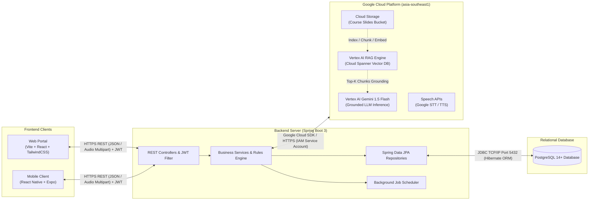

## 3.3 Component Interaction & Communication Protocols

| Channel | Source ➔ Destination | Protocol & Format | Payload Description | Security & Reliability |
| :---: | :--- | :--- | :--- | :--- |
| **CH-1** | Web / Mobile ➔ Backend | HTTPS / REST | JSON for commands; `multipart/form-data` for candidate voice recordings | Bearer JWT header validation; client request validation |
| **CH-2** | Backend ➔ Web / Mobile | HTTPS Response | Standard HTTP Status Codes (`200`, `400`, `401`, `403`, `404`, `409`, `500`) + JSON body | Base64 synthesized audio payloads or presigned audio URLs |
| **CH-3** | Backend ➔ Google Cloud | HTTPS / Cloud SDK | Slide upload (GCS), RAG retrieval query, Grounded prompt context, Audio recognition/synthesis | IAM Service Account authorization (`roles/aiplatform.user`, `roles/storage.objectAdmin`); Zero Trust; no static API keys |
| **CH-4** | Google Cloud ➔ Backend | HTTPS Response | Top-K semantic chunks, Grounded JSON responses (questions/grades) with citations, STT transcripts | Runtime JSON schema validation and Grounding metadata citation verification |
| **CH-5** | Backend ➔ PostgreSQL | JDBC (TCP Port 5432) | SQL queries generated by Hibernate ORM; HikariCP connection pool | Prepared statements, connection pooling, transactional isolation |

## 3.4 Deployment Diagram

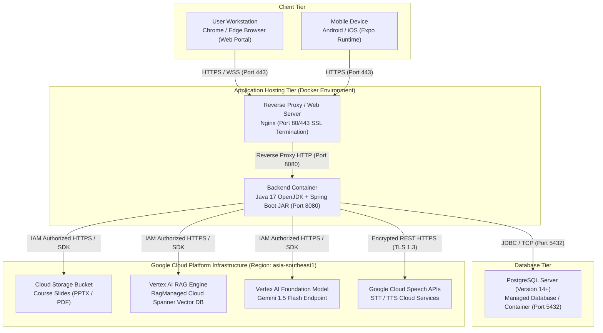

---

# 4. Technology Stack

## 4.1 Programming Languages & Frameworks

| Tier | Technology | Selected Version | Engineering Rationale |
| :--- | :--- | :--- | :--- |
| **Backend Core** | Java | OpenJDK 17 LTS | Enterprise standard offering strong typing, virtual threads readiness, performance, and long-term support. |
| **Backend Framework**| Spring Boot | 3.2.x | Comprehensive ecosystem with Spring Security 6, Spring Data JPA, automated configuration, and production-ready metrics. |
| **Frontend Web** | React | 18.x | Declarative component model, rich ecosystem, optimized reconciliation, and widespread enterprise adoption. |
| **Frontend Tooling** | Vite | 5.x | Instant hot module replacement (HMR), lightweight development server, and optimized rollup production bundles. |
| **Frontend Styling** | TailwindCSS | 3.x | Utility-first CSS framework enabling rapid, highly consistent, and responsive UI design without stylesheet bloat. |
| **Mobile Client** | React Native | Expo SDK 50+ | Cross-platform codebase supporting iOS and Android with native audio recording modules (`expo-av`). |

## 4.2 Database & Data Storage

| Component | Technology | Rationale |
| :--- | :--- | :--- |
| **Relational DBMS** | PostgreSQL 14+ | Robust open-source ACID-compliant relational database. Native UTF-8 support ensures seamless handling of Vietnamese text and transcriptions. |
| **Persistence Layer**| Spring Data JPA / Hibernate | Object-Relational Mapping (ORM) reducing boilerplate SQL, providing compile-time type safety and transparent transaction management. |
| **Connection Pool** | HikariCP | High-performance, lightweight JDBC connection pool with minimal thread overhead. |

## 4.3 Artificial Intelligence & Cloud Services

| Service | Provider | Purpose & Implementation Details |
| :--- | :--- | :--- |
| **Managed AI & RAG Platform** | Google Cloud Vertex AI | Enterprise RAG architecture in `asia-southeast1`. Eliminates static API keys via IAM Service Account RBAC (`roles/aiplatform.user`). |
| **Unstructured Document Storage** | Google Cloud Storage (GCS) | Dedicated bucket storing course syllabus and lecture slides (PPTX, PDF) organized by Course/Subject. IAM role: `roles/storage.objectAdmin`. |
| **Vector DB & Retrieval Engine** | Vertex AI RAG Engine | Managed semantic retrieval on Cloud Spanner vector store with `text-multilingual-embedding-002` (Chunk: 1024 tokens, Overlap: 256, Top-K: 5). |
| **Reasoning & Foundation Model** | Vertex AI Gemini 1.5 Flash | Grounded inference based on retrieved lecture chunks. Sub-second token latency, strict JSON Schema enforcement for question generation and rubric grading. |
| **Speech-to-Text (STT)**| Google Cloud Speech-to-Text | Accurate speech recognition with Vietnamese language model (`vi-VN`) and domain keyword hint boosting for technical terminologies. |
| **Text-to-Speech (TTS)**| Google Cloud Text-to-Speech | High-fidelity neural voice synthesis converting written question prompts into natural audio for candidate playback. |

## 4.4 DevOps, Version Control & Development Tools
- **Version Control**: Git & GitHub with branch protection rules (`main`, feature branches).
- **API Documentation**: OpenAPI 3.0 / Swagger UI for interactive endpoint testing and verification.
- **Containerization**: Docker and Docker Compose for reproducible local development and production orchestration.
- **Modeling & Architecture**: Mermaid.js, PlantUML, and Draw.io.

---

# 5. Requirements Modeling

## 5.1 System Actors

| Actor | Type | Description & System Permissions |
| :--- | :--- | :--- |
| **Student (Examinee)** | Human | Candidates authenticated via institutional email. Can participate in scheduled viva sessions, interact with the AI examiner, view officially published results, and submit grade appeals. |
| **Lecturer (Examiner)** | Human | Faculty members responsible for course content. Can upload materials, review/approve AI-generated questions and rubrics, schedule exam sessions, review transcripts, override AI proposed scores, and publish final grades. |
| **Administrator** | Human | System managers responsible for institutional user provisioning, role assignments, system-wide settings, and auditing security logs. |
| **External AI Engine** | System | Cloud services (Gemini LLM, Google STT/TTS) acting as processing workers invoked by the backend via secure APIs. |

## 5.2 Use Case Diagram & Descriptions

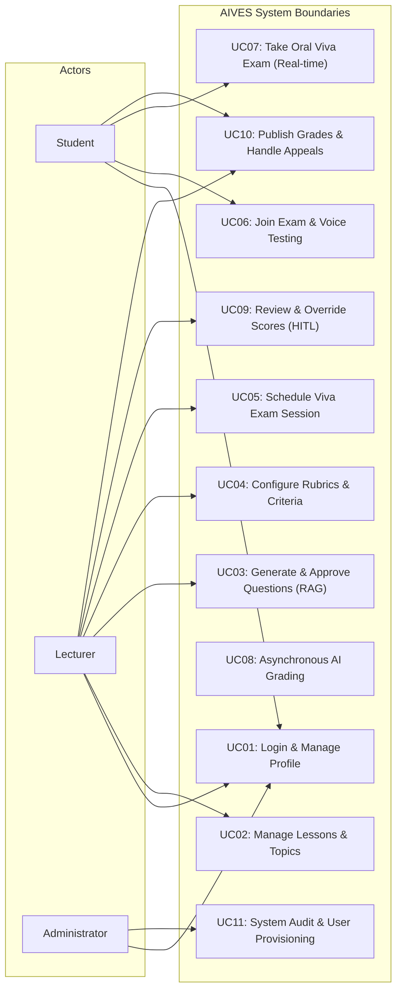

### Detailed Core Use Case Descriptions:
- **UC07: Take Oral Viva Exam**: The student enters the exam room using session credentials. The system sequentially renders question text and audio, records the student's voice response, monitors speech boundaries, performs transcription, evaluates adaptive follow-ups, and completes the attempt.
- **UC09: Review & Override Scores (HITL)**: The lecturer accesses the evaluation portal, examines the verbatim transcript and audio playback alongside the AI suggested score, provides manual overrides with required justifications for discrepancies over 2.0 points, and commits the official grade.

## 5.3 Non-Functional Requirements (NFRs)

| Category | Metric / Specification | Architectural Measure |
| :--- | :--- | :--- |
| **Security & Privacy** | - Passwords hashed with BCrypt (strength 10+)<br>- Stateless JWT with 24-hour expiration<br>- Strict RBAC validation on all endpoints<br>- Audio data encrypted at rest | Spring Security filter chain; encrypted storage; Google Cloud IAM Service Account authorization (Least Privilege, no static AI API keys) |
| **Performance & Latency**| - Voice turnaround latency < 3.0s<br>- Database query execution time < 50ms (p95)<br>- Backend REST API throughput > 200 req/s | Asynchronous speech synthesis; indexing on all foreign keys; connection pooling |
| **Reliability & Resilience**| - 99.5% uptime during examination windows<br>- Guaranteed exam state recovery upon client disconnection<br>- Background job retry policy (up to 3 attempts) | Status-driven transactional state machine; persistent audit logs; exponential backoff retries |
| **Scalability** | - Support 100+ concurrent viva sessions per institutional node | Decoupled background workers; stateless backend enabling horizontal scaling |
| **Data Integrity** | - Sum of rubric criteria weights must equal exactly 100%<br>- One single active attempt per student per exam session | Database CHECK constraints, partial unique indexes, transactional service validations |

---

# 6. Main Flows

## 6.1 Flow 1: Question Bank & Rubric Preparation
This flow describes the curriculum ingestion, automated RAG question drafting, and mandatory faculty validation.

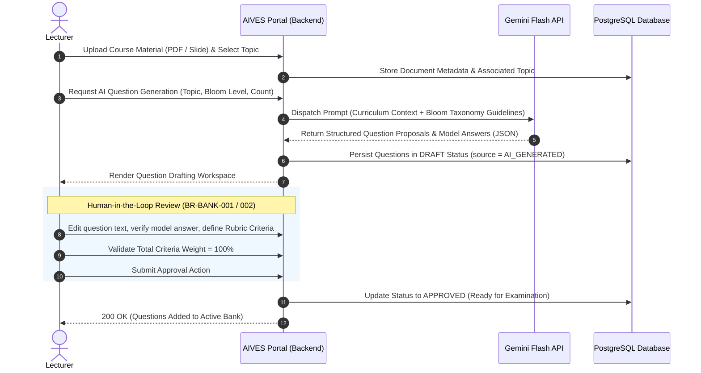

## 6.2 Flow 2: Real-Time Viva Examination (Voice AI & Adaptive Interrogation)
This flow encapsulates the candidate's real-time interaction with the virtual examiner.

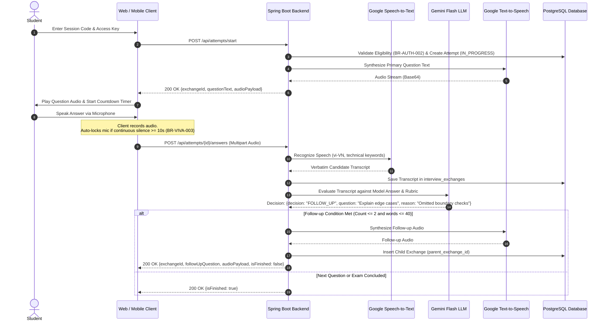

## 6.3 Flow 3: AI-Assisted Scoring & Human-in-the-Loop (HITL) Review
This flow covers the asynchronous grading pipeline and faculty review.

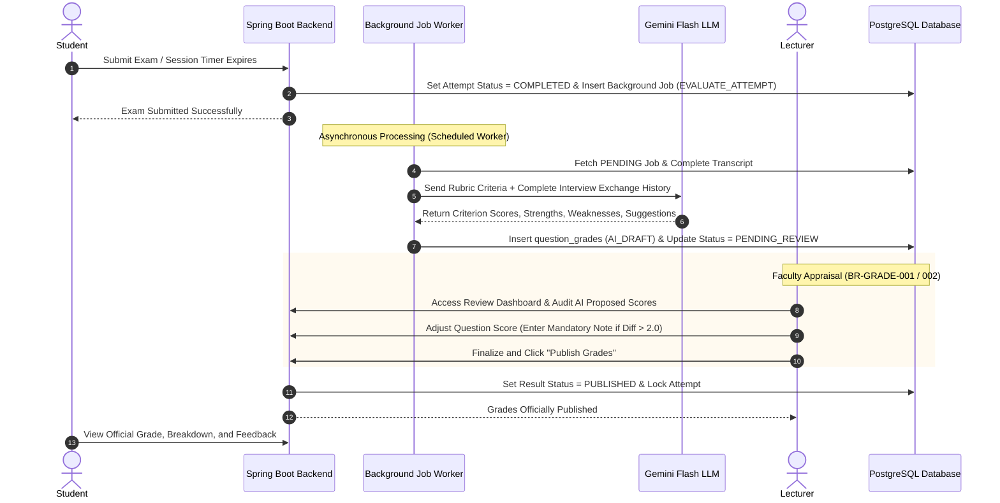

---

# 7. Static Modeling

## 7.1 Conceptual ERD & Domain Entities
The domain model captures 16 primary business entities mapped across 4 core operational subdomains:

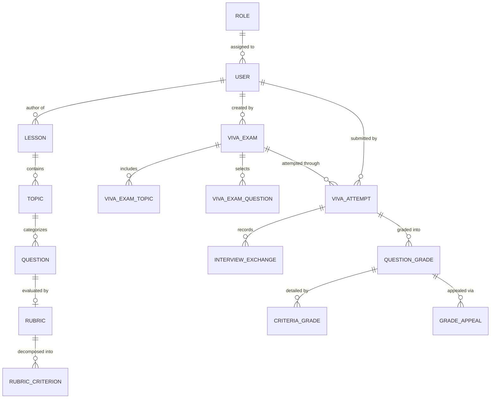

## 7.2 Class Diagram: Domain & Layered Architecture

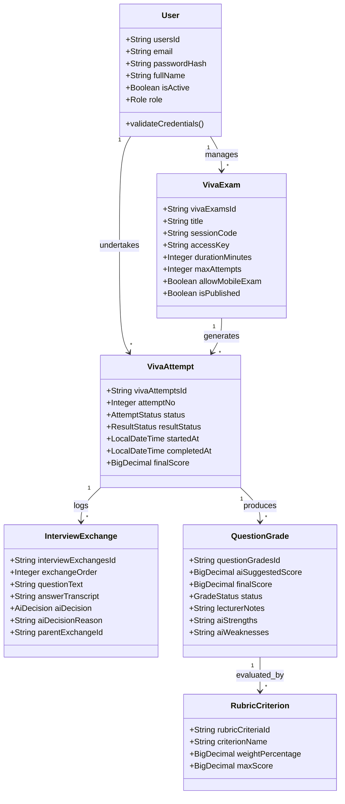

---

# 8. Database Design

## 8.1 Physical Database Diagram
The relational schema comprises **18 production tables** in PostgreSQL 14+, structured with standardized primary keys (`VARCHAR(20)`/`VARCHAR(30)`), foreign key constraints, explicit non-null invariants, and domain check constraints.

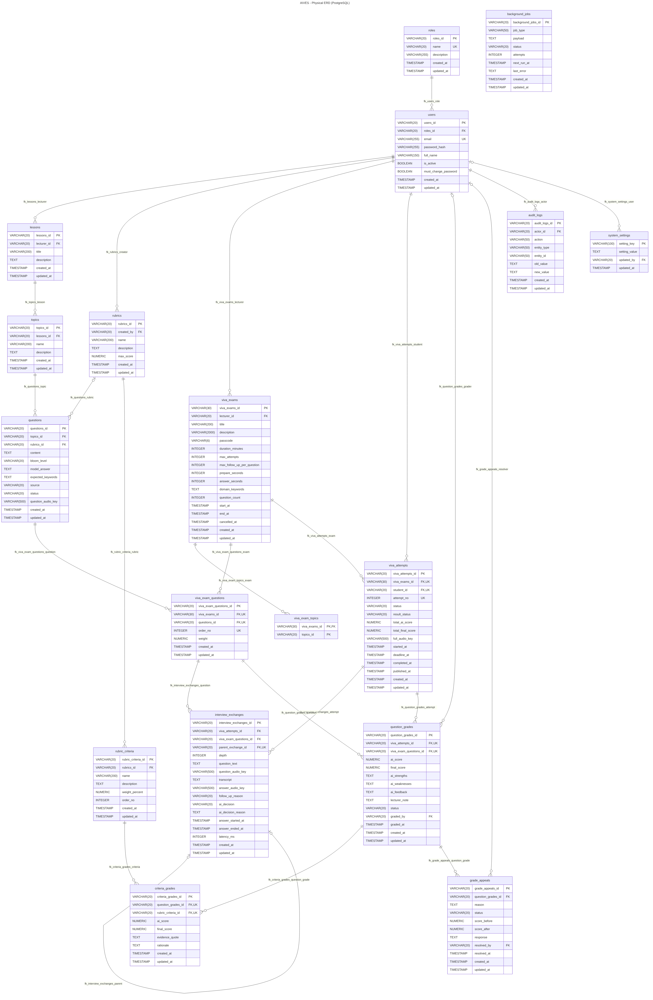

## 8.2 Data Dictionary (Core Production Tables)

### Table: `users`
Represents all system users with role-based access.

| Column Name | Data Type | Nullable | Constraints & Defaults | Description |
| :--- | :--- | :---: | :--- | :--- |
| `users_id` | `VARCHAR(20)` | No | PK | Formatted identifier (`ADxxxxxx`, `LExxxxxx`, `STxxxxxx`) |
| `roles_id` | `VARCHAR(20)` | No | FK ➔ `roles(roles_id)` | Role reference (`AD`, `LE`, `ST`) |
| `email` | `VARCHAR(255)` | No | UNIQUE | Institutional email address |
| `password_hash` | `VARCHAR(255)` | No | | BCrypt encrypted hash |
| `full_name` | `VARCHAR(150)` | No | | Full legal name |
| `is_active` | `BOOLEAN` | No | DEFAULT `TRUE` | Account active flag |
| `must_change_password` | `BOOLEAN` | No | DEFAULT `FALSE` | Forced password reset flag on first login |
| `created_at` | `TIMESTAMP(6)` | No | DEFAULT `LOCALTIMESTAMP`| Record creation timestamp |
| `updated_at` | `TIMESTAMP(6)` | No | DEFAULT `LOCALTIMESTAMP`| Last modification timestamp |

### Table: `viva_exams`
Configuration for an oral examination session.

| Column Name | Data Type | Nullable | Constraints & Defaults | Description |
| :--- | :--- | :---: | :--- | :--- |
| `viva_exams_id` | `VARCHAR(30)` | No | PK | Unique identifier (`EXAM-YYYYMMDD-XXXX`) |
| `created_by` | `VARCHAR(20)` | No | FK ➔ `users(users_id)` | Lecturer who created the exam |
| `title` | `VARCHAR(200)` | No | | Exam title |
| `session_code` | `VARCHAR(50)` | No | UNIQUE | Public session code |
| `access_key` | `VARCHAR(100)` | No | | Secret passkey required to join |
| `duration_minutes` | `INTEGER` | No | CHECK (`> 0`) | Allowed exam duration |
| `max_attempts` | `INTEGER` | No | DEFAULT `1` | Max allowed attempts per student |
| `allow_mobile_exam` | `BOOLEAN` | No | DEFAULT `FALSE` | Enable/disable mobile app participation |
| `is_published` | `BOOLEAN` | No | DEFAULT `FALSE` | Exam visibility status |

### Table: `viva_attempts`
Records an individual student's examination attempt.

| Column Name | Data Type | Nullable | Constraints & Defaults | Description |
| :--- | :--- | :---: | :--- | :--- |
| `viva_attempts_id` | `VARCHAR(20)` | No | PK | Identifier (`ATTxxxxxx`) |
| `viva_exams_id` | `VARCHAR(30)` | No | FK ➔ `viva_exams` | Associated exam session |
| `student_id` | `VARCHAR(20)` | No | FK ➔ `users(users_id)` | Student examinee identifier |
| `attempt_no` | `INTEGER` | No | DEFAULT `1` | Sequential attempt counter |
| `status` | `VARCHAR(20)` | No | CHECK in (`NOT_STARTED`, `IN_PROGRESS`, `COMPLETED`, `ABANDONED`) | Lifecycle state |
| `result_status` | `VARCHAR(20)` | No | CHECK in (`NONE`, `GRADING`, `PENDING_REVIEW`, `PUBLISHED`, `GRADING_FAILED`) | Grading state |
| `started_at` | `TIMESTAMP(6)` | Yes | | Exam commencement timestamp |
| `completed_at` | `TIMESTAMP(6)` | Yes | | Exam submission timestamp |
| `final_score` | `NUMERIC(5,2)` | Yes | CHECK (`0 <= score <= 10.00`)| Official final score |

### Table: `interview_exchanges`
Auditable turn-by-turn question and response transcripts.

| Column Name | Data Type | Nullable | Constraints & Defaults | Description |
| :--- | :--- | :---: | :--- | :--- |
| `interview_exchanges_id` | `VARCHAR(20)` | No | PK | Identifier (`EXCxxxxxx`) |
| `viva_attempts_id` | `VARCHAR(20)` | No | FK ➔ `viva_attempts` | Parent attempt reference |
| `parent_exchange_id` | `VARCHAR(20)` | Yes| FK ➔ `interview_exchanges`| References primary exchange if follow-up |
| `exchange_order` | `INTEGER` | No | | Sequential ordering within attempt |
| `question_text` | `TEXT` | No | | Question prompt spoken by AI |
| `answer_transcript` | `TEXT` | Yes | | Verbatim STT transcription of answer |
| `ai_decision` | `VARCHAR(20)` | Yes| CHECK in (`FOLLOW_UP`, `NEXT`, `SKIPPED`) | Real-time adaptive AI routing decision |
| `ai_decision_reason` | `TEXT` | Yes | | Explanation for asking follow-up |

---

# 9. Dynamic Modeling

## 9.1 Sequence Diagram: Real-Time Oral Exam Session with Adaptive AI Follow-up

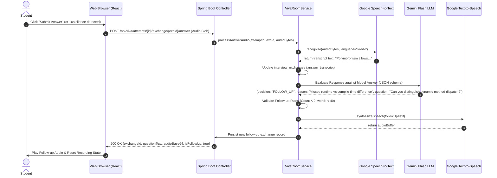

## 9.2 State Machine Diagram: Viva Attempt Lifecycle

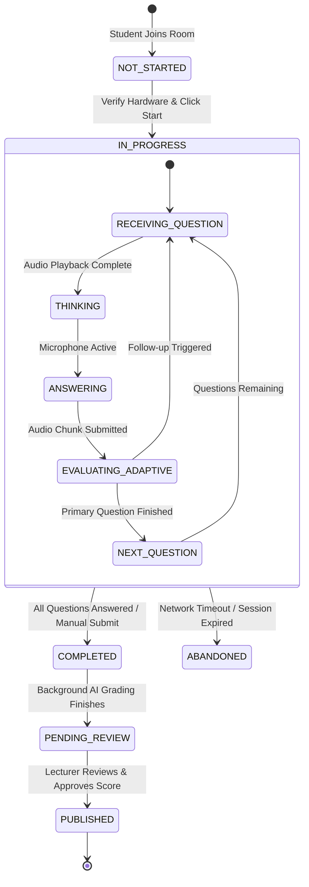

---

# 10. Product & User Interface

## 10.1 UI/UX Architecture
The AIVES frontend delivers an accessible, high-performance interface with clear role-specific layouts:
- **Responsive Layout**: Designed primarily for modern desktop browsers with fallback mobile responsiveness.
- **Audio Feedback**: Live visual wave animations indicating microphone activity and silence timeout warnings.
- **Side-by-Side Review Workspace**: For faculty members to view candidate video/audio recordings, verbatim transcripts, and AI suggestions simultaneously.

## 10.2 Core Screens Walkthrough

| Screen | Primary User | Core Capabilities |
| :--- | :--- | :--- |
| **Authentication & Profile** | All Users | JWT authentication, role routing, password reset, and first-time forced credential update. |
| **Question Bank & Rubric Editor** | Lecturer | Document uploader for RAG, Bloom-level question generator, weight allocator for criteria totaling 100%. |
| **Exam Setup & Scheduling** | Lecturer | Session configuration, access key generation, exam duration, attempt quota, and mobile permission toggle. |
| **Virtual Viva Examination Room** | Student | Audio diagnostics, countdown timer, question synthesizer, real-time voice recording, and progress tracker. |
| **Faculty Appraisal Dashboard (HITL)** | Lecturer | Full transcript inspection, audio playback, AI criteria breakdown, score adjustment with audit notes, and one-click publishing. |
| **Student Score Portal & Appeals** | Student | Breakdown of verified criteria scores, teacher comments, and grade appeal submission form. |

## 10.3 CRUD Demonstration & API Verification
The backend includes a verified REST API and CRUD demonstration suite (`/api/demo/crud`) validating:
- Entity creation, retrieval, updates, and soft deletes across `users`, `lessons`, `questions`, and `viva_exams`.
- Integration test results proving database transaction isolation and OpenAPI compliance.

---

# 11. Test Cases

## 11.1 Test Strategy
Testing follows a standard pyramid structure comprising:
- **Unit Tests**: Business rule verifications (criteria weight totaling 100%, silence timeout limit, score deviation check).
- **Integration Tests**: Spring Boot `@SpringBootTest` testing REST controllers, JPA persistence, and database constraint triggers.
- **End-to-End Tests**: Simulated full oral exam sessions validating STT, LLM JSON schema outputs, and TTS playback.

## 11.2 Core Functional Test Suite

| Test ID | Test Scenario | Preconditions | Execution Steps | Expected Result | Status |
| :---: | :--- | :--- | :--- | :--- | :---: |
| **TC-AUTH-01** | Standard Student Login | Active account exists in `users` | 1. Enter email and password<br>2. Send POST `/api/auth/login` | Returns 200 OK with valid JWT bearer token and `STUDENT` role | **PASSED** |
| **TC-AUTH-02** | Prevent Unauthorized Role Access | Student token obtained | 1. Attempt GET `/api/admin/users`<br>2. Inspect HTTP status | Returns 403 Forbidden with standard error body | **PASSED** |
| **TC-BANK-01** | Rubric Criteria Weight Validation | Topic exists | 1. Create rubric with criteria weights totaling 90%<br>2. Submit to POST `/api/rubrics` | Returns 400 Bad Request (`INVALID_RUBRIC_WEIGHT_SUM`) | **PASSED** |
| **TC-VIVA-01** | Enforce Max Attempts Limit | Attempt 1 marked `COMPLETED` | 1. Student attempts to start second attempt when `max_attempts = 1` | Returns 409 Conflict (`MAX_ATTEMPTS_EXCEEDED`) | **PASSED** |
| **TC-VIVA-02** | Silence Detection Auto-Submit | Exam `IN_PROGRESS` | 1. Open microphone<br>2. Remain silent for 10 consecutive seconds | Frontend automatically locks recording and sends audio buffer to server | **PASSED** |
| **TC-VIVA-03** | Adaptive Follow-Up Questioning | Vague student answer provided | 1. Submit partial answer<br>2. Backend invokes Gemini LLM | Backend creates child exchange with `parent_exchange_id` and plays follow-up audio | **PASSED** |
| **TC-GRADE-01**| Mandatory Justification for Score Override | Score deviation > 2.0 | 1. Lecturer overrides AI score from 6.0 to 9.0 without entering note | Returns 400 Bad Request (`NOTE_REQUIRED_FOR_LARGE_DEVIATION`) | **PASSED** |
| **TC-GRADE-02**| Prevent Student Viewing Unpublished Scores | Result status = `PENDING_REVIEW` | 1. Student requests GET `/api/attempts/{id}/result` | Returns 403 Forbidden (`RESULT_NOT_PUBLISHED`) | **PASSED** |

---

# 12. Conclusion

## 12.1 Summary of Architecture & Design Accomplishments
The AIVES architecture bridges advanced artificial intelligence with rigorous academic evaluation standards:
- **Pragmatic Architecture**: A layered modular monolith backed by PostgreSQL and Spring Boot ensures high developer productivity, rapid deployment, and minimal operational overhead.
- **Pedagogical Alignment**: Embedding Bloom's cognitive taxonomy and multi-criteria rubrics into AI prompts guarantees structured and objective assessments.
- **Ethical AI Governance**: The Human-in-the-Loop design preserves faculty authority while eliminating repetitive manual interviewing.

## 12.2 Known Limitations & Engineering Trade-offs
- **Network Dependency**: Real-time voice interaction requires a stable internet connection for low-latency STT and TTS streaming.
- **Language Nuances**: Speech recognition in noisy environments or with heavy regional accents may occasionally require transcription confirmation.
- **Monolithic Cloud Calls**: Synchronous LLM calls during real-time follow-ups introduce a 1.0–2.0 second turnaround time.

## 12.3 Future Work & Roadmap
- **Edge AI & WebAssembly Speech Processing**: Moving preliminary voice activity detection (VAD) and noise filtering to client devices to reduce cloud bandwidth.
- **Multimodal Visual Proctoring**: Adding browser tab locking and optional webcam gaze analysis to verify candidate focus during viva examinations.
- **Automated Audio Diarization**: Supporting multi-speaker panel examinations with multiple candidates evaluated in the same session.

---

# 13. AI Appendix (Phụ lục sử dụng AI)

## 13.1 Enterprise Vertex AI Managed RAG Architecture
AIVES adopts an enterprise **Retrieval-Augmented Generation (RAG)** architecture deployed on **Google Cloud Platform (Vertex AI Managed RAG Platform, Region: `asia-southeast1`)** to ensure all LLM reasoning is strictly grounded on official course slides and syllabus materials uploaded by faculty, eliminating hallucinations in high-stakes viva assessments.

### Architecture Evolution: From Static API Key to Managed RAG

```
[Legacy Architecture - Deprecated]
Frontend / Client ---> Backend Server ---> Google AI Studio (Gemini API via Static API Key)
                      │
                      └── (Lacks Grounding, high hallucination risk, static secret exposure)

[Target Enterprise Architecture]
Frontend (Admin/SV) ---> Backend Server (Spring Boot 3)
                        │
                        ├── 1. Upload & Ingest ─────────> Google Cloud Storage (Bucket)
                        │                                  │ (Raw PPTX / PDF)
                        │                                  ▼
                        ├── 2. Index / Sync ────────────> Vertex AI RAG Engine (Cloud Spanner Vector DB)
                        │                                  │ (Semantic Search Top-5 Chunks)
                        │                                  ▼
                        └── 3. Grounded Inference ──────> Vertex AI Foundation Model (Gemini 1.5 Flash)
[Google Cloud IAM Service Account Authorization - Zero Trust (roles/aiplatform.user, roles/storage.objectAdmin)]
```

### Dual-Pipeline Operational Workflow

#### Pipeline 1: Document Ingestion & Indexing Pipeline (Preparation Phase)
1. **Slide Upload**: Lecturers upload course slides (PPTX, PDF) via Web Portal.
2. **Object Storage**: Backend streams files directly to Google Cloud Storage (GCS) organized by Course/Subject namespace.
3. **Managed Ingestion**: Backend triggers Vertex AI RAG Engine ingestion API.
4. **Parsing & Chunking**: Vertex AI parser segments documents into chunks (Size: 1024 tokens, Overlap: 256 tokens).
5. **Vector Embedding**: Text chunks are embedded using `text-multilingual-embedding-002` (optimized for Vietnamese and English technical terminology) and persisted in RagManaged Cloud Spanner.

#### Pipeline 2: Grounded Inference & Viva Evaluation Pipeline (Exam & Scoring Phase)
1. **Audio Transcription**: Student spoken response is converted to text via Google Cloud STT (`vi-VN`).
2. **Semantic Retrieval**: Backend issues a retrieval query to the Course RAG Corpus (`similarityTopK: 5`).
3. **Grounded Prompt Assembly**: Top-5 retrieved slide chunks are injected alongside the rubric, candidate transcript, and conversation history into a structured prompt.
4. **Constrained Inference**: Gemini 1.5 Flash performs grounded reasoning with low temperature (`0.2`), generating adaptive follow-ups or rubric grades backed by verifiable citations (`groundingMetadata`).

```
+----------------------------------------------------------------------------------+
|                     Vertex AI Grounded Prompt Pipeline                           |
+----------------------------------------------------------------------------------+
| 1. System Role Definition: "You are an academic viva proctor. Ground responses    |
|    exclusively on the provided course lecture context."                          |
| 2. Grounded Lecture Context: Top-5 semantic chunks retrieved from RAG Corpus      |
| 3. Candidate Context: Previous question, verbatim answer transcript              |
| 4. Evaluation Rubric: Criteria definitions, weight percentages, scoring standards|
| 5. Output Constraint: Strict JSON Schema (Enforced by Vertex AI SDK)             |
+----------------------------------------------------------------------------------+
```

### Security & IAM Identity Model
- **No Static API Keys**: The system completely eliminates static API keys (`GEMINI_API_KEY`).
- **Least-Privilege Service Account**: The backend operates under a dedicated Google Cloud IAM Service Account granted only two minimal operational roles:
  - `roles/aiplatform.user`: Execute RAG corpus queries and foundation model inference.
  - `roles/storage.objectAdmin`: Upload and read course material slides in the dedicated storage bucket.
- **Environment Federation**: In production, authentication uses Google Cloud Workload Identity Federation; in development environments, local service account credentials are provided securely via `GOOGLE_APPLICATION_CREDENTIALS`.

## 13.2 Structured JSON Output Schemas

### Adaptive Follow-Up Questioning Schema
```json
{
  "type": "OBJECT",
  "properties": {
    "decision": {
      "type": "STRING",
      "enum": ["FOLLOW_UP", "NEXT", "SKIPPED"]
    },
    "reason": {
      "type": "STRING",
      "description": "Justification explaining why follow-up probing is required"
    },
    "followUpQuestion": {
      "type": "STRING",
      "description": "Concise follow-up question under 40 words"
    }
  },
  "required": ["decision", "reason"]
}
```

### Rubric-Based Scoring Suggestion Schema
```json
{
  "type": "OBJECT",
  "properties": {
    "criteriaScores": {
      "type": "ARRAY",
      "items": {
        "properties": {
          "criterionId": { "type": "STRING" },
          "awardedScore": { "type": "NUMBER" },
          "evidenceCitation": { "type": "STRING" }
        },
        "required": ["criterionId", "awardedScore", "evidenceCitation"]
      }
    },
    "strengths": { "type": "STRING" },
    "weaknesses": { "type": "STRING" },
    "suggestedTotalScore": { "type": "NUMBER" }
  },
  "required": ["criteriaScores", "strengths", "weaknesses", "suggestedTotalScore"]
}
```

## 13.3 Speech Processing (STT / TTS) Integration
- **Google Cloud Speech-to-Text (v2)**: Configured with `recognition_metadata` set to `ACADEMIC_VOICE`, language set to `vi-VN` (and fallback `en-US`), using word-level confidence scores and domain phrase hints to accurately transcribe software engineering terms (e.g., "Polymorphism", "PostgreSQL", "Encapsulation").
- **Google Cloud Text-to-Speech**: Utilizing neural WaveNet voices (`vi-VN-Wavenet-B`) with speaking rate configured at 0.95x for clear, articulate speech delivery.

## 13.4 Human-in-the-Loop (HITL) Safety & Responsible AI Governance
AIVES adheres strictly to responsible AI principles:
- **No Autonomous Final Grading**: AI outputs are strictly tagged as `AI_DRAFT` and cannot be published to students until explicitly validated by a lecturer.
- **Auditability**: Every score adjustment deviating by more than 2.0 points from AI suggestions requires mandatory justification notes stored permanently in `question_grades.lecturer_notes`.
- **Right to Appeal**: Students possess a transparent appeal channel to request secondary human review on any evaluated viva response.
