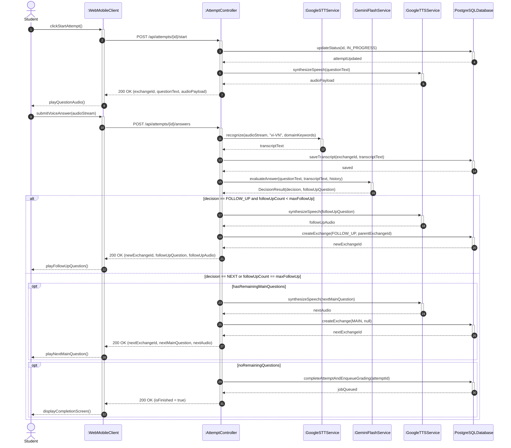
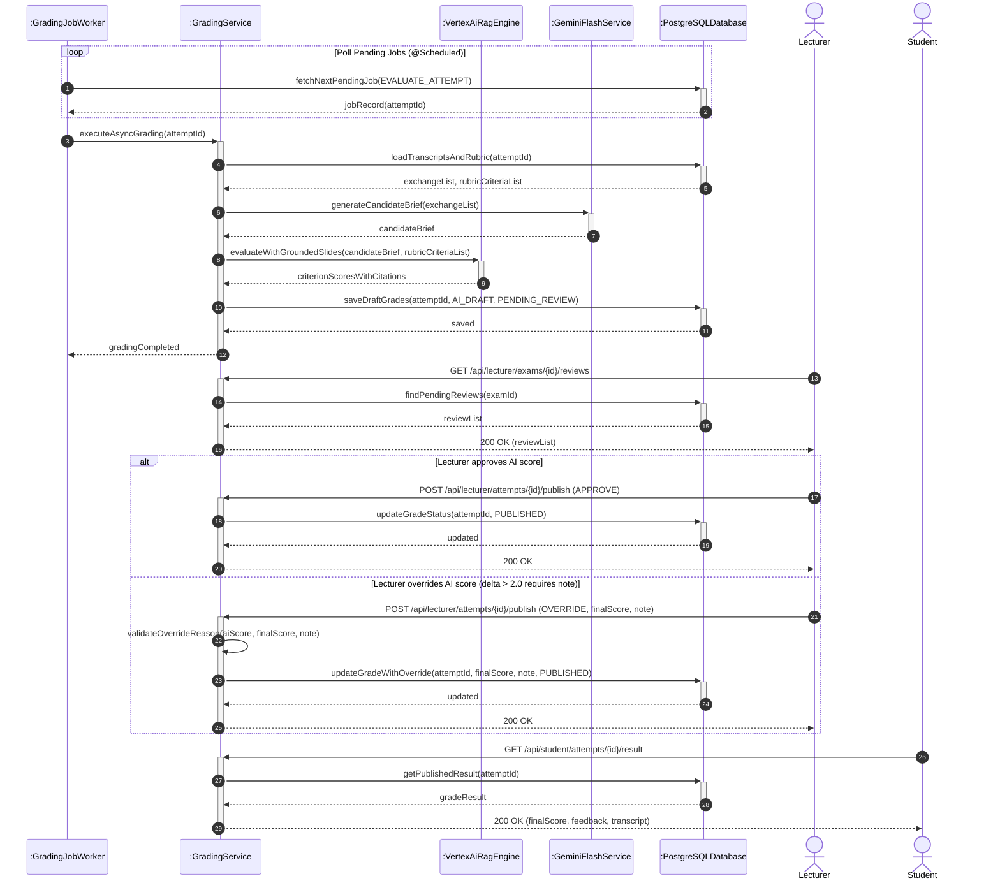
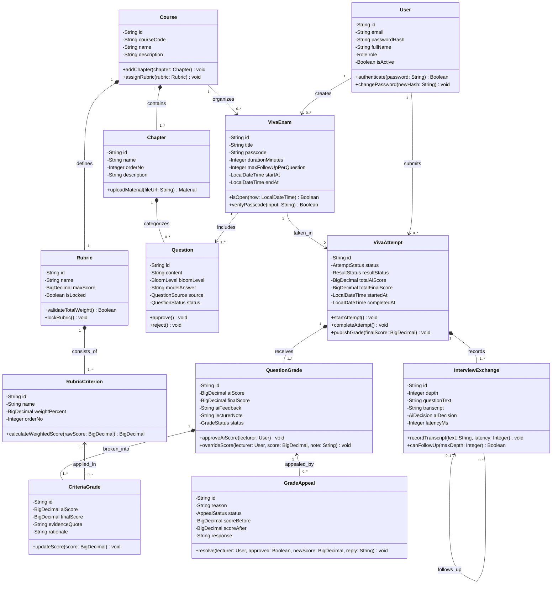

# Giải Pháp Chuẩn Hóa Sơ Đồ UML & Database Trên Draw.io Bằng AI (AIVES Project)

Tài liệu này tổng hợp quy trình chọn định dạng code tối ưu khi import vào draw.io, bộ **System Prompt chuẩn học thuật UML 2.5** (không màu mè, không emoji, đúng ký hiệu Visual Paradigm / GeeksforGeeks / Draw.io), và mã nguồn đã được chuẩn hóa lại từ các file `.mmd` của dự án **AIVES (SWD392)**.

## 1. Ma Trận Chọn Định Dạng Code Cho Từng Loại Diagram Trên Draw.io

Không nên dùng Mermaid (`.mmd`) cho mọi loại sơ đồ vì trình biên dịch Mermaid sang native shape của draw.io không hỗ trợ tốt Swimlane, tự động đổ màu pastel khi có `classDef`, và làm vỡ bố cục với các sơ đồ lớn. Hãy phân loại theo bảng sau:

| Loại Sơ Đồ (Diagram)            | Định Dạng Code Khuyên Dùng                           | Đường Dẫn Chèn Trong Draw.io                                    | Lý Do Kỹ Thuật                                                                                                                                                                                                                        |
| :------------------------------ | :--------------------------------------------------- | :-------------------------------------------------------------- | :------------------------------------------------------------------------------------------------------------------------------------------------------------------------------------------------------------------------------------ |
| **Activity Diagram (Swimlane)** | **mxGraphModel XML** (`.drawio`)                     | `Extras` > `Edit Diagram` (Dán đè XML)                          | Mermaid không có khái niệm Swimlane chuẩn UML. Xuất thẳng XML giúp tạo đúng khung `shape=pool`, các cột `shape=swimlane`, nút Start/End, hình thoi rẽ nhánh và đường vuông góc đen trắng giống hệt ảnh `4fb`.                         |
| **Sequence Diagram**            | **Mermaid Monochrome** (hoặc **PlantUML**)           | `Arrange` > `Insert` > `Mermaid` (hoặc `Advanced` > `PlantUML`) | Khi bỏ hoàn toàn `rect rgb(...)`, emoji và `themeVariables`, thêm `autonumber` + `activate`/`deactivate`, draw.io sẽ sinh ra các Lifeline, thanh Focus of Control (Activation bar) và khung `alt`/`opt`/`loop` chuẩn Visual Paradigm. |
| **Class Diagram**               | **Draw.io CSV Script** (hoặc **Mermaid Monochrome**) | `Arrange` > `Insert` > `Advanced` > `CSV`                       | CSV Script (`# list: attributes`, `# list: methods`) tạo ra đúng khối UML 2.5 Class 3 ngăn (Tên in đậm, Thuộc tính, Phương thức) và tự động dàn trang (`# layout: verticalflow`).                                                     |
| **Physical ERD (Database)**     | **SQL DDL** (`CREATE TABLE`)                         | `Arrange` > `Insert` > `Advanced` > `SQL`                       | Tạo trực tiếp các bảng Entity chuẩn Database trong draw.io chỉ trong 1 giây, sạch đẹp hơn rất nhiều so với `erDiagram` của Mermaid.                                                                                                   |

## 2. System Prompt "Kỷ Luật Thép" Cho AI / Agent Khi Sinh Diagram

Hãy copy đoạn System Prompt dưới đây đưa vào Agent (hoặc lưu thành Rule/Skill) mỗi khi yêu cầu sinh sơ đồ thiết kế hệ thống:

```markdown
# ROLE: Academic UML 2.5 & Software Architecture Diagram Generator for draw.io

Khi được yêu cầu tạo sơ đồ cho báo cáo kỹ thuật phần mềm (như SWD392), bạn PHẢI tuân thủ nghiêm ngặt các quy tắc chuẩn UML 2.5 sau đây:

1. **TUYỆT ĐỐI KHÔNG DÙNG EMOJI & ICON**: Cấm chèn bất kỳ emoji nào (như 👨‍🎓, ⚙️, 🧠, 🗄️, 📚) vào tên Actor, Participant, Class, hay nhãn bước.
2. **PHONG CÁCH ĐƠN SẮC HỌC THUẬT (MONOCHROME ACADEMIC)**:
   - Cấm dùng `%%{init: {'themeVariables': ...}}%%` với các bảng màu tím, hồng, xanh, vàng.
   - Cấm dùng `classDef` tô màu lòe loẹt trong Flowchart/Class Diagram.
   - Cấm dùng `rect rgb(...)` để tô nền các cụm trong Sequence Diagram.
   - Chỉ sử dụng nền trắng (`#FFFFFF`), viền đen (`#000000`), chữ đen (`#000000`) hoặc xám nhạt (`#F5F5F5`) cho thanh tiêu đề Swimlane.
3. **CHỌN ĐÚNG ĐỊNH DẠNG CODE THEO LOẠI SƠ ĐỒ**:
   - **Với Activity Diagram có phân luồng tác nhân (Swimlane)**: KHÔNG dùng `flowchart TD` với `subgraph` của Mermaid. Hãy xuất trực tiếp mã **draw.io XML (`<mxGraphModel>`)** sử dụng `shape=pool` và các cột `shape=swimlane` dọc, nối bằng đường gấp khúc vuông góc (`edgeStyle=orthogonalEdgeStyle;rounded=0;`).
   - **Với Sequence Diagram (Mermaid)**:
     - Đặt tên đối tượng theo chuẩn UML: `actor SV as Student` hoặc `participant BE as :AttemptController`.
     - Bắt buộc bật `autonumber`.
     - Bắt buộc dùng `+` / `-` (hoặc `activate` / `deactivate`) để hiển thị thanh kích hoạt (Focus of Control / Activation Bar) trên Lifeline.
     - Phân biệt rõ mũi tên gọi đồng bộ (`->>`) và mũi tên trả về đứt nét (`-->>`).
     - Chỉ dùng Combined Fragments chuẩn UML (`alt`, `opt`, `loop`, `par`, `break`), hạn chế tối đa `Note over` dài dòng.
   - **Với Class Diagram (Mermaid hoặc Draw.io CSV)**:
     - Mỗi Class phải có đủ 3 ngăn: Tên Class, Attributes (`-id: String`), và Methods/Operations (`+startAttempt(): VivaAttempt`).
     - Không lặp lại các thuộc tính đã được biểu diễn bằng đường quan hệ (Association/Composition) làm rác hộp Class, hoặc phải đồng nhất với chuẩn của giảng viên.
     - Sử dụng đúng ký hiệu Visibility: `-` (private), `+` (public), `#` (protected), `~` (package).
     - Sử dụng đúng mũi tên quan hệ: `<|--` (Inheritance), `<|..` (Realization), `*--` (Composition), `o--` (Aggregation), `-->` (Directed Association), `..>` (Dependency).
   - **Với Physical ERD**: Xuất kèm mã **SQL DDL (`CREATE TABLE`)** tối giản để người dùng chèn qua `Arrange > Insert > Advanced > SQL` trên draw.io.
```

## 3. Code Mẫu Đã Chuẩn Hóa Cho Dự Án AIVES (Copy & Chèn Ngay Vào Draw.io)

### 3.1. Activity Diagram (Swimlane WF3 - AI Scoring & Lecturer Review) — Định dạng Draw.io XML

_Cách dùng trên draw.io_: Mở một trang trắng trên draw.io -> Chọn menu **Extras > Edit Diagram...** -> Xóa nội dung cũ, dán toàn bộ đoạn XML dưới đây vào và bấm **Apply**. Bạn sẽ nhận được ngay sơ đồ Swimlane đen-trắng chuẩn xác như bản chỉnh tay `4fb` mà không tốn công kéo thả:

```xml
<mxGraphModel dx="1200" dy="800" grid="1" gridSize="10" guides="1" tooltips="1" connect="1" arrows="1" fold="1" page="1" pageScale="1" pageWidth="1169" pageHeight="827" math="0" shadow="0">
  <root>
    <mxCell id="0" />
    <mxCell id="1" parent="0" />
    <!-- Pool Header -->
    <mxCell id="pool" value="WF3 - AI Scoring &amp; Lecturer Review" style="swimlane;html=1;childLayout=stackLayout;resizeParent=1;resizeParentMax=0;horizontal=1;startSize=30;horizontalStack=1;whiteSpace=wrap;fillColor=#ffffff;strokeColor=#000000;fontStyle=1;fontSize=13;" vertex="1" parent="1">
      <mxGeometry x="40" y="40" width="960" height="680" as="geometry" />
    </mxCell>
    <!-- Lane 1: AIVES System (Worker) -->
    <mxCell id="lane1" value="AIVES System (Worker)" style="swimlane;html=1;startSize=30;horizontal=1;fillColor=#f5f5f5;strokeColor=#000000;fontStyle=1;fontSize=12;" vertex="1" parent="pool">
      <mxGeometry x="0" y="30" width="240" height="650" as="geometry" />
    </mxCell>
    <mxCell id="start" value="" style="ellipse;html=1;shape=startState;fillColor=#000000;strokeColor=#000000;" vertex="1" parent="lane1">
      <mxGeometry x="105" y="50" width="30" height="30" as="geometry" />
    </mxCell>
    <mxCell id="act_queue" value="Queue grading job" style="rounded=1;whiteSpace=wrap;html=1;arcSize=20;fillColor=#ffffff;strokeColor=#000000;fontSize=12;" vertex="1" parent="lane1">
      <mxGeometry x="45" y="110" width="150" height="50" as="geometry" />
    </mxCell>
    <mxCell id="act_load" value="Load transcript + rubric" style="rounded=1;whiteSpace=wrap;html=1;arcSize=20;fillColor=#ffffff;strokeColor=#000000;fontSize=12;" vertex="1" parent="lane1">
      <mxGeometry x="45" y="190" width="150" height="50" as="geometry" />
    </mxCell>
    <mxCell id="act_save_draft" value="Save score as AI_DRAFT" style="rounded=1;whiteSpace=wrap;html=1;arcSize=20;fillColor=#ffffff;strokeColor=#000000;fontSize=12;" vertex="1" parent="lane1">
      <mxGeometry x="45" y="340" width="150" height="50" as="geometry" />
    </mxCell>
    <mxCell id="act_publish" value="Publish official score" style="rounded=1;whiteSpace=wrap;html=1;arcSize=20;fillColor=#ffffff;strokeColor=#000000;fontSize=12;" vertex="1" parent="lane1">
      <mxGeometry x="45" y="560" width="150" height="50" as="geometry" />
    </mxCell>
    <mxCell id="e1" style="edgeStyle=orthogonalEdgeStyle;rounded=0;orthogonalLoop=1;jettySize=auto;html=1;strokeColor=#000000;endArrow=block;endFill=1;" edge="1" parent="lane1" source="start" target="act_queue">
      <mxGeometry relative="1" as="geometry" />
    </mxCell>
    <mxCell id="e2" style="edgeStyle=orthogonalEdgeStyle;rounded=0;orthogonalLoop=1;jettySize=auto;html=1;strokeColor=#000000;endArrow=block;endFill=1;" edge="1" parent="lane1" source="act_queue" target="act_load">
      <mxGeometry relative="1" as="geometry" />
    </mxCell>

    <!-- Lane 2: AI LLM & RAG -->
    <mxCell id="lane2" value="AI LLM" style="swimlane;html=1;startSize=30;horizontal=1;fillColor=#f5f5f5;strokeColor=#000000;fontStyle=1;fontSize=12;" vertex="1" parent="pool">
      <mxGeometry x="240" y="30" width="240" height="650" as="geometry" />
    </mxCell>
    <mxCell id="act_score" value="Score each rubric criterion" style="rounded=1;whiteSpace=wrap;html=1;arcSize=20;fillColor=#ffffff;strokeColor=#000000;fontSize=12;" vertex="1" parent="lane2">
      <mxGeometry x="45" y="190" width="150" height="50" as="geometry" />
    </mxCell>
    <mxCell id="act_write_fb" value="Write strengths / weaknesses" style="rounded=1;whiteSpace=wrap;html=1;arcSize=20;fillColor=#ffffff;strokeColor=#000000;fontSize=12;" vertex="1" parent="lane2">
      <mxGeometry x="45" y="265" width="150" height="50" as="geometry" />
    </mxCell>
    <mxCell id="e4" style="edgeStyle=orthogonalEdgeStyle;rounded=0;orthogonalLoop=1;jettySize=auto;html=1;strokeColor=#000000;endArrow=block;endFill=1;" edge="1" parent="lane2" source="act_score" target="act_write_fb">
      <mxGeometry relative="1" as="geometry" />
    </mxCell>

    <!-- Lane 3: Lecturer -->
    <mxCell id="lane3" value="Lecturer" style="swimlane;html=1;startSize=30;horizontal=1;fillColor=#f5f5f5;strokeColor=#000000;fontStyle=1;fontSize=12;" vertex="1" parent="pool">
      <mxGeometry x="480" y="30" width="240" height="650" as="geometry" />
    </mxCell>
    <mxCell id="act_review" value="Review transcript and AI score" style="rounded=1;whiteSpace=wrap;html=1;arcSize=20;fillColor=#ffffff;strokeColor=#000000;fontSize=12;" vertex="1" parent="lane3">
      <mxGeometry x="45" y="340" width="150" height="50" as="geometry" />
    </mxCell>
    <mxCell id="dec_agree" value="Agree with AI?" style="rhombus;whiteSpace=wrap;html=1;fillColor=#ffffff;strokeColor=#000000;fontSize=11;" vertex="1" parent="lane3">
      <mxGeometry x="65" y="415" width="110" height="65" as="geometry" />
    </mxCell>
    <mxCell id="act_adjust" value="Adjust score, write reason" style="rounded=1;whiteSpace=wrap;html=1;arcSize=20;fillColor=#ffffff;strokeColor=#000000;fontSize=12;" vertex="1" parent="lane3">
      <mxGeometry x="45" y="510" width="150" height="50" as="geometry" />
    </mxCell>
    <mxCell id="act_review_appeal" value="Review feedback &amp; appeal" style="rounded=1;whiteSpace=wrap;html=1;arcSize=20;fillColor=#ffffff;strokeColor=#000000;fontSize=12;" vertex="1" parent="lane3">
      <mxGeometry x="45" y="185" width="150" height="50" as="geometry" />
    </mxCell>
    <mxCell id="e7" style="edgeStyle=orthogonalEdgeStyle;rounded=0;orthogonalLoop=1;jettySize=auto;html=1;strokeColor=#000000;endArrow=block;endFill=1;" edge="1" parent="lane3" source="act_review" target="dec_agree">
      <mxGeometry relative="1" as="geometry" />
    </mxCell>
    <mxCell id="e8" value="no" style="edgeStyle=orthogonalEdgeStyle;rounded=0;orthogonalLoop=1;jettySize=auto;html=1;strokeColor=#000000;endArrow=block;endFill=1;" edge="1" parent="lane3" source="dec_agree" target="act_adjust">
      <mxGeometry relative="1" as="geometry" />
    </mxCell>

    <!-- Lane 4: Student -->
    <mxCell id="lane4" value="Student" style="swimlane;html=1;startSize=30;horizontal=1;fillColor=#f5f5f5;strokeColor=#000000;fontStyle=1;fontSize=12;" vertex="1" parent="pool">
      <mxGeometry x="720" y="30" width="240" height="650" as="geometry" />
    </mxCell>
    <mxCell id="act_view_score" value="View official score &amp; feedback" style="rounded=1;whiteSpace=wrap;html=1;arcSize=20;fillColor=#ffffff;strokeColor=#000000;fontSize=12;" vertex="1" parent="lane4">
      <mxGeometry x="45" y="560" width="150" height="50" as="geometry" />
    </mxCell>
    <mxCell id="dec_appeal" value="Appeal?" style="rhombus;whiteSpace=wrap;html=1;fillColor=#ffffff;strokeColor=#000000;fontSize=11;" vertex="1" parent="lane4">
      <mxGeometry x="65" y="455" width="110" height="65" as="geometry" />
    </mxCell>
    <mxCell id="end" value="" style="ellipse;html=1;shape=endState;fillColor=#000000;strokeColor=#000000;" vertex="1" parent="lane4">
      <mxGeometry x="105" y="365" width="30" height="30" as="geometry" />
    </mxCell>
    <mxCell id="e11" style="edgeStyle=orthogonalEdgeStyle;rounded=0;orthogonalLoop=1;jettySize=auto;html=1;strokeColor=#000000;endArrow=block;endFill=1;" edge="1" parent="lane4" source="act_view_score" target="dec_appeal">
      <mxGeometry relative="1" as="geometry" />
    </mxCell>
    <mxCell id="e12" value="no" style="edgeStyle=orthogonalEdgeStyle;rounded=0;orthogonalLoop=1;jettySize=auto;html=1;strokeColor=#000000;endArrow=block;endFill=1;" edge="1" parent="lane4" source="dec_appeal" target="end">
      <mxGeometry relative="1" as="geometry" />
    </mxCell>

    <!-- Cross-lane connectors -->
    <mxCell id="e3" style="edgeStyle=orthogonalEdgeStyle;rounded=0;orthogonalLoop=1;jettySize=auto;html=1;strokeColor=#000000;endArrow=block;endFill=1;" edge="1" parent="pool" source="act_load" target="act_score">
      <mxGeometry relative="1" as="geometry" />
    </mxCell>
    <mxCell id="e5" style="edgeStyle=orthogonalEdgeStyle;rounded=0;orthogonalLoop=1;jettySize=auto;html=1;strokeColor=#000000;endArrow=block;endFill=1;" edge="1" parent="pool" source="act_write_fb" target="act_save_draft">
      <mxGeometry relative="1" as="geometry" />
    </mxCell>
    <mxCell id="e6" style="edgeStyle=orthogonalEdgeStyle;rounded=0;orthogonalLoop=1;jettySize=auto;html=1;strokeColor=#000000;endArrow=block;endFill=1;" edge="1" parent="pool" source="act_save_draft" target="act_review">
      <mxGeometry relative="1" as="geometry" />
    </mxCell>
    <mxCell id="e9" value="yes" style="edgeStyle=orthogonalEdgeStyle;rounded=0;orthogonalLoop=1;jettySize=auto;html=1;strokeColor=#000000;endArrow=block;endFill=1;exitX=0;exitY=0.5;exitDx=0;exitDy=0;" edge="1" parent="pool" source="dec_agree" target="act_publish">
      <mxGeometry relative="1" as="geometry" />
    </mxCell>
    <mxCell id="e10" style="edgeStyle=orthogonalEdgeStyle;rounded=0;orthogonalLoop=1;jettySize=auto;html=1;strokeColor=#000000;endArrow=block;endFill=1;" edge="1" parent="pool" source="act_adjust" target="act_publish">
      <mxGeometry relative="1" as="geometry" />
    </mxCell>
    <mxCell id="e13" style="edgeStyle=orthogonalEdgeStyle;rounded=0;orthogonalLoop=1;jettySize=auto;html=1;strokeColor=#000000;endArrow=block;endFill=1;" edge="1" parent="pool" source="act_publish" target="act_view_score">
      <mxGeometry relative="1" as="geometry" />
    </mxCell>
    <mxCell id="e14" value="yes" style="edgeStyle=orthogonalEdgeStyle;rounded=0;orthogonalLoop=1;jettySize=auto;html=1;strokeColor=#000000;endArrow=block;endFill=1;" edge="1" parent="pool" source="dec_appeal" target="act_review_appeal">
      <mxGeometry relative="1" as="geometry" />
    </mxCell>
    <mxCell id="e15" style="edgeStyle=orthogonalEdgeStyle;rounded=0;orthogonalLoop=1;jettySize=auto;html=1;strokeColor=#000000;endArrow=block;endFill=1;" edge="1" parent="pool" source="act_review_appeal" target="act_adjust">
      <mxGeometry relative="1" as="geometry" />
    </mxCell>
  </root>
</mxGraphModel>
```

### 3.2. Sequence Diagram Đã Chuẩn Hóa (`live-adaptive-viva-sequence.mmd`)

_Đã loại bỏ_: Toàn bộ emoji, khối `rect rgb(...)` tô nền vàng/xanh, và `themeVariables` màu tím.
_Đã bổ sung_: Ký hiệu `:ClassName` chuẩn UML, thanh kích hoạt `activate`/`deactivate` (`+`/`-`) trên Lifeline theo đúng tài liệu Visual Paradigm mà giảng viên gửi.
_Cách dùng_: Chọn **Arrange > Insert > Mermaid** trên draw.io và dán đoạn mã sau:



### 3.3. Sequence Diagram Chấm Điểm Ngầm & HITL (`scoring-hitl-review-sequence.mmd`)

_Cách dùng_: Chọn **Arrange > Insert > Mermaid** trên draw.io:



### 3.4. Class Diagram Chuẩn 3 Ngăn UML 2.5 (Bổ sung đầy đủ Methods & Private Visibility)

Trong file `class-diagram.mmd` cũ của bạn, tất cả các thuộc tính đều để `+` (public) và **không có bất kỳ phương thức (method) nào**, khiến mỗi class chỉ có 2 ngăn thay vì 3 ngăn như tài liệu GeeksforGeeks & Draw.io mà giảng viên gửi. Dưới đây là bản Mermaid đã chuẩn hóa đủ 3 ngăn (Attributes `-` private, Methods `+` public, không tô màu tím):



### 3.5. Physical ERD Chuẩn SQL DDL (Dùng cho `Arrange > Insert > Advanced > SQL`)

Thay vì dùng `physical-erd.mmd` bị biến thành các hộp xấu khi đưa vào draw.io, hãy copy đoạn SQL dưới đây và dán vào **Arrange > Insert > Advanced > SQL** trên draw.io để tạo ngay các bảng Entity chuẩn Database:

```sql
CREATE TABLE roles (
    roles_id VARCHAR(20) PRIMARY KEY,
    name VARCHAR(20) UNIQUE NOT NULL,
    description VARCHAR(255)
);

CREATE TABLE users (
    users_id VARCHAR(20) PRIMARY KEY,
    roles_id VARCHAR(20) REFERENCES roles(roles_id),
    email VARCHAR(255) UNIQUE NOT NULL,
    password_hash VARCHAR(255) NOT NULL,
    full_name VARCHAR(150) NOT NULL,
    is_active BOOLEAN DEFAULT TRUE
);

CREATE TABLE courses (
    courses_id VARCHAR(20) PRIMARY KEY,
    course_code VARCHAR(50) UNIQUE NOT NULL,
    name VARCHAR(200) NOT NULL,
    description TEXT
);

CREATE TABLE chapters (
    chapters_id VARCHAR(20) PRIMARY KEY,
    courses_id VARCHAR(20) REFERENCES courses(courses_id),
    name VARCHAR(200) NOT NULL,
    order_no INTEGER NOT NULL
);

CREATE TABLE rubrics (
    rubrics_id VARCHAR(20) PRIMARY KEY,
    courses_id VARCHAR(20) UNIQUE REFERENCES courses(courses_id),
    created_by VARCHAR(20) REFERENCES users(users_id),
    name VARCHAR(200) NOT NULL,
    max_score NUMERIC(5,2) NOT NULL,
    is_locked BOOLEAN DEFAULT FALSE
);

CREATE TABLE rubric_criteria (
    rubric_criteria_id VARCHAR(20) PRIMARY KEY,
    rubrics_id VARCHAR(20) REFERENCES rubrics(rubrics_id),
    name VARCHAR(200) NOT NULL,
    weight_percent NUMERIC(5,2) NOT NULL,
    order_no INTEGER NOT NULL
);

CREATE TABLE questions (
    questions_id VARCHAR(20) PRIMARY KEY,
    chapters_id VARCHAR(20) REFERENCES chapters(chapters_id),
    created_by VARCHAR(20) REFERENCES users(users_id),
    content TEXT NOT NULL,
    difficulty VARCHAR(20) NOT NULL,
    model_answer TEXT,
    source VARCHAR(20) NOT NULL,
    status VARCHAR(20) NOT NULL
);

CREATE TABLE viva_exams (
    viva_exams_id VARCHAR(30) PRIMARY KEY,
    courses_id VARCHAR(20) REFERENCES courses(courses_id),
    lecturer_id VARCHAR(20) REFERENCES users(users_id),
    title VARCHAR(200) NOT NULL,
    passcode VARCHAR(6) NOT NULL,
    duration_minutes INTEGER NOT NULL,
    max_follow_up_per_question INTEGER NOT NULL,
    start_at TIMESTAMP NOT NULL,
    end_at TIMESTAMP NOT NULL
);

CREATE TABLE viva_exam_questions (
    viva_exam_questions_id VARCHAR(20) PRIMARY KEY,
    viva_exams_id VARCHAR(30) REFERENCES viva_exams(viva_exams_id),
    questions_id VARCHAR(20) REFERENCES questions(questions_id),
    order_no INTEGER NOT NULL,
    weight NUMERIC(5,2) NOT NULL
);

CREATE TABLE viva_attempts (
    viva_attempts_id VARCHAR(20) PRIMARY KEY,
    viva_exams_id VARCHAR(30) REFERENCES viva_exams(viva_exams_id),
    student_id VARCHAR(20) REFERENCES users(users_id),
    status VARCHAR(20) NOT NULL,
    result_status VARCHAR(20) NOT NULL,
    total_ai_score NUMERIC(5,2),
    total_final_score NUMERIC(5,2),
    started_at TIMESTAMP,
    completed_at TIMESTAMP,
    published_at TIMESTAMP
);

CREATE TABLE interview_exchanges (
    interview_exchanges_id VARCHAR(20) PRIMARY KEY,
    viva_attempts_id VARCHAR(20) REFERENCES viva_attempts(viva_attempts_id),
    viva_exam_questions_id VARCHAR(20) REFERENCES viva_exam_questions(viva_exam_questions_id),
    parent_exchange_id VARCHAR(20) REFERENCES interview_exchanges(interview_exchanges_id),
    depth INTEGER NOT NULL,
    question_text TEXT NOT NULL,
    transcript TEXT,
    ai_decision VARCHAR(20),
    latency_ms INTEGER
);

CREATE TABLE question_grades (
    question_grades_id VARCHAR(20) PRIMARY KEY,
    viva_attempts_id VARCHAR(20) REFERENCES viva_attempts(viva_attempts_id),
    viva_exam_questions_id VARCHAR(20) REFERENCES viva_exam_questions(viva_exam_questions_id),
    graded_by VARCHAR(20) REFERENCES users(users_id),
    ai_score NUMERIC(5,2),
    final_score NUMERIC(5,2),
    ai_feedback TEXT,
    lecturer_note TEXT,
    status VARCHAR(20) NOT NULL
);

CREATE TABLE criteria_grades (
    criteria_grades_id VARCHAR(20) PRIMARY KEY,
    question_grades_id VARCHAR(20) REFERENCES question_grades(question_grades_id),
    rubric_criteria_id VARCHAR(20) REFERENCES rubric_criteria(rubric_criteria_id),
    ai_score NUMERIC(5,2),
    final_score NUMERIC(5,2),
    evidence_quote TEXT,
    rationale TEXT
);

CREATE TABLE grade_appeals (
    grade_appeals_id VARCHAR(20) PRIMARY KEY,
    question_grades_id VARCHAR(20) REFERENCES question_grades(question_grades_id),
    resolved_by VARCHAR(20) REFERENCES users(users_id),
    reason TEXT NOT NULL,
    status VARCHAR(20) NOT NULL,
    score_before NUMERIC(5,2),
    score_after NUMERIC(5,2),
    response TEXT
);
```

- **Với Context Diagram (DFD Level 0)**:
  - KHÔNG dùng Mermaid `flowchart` vì Mermaid tự xếp các khối thành hàng ngang/dọc làm mất cấu trúc "trung tâm - vệ tinh". Hãy xuất trực tiếp mã **draw.io XML (`<mxGraphModel>`)**.
  - Quy tắc chuẩn DFD Level 0: Chính giữa trang là **1 hình tròn (hoặc hình chữ nhật bo góc lớn) duy nhất** đại diện cho toàn bộ hệ thống (`0. AIVES System`) — tuyệt đối không vẽ tách FE, BE, hay Database bên trong Context Diagram.
  - Xung quanh là các hình chữ nhật sắc cạnh (`rounded=0`) đại diện cho External Entities / Actors (`Lecturer`, `Student`, `Vertex AI RAG Engine`, `Gemini Flash API`, `Google STT/TTS`).
  - Các mũi tên nối giữa External Entity và System chỉ được ghi **danh từ chỉ gói dữ liệu** (ví dụ: `Course Materials`, `Voice Audio Stream`, `Grounded Draft Questions`), tuyệt đối không ghi động từ hành động hay tên hàm API, và tách riêng mũi tên chiều đi / chiều về (không dùng mũi tên 2 đầu `<-->`).

  - **Với Use Case Diagram**:
    - Mermaid **không hỗ trợ** Use Case Diagram. Bắt buộc xuất mã **draw.io XML (`<mxGraphModel>`)** (hoặc **PlantUML**).
    - Quy tắc chuẩn UML 2.5: Có 1 khung chữ nhật lớn làm **System Boundary** (ghi tên hệ thống `AIVES` ở đỉnh trên cùng).
    - Các **Actor** (`shape=umlActor` hình người que) bắt buộc đặt **bên ngoài** khung System Boundary (Actor chính bên trái, Actor phụ/External System bên phải).
    - Các **Use Case** là hình elip (`ellipse`) nằm **bên trong** khung System Boundary, nhãn bắt buộc bắt đầu bằng **Động từ + Tân ngữ** (ví dụ: `Take Viva Exam`, `Review AI Score`, `Submit Grade Appeal`).
    - Quy tắc nối dây: Giữa Actor và Use Case dùng đường thẳng nét liền không mũi tên (`endArrow=none`). Quan hệ bắt buộc dùng đường đứt nét có nhãn `<<include>>` với mũi tên hướng vào Use Case được gọi (`dashed=1;endArrow=open;`). Quan hệ mở rộng/tùy chọn dùng đường đứt nét có nhãn `<<extend>>` với mũi tên hướng từ Use Case mở rộng **quay ngược về** Use Case gốc.

  - **Với Conceptual ERD vs. Logical ERD (Phân biệt rõ 2 mức)**:
    - **Conceptual ERD**: Chỉ thể hiện các **Thực thể cốt lõi (Entity Names)** và **Mối quan hệ nghiệp vụ + Bản số (Crow's Foot Cardinality: `||--o{`, `||--|{`)**. Nếu xuất bằng Mermaid `erDiagram` hoặc Draw.io XML, các khối Entity chỉ chứa **Tên thực thể** (không liệt kê chi tiết các cột thuộc tính, khóa ngoại `FK`, hay kiểu dữ liệu `varchar`/`int`).
    - **Logical ERD**: Thể hiện đầy đủ các thực thể, thuộc tính (Attributes), đánh dấu rõ `PK` (Primary Key), `FK` (Foreign Key), và đã tách các quan hệ nhiều-nhiều (`M:N`) thành bảng trung gian (Associative Entities như `VIVA_EXAM_QUESTION`, `COURSE_LECTURER`), dùng kiểu dữ liệu logic chung (`string`, `int`, `decimal`, `datetime`, `boolean`) thay vì kiểu vật lý đặc thù của hệ quản trị CSDL. Khuyên dùng **Draw.io CSV Script (`# list`)** hoặc **SQL DDL** chèn qua `Arrange > Insert > Advanced` để các bảng hiển thị thành khung chuẩn thay vì hộp màu của Mermaid.

  - **Với State Diagram (State Machine Diagram)**:
    - Có thể dùng **Mermaid (`stateDiagram-v2`)** đơn sắc hoặc **draw.io XML (`<mxGraphModel>`)**.
    - Quy tắc chuẩn UML: Phải chỉ rõ sơ đồ trạng thái này của **1 đối tượng cụ thể nào** (ví dụ: vòng đời của `VivaAttempt` hoặc `QuestionGrade`, không trộn lẫn trạng thái của nhiều bảng khác nhau vào 1 sơ đồ).
    - Bắt buộc có **Initial State** (`[*]` — chấm tròn đen đặc) và **Final State** (`[*]` — chấm tròn đen có viền tròn bao ngoài).
    - Các hộp **State** là hình chữ nhật bo tròn góc, đặt tên bằng **Tính từ / Phân từ / Danh từ chỉ trạng thái** (ví dụ: `NOT_STARTED`, `IN_PROGRESS`, `COMPLETED`, `PENDING_REVIEW`, `PUBLISHED`) — tuyệt đối không viết câu hành động vào trong hộp State (như "Sinh viên làm bài").
    - Nhãn trên mũi tên chuyển trạng thái (Transition) phải tuân thủ cú pháp chuẩn UML: `trigger [guard] / effect` (ví dụ: `submitExam() [allQuestionsAnswered] / enqueueGradingJob()`).

  - **Bổ sung cho Sequence Diagram (SD1, SD2, SD3)**:
    - Nếu giảng viên yêu cầu theo mẫu **MVC / BCE (Boundary - Control - Entity)** trong Visual Paradigm, phải phân lớp rõ thứ tự Lifeline từ trái sang phải: `Actor` -> `Boundary (UI / Page)` -> `Control (Controller / Service)` -> `Entity / Database` -> `External Service`.
    - Với thông điệp tự gọi chính mình (**Self-Message**, ví dụ `BE->>BE: validateOverrideReason()`), không dùng `+`/`-` chồng chéo làm lỗi parser của draw.io; chỉ dùng `+`/`-` cho các lời gọi giữa 2 Lifeline khác nhau.
