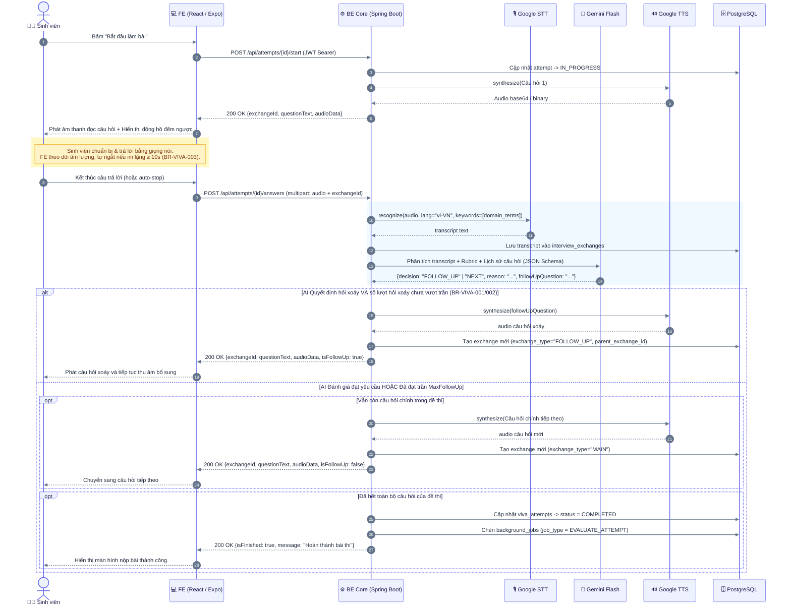
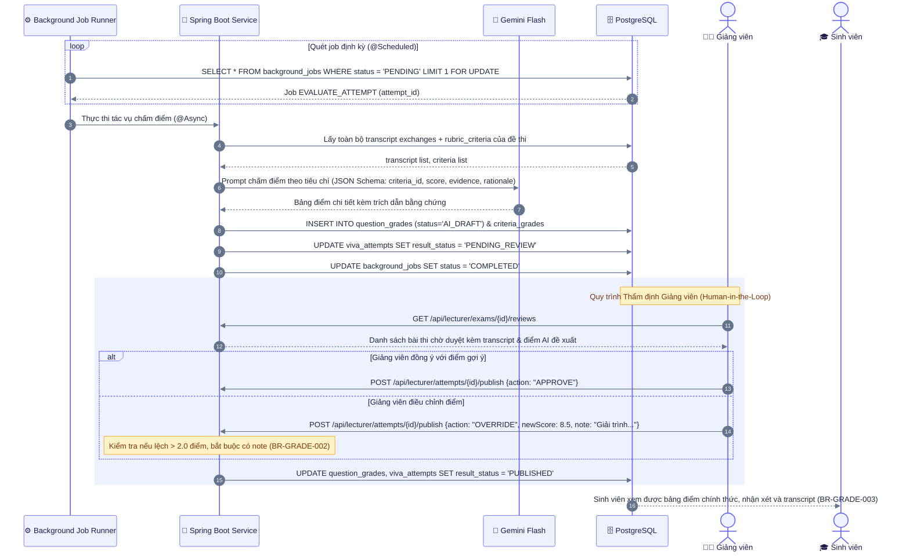

# Master Workflows & Specifications: AIVES

> **Hệ thống**: AI-powered Viva Exam System (AIVES)  
> **Tài liệu**: Đặc tả Luồng Nghiệp Vụ Cốt Lõi Toàn Hệ Thống (Master End-to-End Mainflow) & Các Quy Trình Thành Phần.  
> **Căn cứ**: [00-overview](00-overview/README.md), [01-business-rule](01-business-rule/README.md), [02-architecture-design](02-architecture-design/README.md), [03-context-diagram](03-context-diagram/README.md), [Physical ERD](ERD/03-physical-erd.md).

---

## 1. Sơ Đồ Master Mainflow Toàn Hệ Thống (End-to-End Big Picture)

Biểu đồ dưới đây mô tả toàn bộ vòng đời của một đợt thi vấn đáp từ khâu chuẩn bị học liệu, thiết lập ca thi, kiểm tra điều kiện sinh viên, vận hành phòng thi bằng giọng nói thời gian thực, chấm điểm ngầm bằng AI, thẩm định điểm (Human-in-the-Loop) đến công bố và phúc khảo.

```mermaid
%%{init: {
  'theme': 'base',
  'themeVariables': {
    'primaryColor': '#EEF2FF',
    'primaryTextColor': '#1E1B4B',
    'primaryBorderColor': '#6366F1',
    'lineColor': '#64748B',
    'fontFamily': 'Inter, system-ui, -apple-system, sans-serif',
    'fontSize': '13px'
  }
}}%%

flowchart TD
    %% Class Definitions theo Semantic Color System
    classDef client fill:#E0F2FE,stroke:#0284C7,stroke-width:1.5px,color:#0369A1,rx:8,ry:8;
    classDef service fill:#F5F3FF,stroke:#8B5CF6,stroke-width:2px,color:#5B21B6,rx:8,ry:8;
    classDef ai fill:#FFE4E6,stroke:#F43F5E,stroke-width:2px,color:#9F1239,rx:8,ry:8;
    classDef storage fill:#ECFDF5,stroke:#10B981,stroke-width:1.5px,color:#065F46,rx:4,ry:4;
    classDef decision fill:#FEF3C7,stroke:#D97706,stroke-width:2px,color:#92400E,rx:6,ry:6;
    classDef terminal fill:#DCFCE7,stroke:#16A34A,stroke-width:2px,color:#15803D,rx:8,ry:8;

    %% ==========================================
    %% GIAI ĐOẠN 1: CHUẨN BỊ NGÂN HÀNG & RUBRIC
    %% ==========================================
    subgraph P1 [" 📚 Giai đoạn 1: Chuẩn Bị Tri Thức & Soạn Đề Thi "]
        L1["👨‍🏫 Giảng viên: Tạo Bài học (Lesson) & Chủ đề (Topic)"]:::client
        L2["Tải tài liệu môn học / Yêu cầu AI gợi ý câu hỏi theo thang Bloom"]:::client
        L3["🧠 Gemini Flash: Sinh câu hỏi nháp (DRAFT) & Đáp án mẫu"]:::ai
        L4["👨‍🏫 Giảng viên: Kiểm duyệt, sửa nội dung & Thiết lập Rubric (100%)"]:::client
        L5[("🗄️ Lưu Questions & Rubrics (Status: APPROVED)")]:::storage

        L1 --> L2 --> L3 --> L4 --> L5
    end

    %% ==========================================
    %% GIAI ĐOẠN 2: THIẾT LẬP CA THI (VIVA EXAM)
    %% ==========================================
    subgraph P2 [" 📅 Giai đoạn 2: Thiết Lập Ca Thi & Cấp Mã Truy Cập "]
        E1["👨‍🏫 Giảng viên: Tạo Ca thi (Viva Exam)"]:::client
        E2["Cấu hình: Thời lượng, Số câu, Max Follow-up, cờ allowMobileExam"]:::client
        E3["Chọn danh sách Câu hỏi / Chủ đề đưa vào ca thi"]:::client
        E4["⚙️ Backend: Sinh Mã ca thi (session_code) & Mã truy cập bí mật (access_code)"]:::service
        E5[("🗄️ Lưu viva_exams, viva_exam_topics, viva_exam_questions")]:::storage

        E1 --> E2 --> E3 --> E4 --> E5
    end
    L5 -.-> E3

    %% ==========================================
    %% GIAI ĐOẠN 3: CHECK-IN & KIỂM TRA THIẾT BỊ
    %% ==========================================
    subgraph P3 [" 🚪 Giai đoạn 3: Xác Thực Truy Cập & Kiểm Tra Thiết Bị "]
        S1["🎓 Sinh viên: Đăng nhập Web Portal hoặc Mobile App"]:::client
        S2["Nhập session_code & access_code"]:::client
        S3{"⚙️ BE Kiểm tra: Thiết bị hợp lệ & Ca thi đang mở?"}:::decision
        S4["❌ Từ chối: Thông báo lỗi (MOBILE_EXAM_NOT_ALLOWED / EXAM_CLOSED)"]:::client
        S5["Sinh viên: Kiểm tra Micro, Loa, Đo tiếng ồn môi trường (VAD Test)"]:::client
        S6["Bấm 'Bắt đầu làm bài' -> Khởi tạo viva_attempts (Status: IN_PROGRESS)"]:::service

        S1 --> S2 --> S3
        S3 -- "Không hợp lệ" --> S4
        S3 -- "Hợp lệ" --> S5 --> S6
    end
    E4 -.-> S2

    %% ==========================================
    %% GIAI ĐOẠN 4: VÒNG LẶP VẤN ĐÁP ADAPTIVE REAL-TIME
    %% ==========================================
    subgraph P4 [" 🎙️ Giai đoạn 4: Vòng Lặp Vấn Đáp Thích Ứng Thời Gian Thực "]
        V1["⚙️ BE: Lấy câu hỏi chính theo thứ tự"]:::service
        V2["🔊 Google TTS: Chuyển văn bản câu hỏi thành Audio"]:::ai
        V3["FE (Web/Mobile): Phát âm thanh câu hỏi + Đếm ngược suy nghĩ"]:::client
        V4["🎓 Sinh viên: Bật mic trả lời bằng giọng nói (Recording)"]:::client
        V5{"Phát hiện im lặng ≥ 10s hoặc SV bấm nộp câu?"}:::decision
        V6["FE: Đóng mic, gửi Audio lên BE (POST /api/attempts/{id}/answers)"]:::client
        V7["🎙️ Google STT: Chuyển Audio thành Transcript tiếng Việt"]:::ai
        V8["🧠 Gemini Flash: Đánh giá transcript đối chiếu Rubric & Lịch sử đối thoại"]:::ai
        V9{"AI Quyết định: Cần hỏi xoáy (FOLLOW_UP) hay Chuyển câu (NEXT)?"}:::decision
        V10["AI sinh câu hỏi xoáy ngắn gọn (≤ 40 từ) bám sát ý thiếu"]:::ai
        V11{"Đã hoàn thành hết số câu hỏi của đề thi?"}:::decision
        V12["⚙️ BE: Kết thúc lượt thi, viva_attempts.status = COMPLETED"]:::service

        V1 --> V2 --> V3 --> V4 --> V5
        V5 -- "Hết giờ / Nộp" --> V6 --> V7 --> V8 --> V9
        V9 -- "FOLLOW_UP (Chưa quá Max)" --> V10 --> V2
        V9 -- "NEXT (Đạt ý / Đủ trần)" --> V11
        V11 -- "Chưa hết" --> V1 --> V2
        V11 -- "Đã xong tất cả" --> V12
    end
    S6 --> V1

    %% ==========================================
    %% GIAI ĐOẠN 5: CHẤM ĐIỂM NGẦM & THẨM ĐỊNH HITL
    %% ==========================================
    subgraph P5 [" ⚖️ Giai đoạn 5: Chấm Điểm AI, Thẩm Định HITL & Phúc Khảo "]
        G1[("⚙️ BE: Tạo Background Job EVALUATE_ATTEMPT trong DB")]:::storage
        G2["⚙️ Worker (@Scheduled + @Async): Lấy Job PENDING, đọc Transcript + Rubric"]:::service
        G3["🧠 Gemini Flash: Chấm từng tiêu chí Rubric + Trích xuất bằng chứng (Evidence)"]:::ai
        G4[("🗄️ Lưu question_grades (AI_DRAFT) & criteria_grades -> PENDING_REVIEW")]:::storage
        G5["👨‍🏫 Giảng viên: Mở màn hình Thẩm định (Review Dashboard)"]:::client
        G6{"Giảng viên đồng ý với điểm AI?"}:::decision
        G7["Phê duyệt giữ nguyên điểm AI đề xuất"]:::client
        G8["Ghi đè điểm (Override) + Bắt buộc nhập lý do (nếu lệch > 2.0đ)"]:::client
        G9["👨‍🏫 Chốt & Bấm 'Công Bố Điểm' -> Status: PUBLISHED"]:::client
        G10["🎓 Sinh viên: Xem điểm chính thức, nhận xét chi tiết và transcript"]:::terminal
        G11{"Sinh viên có khiếu nại điểm?"}:::decision
        G12["Tạo đơn phúc khảo (grade_appeals)"]:::client
        G13["👨‍🏫 Giảng viên: Rà soát lại bản ghi & Cập nhật kết quả phúc khảo"]:::client
        G14["🏁 Hoàn Tất Chu Kỳ Thi Vấn Đáp"]:::terminal

        G1 --> G2 --> G3 --> G4 --> G5 --> G6
        G6 -- "Đồng thuận" --> G7 --> G9
        G6 -- "Điều chỉnh" --> G8 --> G9
        G9 --> G10 --> G11
        G11 -- "Có khiếu nại" --> G12 --> G13 --> G14
        G11 -- "Không khiếu nại" --> G14
    end
    V12 --> G1
```

---

## 2. Ma Trận Vai Trò & Trách Nhiệm (RACI Matrix)

| Giai đoạn / Tác vụ | Giảng viên (Lecturer) | Sinh viên (Student) | Backend Core (Spring Boot) | External AI Services | Database (PostgreSQL) |
| :--- | :---: | :---: | :---: | :---: | :---: |
| **1. Soạn đề & Rubric** | **A / R** (Duyệt tối cao) | I | C (Cung cấp API) | R (Gemini gợi ý câu hỏi) | R (Lưu trữ) |
| **2. Thiết lập Ca thi** | **A / R** (Tạo phiên & mã) | I | R (Sinh `session_code`) | - | R (Lưu `viva_exams`) |
| **3. Check-in & Kiểm tra** | I | **A / R** (Nhập mã, test mic) | R (Validate & tạo attempt) | - | R (Lưu `viva_attempts`) |
| **4. Phỏng vấn trực tiếp** | I (Giám sát nếu cần) | **A / R** (Nói & trả lời) | **R** (Điều phối FSM/REST) | **R** (STT bóc băng, TTS đọc, Gemini xoáy) | R (Lưu `interview_exchanges`) |
| **5. Chấm điểm ngầm (AI)** | I | - | **R** (Chạy Background Job) | **R** (Gemini chấm Rubric + trích dẫn) | R (Lưu `question_grades`) |
| **6. Thẩm định điểm (HITL)** | **A / R** (Duyệt/Sửa điểm) | - | R (Kiểm tra quy tắc lệch điểm) | - | R (Cập nhật `PUBLISHED`) |
| **7. Xem điểm & Phúc khảo** | R (Xử lý đơn phúc khảo) | **A / R** (Xem & Gửi đơn) | R (Quản lý trạng thái) | - | R (Lưu `grade_appeals`) |

> *Ghi chú ký hiệu RACI*: **R** = Responsible (Người làm), **A** = Accountable (Người chịu trách nhiệm chính/phê duyệt), **C** = Consulted (Được tham vấn), **I** = Informed (Được thông báo).

---

## 3. Đặc Tả Chi Tiết 5 Giai Đoạn Nghiệp Vụ Cốt Lõi

### 3.1. Giai đoạn 1: Chuẩn Bị Tri Thức & Soạn Đề Thi (Question & Rubric Preparation)
- **Mục tiêu**: Tạo ra bộ câu hỏi chuẩn hóa kèm Rubric đánh giá đa mức độ tư duy (Bloom taxonomy).
- **Thực thể liên quan**: `lessons`, `topics`, `questions`, `rubrics`, `rubric_criteria`.
- **Quy tắc nghiệp vụ**:
  - `BR-AUTH-001`: Giảng viên chỉ được tạo/sửa câu hỏi và rubric thuộc môn học mình phụ trách.
  - `BR-BANK-001`: Tổng trọng số ($\sum \text{weight}$) của các tiêu chí trong một Rubric bắt buộc bằng đúng $100\%$.
  - `BR-BANK-002`: Câu hỏi do AI sinh ra mang trạng thái `DRAFT`. Giảng viên phải kiểm tra nội dung, gán Rubric và đổi trạng thái sang `APPROVED` thì mới được sử dụng trong ca thi.

---

### 3.2. Giai đoạn 2: Thiết Lập Ca Thi & Cấp Mã Truy Cập (Exam Session Scheduling)
- **Mục tiêu**: Lên lịch đợt thi, cấu hình các tham số vận hành và cấp mã vào phòng thi an toàn.
- **Thực thể liên quan**: `viva_exams`, `viva_exam_topics`, `viva_exam_questions`.
- **Cấu hình ca thi**:
  - `session_code`: Mã phòng công khai (VD: `SWD392-SE1701`).
  - `access_code`: Mã bí mật do hệ thống sinh ngẫu nhiên dùng để vào phòng.
  - `duration_minutes`: Thời gian tối đa cho toàn bộ ca thi.
  - `max_questions`: Số lượng câu hỏi chính mỗi sinh viên phải trả lời.
  - `max_follow_up_per_question`: Giới hạn số lượt hỏi xoáy tối đa cho mỗi câu (thường từ 1 - 2 lượt).
  - `allow_mobile_exam`: Cờ Boolean (`true`/`false`) cho phép hoặc cấm thí sinh thi bằng ứng dụng di động.

---

### 3.3. Giai đoạn 3: Xác Thực Truy Cập & Kiểm Tra Thiết Bị (Access & Device Check)
- **Mục tiêu**: Đảm bảo thí sinh đúng danh tính, sử dụng đúng thiết bị cho phép và âm thanh đạt chuẩn.
- **Thực thể liên quan**: `viva_attempts`, `users`.
- **Luồng xử lý**:
  1. Sinh viên đăng nhập vào hệ thống, nhận JWT Token.
  2. Gửi request `POST /api/exams/join` kèm `session_code`, `access_code` và header nền tảng (`platform: WEB` hoặc `platform: MOBILE`).
  3. Backend kiểm tra:
     - Nếu `platform == MOBILE` và ca thi có `allow_mobile_exam == false` $\rightarrow$ Trả về mã lỗi `400 Bad Request (MOBILE_EXAM_NOT_ALLOWED)`.
     - Nếu ca thi chưa đến giờ hoặc đã đóng $\rightarrow$ Báo lỗi.
  4. Client tiến hành kiểm tra âm thanh (Audio Loopback Test): Thu âm giọng nói mẫu và phát lại để sinh viên tự kiểm tra tai nghe/mic, đo ngưỡng tạp âm nền (Voice Activity Detection - VAD).
  5. Sinh viên bấm "Bắt đầu làm bài" $\rightarrow$ Backend tạo bản ghi `viva_attempts` với `status = IN_PROGRESS`, gán ngẫu nhiên bộ câu hỏi từ ca thi.

---

### 3.4. Giai đoạn 4: Vòng Lặp Vấn Đáp Thích Ứng Thời Gian Thực (Live Adaptive Viva Loop)
- **Mục tiêu**: Giám khảo AI đối thoại hai chiều với thí sinh bằng giọng nói, kích hoạt hỏi xoáy khi phát hiện câu trả lời chưa đầy đủ.
- **Thực thể liên quan**: `viva_attempts`, `interview_exchanges`.
- **Quy tắc nghiệp vụ**:
  - `BR-VIVA-001`: Quyết định hỏi xoáy (Follow-up) được kích hoạt khi câu trả lời thiếu ý chính, mơ hồ hoặc mâu thuẫn so với tiêu chí của Rubric và chưa chạm trần `max_follow_up_per_question`.
  - `BR-VIVA-002`: Câu hỏi xoáy do AI sinh ra phải ngắn gọn, súc tích ($\le 40$ từ) và tập trung thẳng vào phần kiến thức bị thiếu, không lan man sang chủ đề khác.
  - `BR-VIVA-003`: Client sử dụng Web Audio API / Expo Audio theo dõi mức năng lượng giọng nói. Khi phát hiện im lặng liên tục $\ge 10$ giây, hệ thống tự động khóa mic và nộp câu trả lời (`AUTO_SUBMIT`).
  - `BR-VIVA-004`: Audio câu trả lời được gửi lên Backend kèm danh mục từ khóa chuyên môn môn học (`domain_keywords`) để Google STT bóc băng chính xác các thuật ngữ kỹ thuật tiếng Việt.
- **Cơ chế lưu trữ đối thoại (`interview_exchanges`)**:
  - Câu hỏi chính: `parent_exchange_id = NULL`, `exchange_type = MAIN`.
  - Câu hỏi xoáy: `parent_exchange_id = <ID câu trước>`, `exchange_type = FOLLOW_UP`.

---

### 3.5. Giai đoạn 5: Chấm Điểm AI, Thẩm Định HITL & Phúc Khảo (Scoring & HITL Review)
- **Mục tiêu**: Chấm điểm minh bạch theo Rubric có bằng chứng, Giảng viên kiểm soát chất lượng tối cao và hỗ trợ quy trình phúc khảo văn minh.
- **Thực thể liên quan**: `background_jobs`, `question_grades`, `criteria_grades`, `grade_appeals`.
- **Cơ chế hoạt động**:
  1. **Async Scoring**: Ngay khi sinh viên hoàn tất bài thi (`viva_attempts.status = COMPLETED`), Backend chèn một bản ghi vào bảng `background_jobs` với `job_type = EVALUATE_ATTEMPT`.
  2. **Worker Chấm Điểm**: Service nền (`@Scheduled` kết hợp `@Async`) định kỳ quét job `PENDING`. Worker đọc toàn bộ transcript của các lượt exchange cùng Rubric của câu hỏi, gửi prompt đến **Gemini Flash** theo định dạng JSON Schema nghiêm ngặt (`BR-GRADE-001`).
  3. **Lưu Điểm Dự Thảo**: Kết quả chấm gồm điểm từng tiêu chí (`criteria_grades`), điểm câu hỏi (`question_grades`) kèm nhận xét điểm mạnh (`strengths`), điểm yếu (`weaknesses`) và trích dẫn trực tiếp lời nói của sinh viên (`evidence_quote`). Trạng thái lúc này là `AI_DRAFT` và `viva_attempts.result_status = PENDING_REVIEW`. Điểm tuyệt đối **không** hiển thị cho sinh viên ở giai đoạn này.
  4. **Thẩm Định của Giảng Viên (HITL)**:
     - Giảng viên truy cập màn hình Review, nghe lại audio, xem transcript và đánh giá của AI.
     - Giảng viên có quyền chấp thuận hoặc điều chỉnh điểm số.
     - `BR-GRADE-002`: Nếu giảng viên điều chỉnh điểm chênh lệch $> 2.0$ điểm so với AI đề xuất, hệ thống bắt buộc giảng viên phải nhập lý do giải trình (`lecturer_note`).
  5. **Công Bố Kết Quả (Publish)**: Giảng viên bấm phê duyệt $\rightarrow$ `viva_attempts.result_status = PUBLISHED`. Sinh viên nhận được thông báo và xem chi tiết điểm số (`BR-GRADE-003`).
  6. **Phúc Khảo (Grade Appeal)**:
     - Sinh viên có thể tạo yêu cầu phúc khảo (`grade_appeals`) nếu nhận thấy điểm số chưa thỏa đáng.
     - Giảng viên tiếp nhận đơn, đối soát transcript gốc và cập nhật trạng thái (`APPROVED` / `REJECTED`) kèm phản hồi chính thức.

---

## 4. Đặc Tả Chi Tiết Sequence Diagram: Vòng Lặp Vấn Đáp Trực Tiếp

---

## 5. Đặc Tả Chi Tiết Sequence Diagram: Chấm Điểm Nền & Thẩm Định HITL

---

## 6. Tổng Kết Tính Nhất Quán Kiến Trúc

| Thành phần | Công nghệ triển khai | Vai trò trong Mainflow |
| :--- | :--- | :--- |
| **Frontend Web** | React 19 + Vite + TailwindCSS v4 | Cổng thông tin cho Giảng viên (soạn đề, thẩm định) & Sinh viên (vào phòng thi, xem điểm). |
| **Frontend Mobile** | React Native + Expo | Thiết bị thi di động tiện lợi cho Sinh viên (chỉ khả dụng khi có cờ `allow_mobile_exam`). |
| **Backend Monolith** | Java 17 + Spring Boot 3.5.6 | Điều phối toàn bộ nghiệp vụ, kiểm tra Business Rules, quản lý REST APIs, bảo vệ API Key dịch vụ ngoài. |
| **Persistence** | PostgreSQL 16/17 (Supabase Managed) | Lưu trữ tập trung 18 bảng quan hệ theo Physical ERD, quản lý hàng đợi tác vụ qua bảng `background_jobs`. |
| **Speech Processing** | Google Cloud STT & TTS REST | Chuyển đổi giọng nói - văn bản hai chiều tiếng Việt (`vi-VN`) với độ trễ thấp. |
| **Cognitive Engine** | Gemini Flash API (REST HTTPS) | Quyết định logic hỏi xoáy thông minh và chấm điểm minh bạch theo Rubric. |
